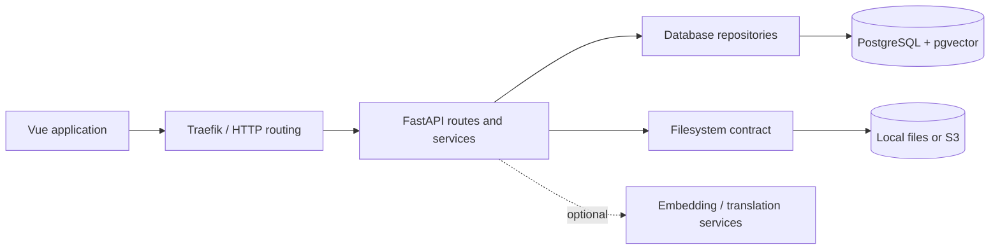

# People Gator

People Gator helps researchers and annotators find people in digitized library
documents and connect identities to evidence. The Vue application brings scanned
pages, detected faces and OCR mentions together for search, annotation and review;
the API stores those relationships with their provenance and processing actor.

## Capabilities

- Search people, faces, pages and documents using text and existing face vectors.
  Combine modalities with reciprocal-rank fusion and filter results by evidence,
  assignment state, document, library and processing metadata.
- Browse registered documents and scans, view page images and OCR overlays, and
  inspect a person's linked faces and mentions.
- Edit identities and aliases; assign, reassign and verify evidence links; merge
  identities with the required administrator scope.
- Ingest sources, faces, model-specific vectors, OCR mentions and page assets
  through typed APIs, including batch operations.
- Attribute changes to JWT users or registered API keys. Optionally connect an
  embedding service or OpenRouter translation service.
- Develop and review with deterministic synthetic data, repeatable migrations,
  automated tests and isolated pull-request previews.

## Technology stack

| Component | Technologies |
| --- | --- |
| Browser application | Vue 3, TypeScript, Vue Router, TanStack Vue Query, Vite, Tailwind CSS 4, shadcn-vue/Reka UI |
| API | Python 3.14, FastAPI, Pydantic, uv, async SQLAlchemy/asyncpg, Alembic |
| Data | PostgreSQL 16, pgvector, pg_trgm, unaccent; local or S3 object storage |
| Contracts and tests | OpenAPI-generated TypeScript SDK, Vitest, pytest |
| Deployment | Docker Compose, Traefik, GitHub Actions, GHCR; optional OpenTelemetry/LGTM |

An optional Weaviate adapter remains in the API. PostgreSQL is the development,
CI and preview path and provides the transactional behavior described here.

## Repository structure

```text
people-gator-app/       Browser app, generated SDK and frontend tests
people-gator-api/       API package, migrations, backend tests and focused docs
docs/                  Project and operator guides
deploy/preview/        Trusted preview controller, Compose templates and tests
.github/workflows/     PR validation, image publication and preview lifecycle
compose.dev.yaml       Development stack with Compose Watch
compose.live-preview.yaml  Existing shared live-preview deployment
AGENTS.md              Required implementation workflow and feature conventions
```

## Architecture overview



Routes validate schemas and access scopes. Repositories own queries, identity
rules and mutations; media services resolve assets through the filesystem
contract. The frontend uses the generated client through query composables and
viewmodels. See [Architecture](docs/ARCHITECTURE.md) for the current boundaries.

## Getting started

Start with [Start here](docs/START_HERE.md), then follow
[Development](docs/DEVELOPMENT.md) to install pinned dependencies, start a local
pgvector store, migrate and seed it, and run both applications. Node must satisfy
`^22.18.0 || >=24.12.0`; CI uses Node 24. Python 3.14 is required.
Synthetic fixtures and the development-only `test` / `test` account let you
exercise the app without project data or external AI credentials.

For Docker deployments, use [Deployment](docs/DEPLOYMENT.md) and the
[deployment entry point](deploy/README.md). PR CI type-checks/tests the frontend,
tests backend contracts and migrations, runs the seed twice, and validates the
preview controller. Successful same-repository PR builds publish images to GHCR;
a separate trusted workflow deploys the tested commit and cleans up closed PRs.
See [the host installation guide](deploy/preview/README.md) before enabling this
workflow. There is no automatic production release workflow in this repository.

## Documentation

| Guide | Topic |
| --- | --- |
| [Vision](docs/VISION.md) | Users, current scope and proposed roadmap |
| [Architecture](docs/ARCHITECTURE.md) | Modules, access rules, search, annotations and frontend |
| [Database](docs/DATABASE.md) | PostgreSQL tables, relationships and ingestion |
| [Search filters](docs/SEARCH_FILTERS.md) | API filters, ranking and UI state |
| [Start here](docs/START_HERE.md) | First steps and code navigation without project data |
| [Development](docs/DEVELOPMENT.md) | Local environment and disposable test stores |
| [Data maintenance](docs/DATA_MAINTENANCE.md) | Reviewed audits, repairs and recovery |
| [Deployment](docs/DEPLOYMENT.md) | Docker, CI/CD and configuration reference |
| [Observability](docs/OBSERVABILITY.md) | Logs, traces, metrics and dashboard queries |
| [Contributing](CONTRIBUTING.md), [agent instructions](AGENTS.md) | Issue → branch → commits → PR workflow |
