# PeopleGator — uživatelský návod / user tutorial

[Česky](#cesky) · [English](#english)

## Česky

Ve sdílené živé ukázce máme zpracováno **7 dokumentů**.
Kliknutím na odkaz otevřete stránky příslušného dokumentu:

| Knihovna | Dokument |
| --- | --- |
| svkhk | [6c50c29e-1994-46e6-b2ac-0289006fb764](https://live-preview.peoplegator.dev/scans?library=svkhk&document=6c50c29e-1994-46e6-b2ac-0289006fb764) |
| knav | [2e31b2f2-7936-4234-bede-a6a2f9c452b5](https://live-preview.peoplegator.dev/scans?library=knav&document=2e31b2f2-7936-4234-bede-a6a2f9c452b5) |
| svkhk | [6c466752-a299-4bde-a8b0-92a560976826](https://live-preview.peoplegator.dev/scans?library=svkhk&document=6c466752-a299-4bde-a8b0-92a560976826) |
| svkhk | [1faae15d-13ed-4ca5-ac61-6a085a48de33](https://live-preview.peoplegator.dev/scans?library=svkhk&document=1faae15d-13ed-4ca5-ac61-6a085a48de33) |
| svkhk | [e5acee37-b093-41aa-9656-d7477f8c2730](https://live-preview.peoplegator.dev/scans?library=svkhk&document=e5acee37-b093-41aa-9656-d7477f8c2730) |
| knav | [3aa8d947-24a8-40b0-981c-a3b9cea401e6](https://live-preview.peoplegator.dev/scans?library=knav&document=3aa8d947-24a8-40b0-981c-a3b9cea401e6) |
| knav | [b67494e1-4eb3-4ecd-bc99-405721f778e9](https://live-preview.peoplegator.dev/scans?library=knav&document=b67494e1-4eb3-4ecd-bc99-405721f778e9) |

### 1. První obrazovka a navigace

Otevřete [PeopleGator](https://live-preview.peoplegator.dev). Přihlášení ani
registrace nejsou potřeba. Úvodní obrazovka **Browse documents** obsahuje hledání,
filtry a seznam dokumentů s náhledy stránek. Na obrázcích jsou ukázková data,
například Ada Novak a knihovna `preview-mzk`.

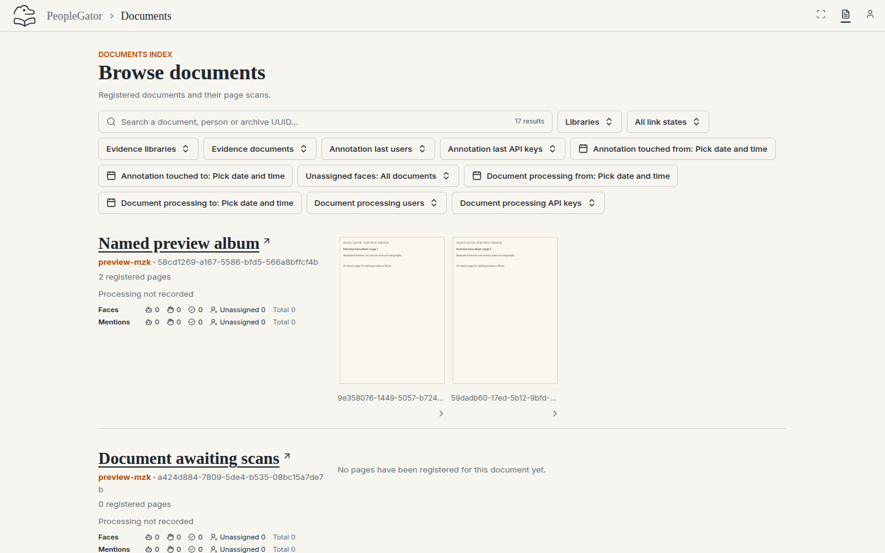

**Horní lišta zůstává na všech obrazovkách.** Vlevo je logo, uprostřed cesta
k aktuálnímu záznamu a vpravo přepínání mezi třemi částmi aplikace.

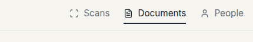

V užším okně jsou místo názvů jen ikony. Jejich pořadí zleva je stejné:

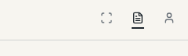

| Prvek horní lišty | Kam vás zavede |
| --- | --- |
| **Logo PeopleGator vlevo** | Na úvodní seznam dokumentů. |
| **Scans — první ikona vpravo, rámeček** | Na seznam jednotlivých naskenovaných stránek. |
| **Documents — druhá ikona, list papíru** | Na seznam dokumentů, kde můžete hledat podle názvu. |
| **People — třetí ikona, postava** | Na hledání osob a jejich profilů. Profil osoby představuje jednu identitu. |
| **Cesta vedle loga, oddělená šipkami `›`** | Na nadřazenou knihovnu, dokument nebo seznam osob podle toho, co máte otevřené. |

Aktuální část je vpravo podtržená. Těmito ikonami přepínáte celé obrazovky;
záložky **Faces**, **Mentions** a **Discover** uvnitř profilu osoby mají jiný účel.

### 2. Najít dokument a otevřít jeho stránku

**Chci najít dokument podle názvu nebo identifikátoru.**

1. Vpravo nahoře klikněte na **Documents**, tedy ikonu listu papíru.
   Zobrazí se **Browse documents**.
2. Do hledání pod nadpisem napište název dokumentu nebo jeho UUID.
   Vyzkoušet můžete `6c50c29e-1994-46e6-b2ac-0289006fb764`.
   Pod panelem se zobrazí odpovídající dokumenty.
3. Klikněte na **podtržený název dokumentu**. Otevře se **Document pages**,
   seznam stránek tohoto dokumentu.
4. Klikněte na **náhled konkrétní stránky**. Otevře se sken a jeho anotace.

Kliknutí na náhled stránky přímo v seznamu dokumentů vás rovnou přenese na sken.

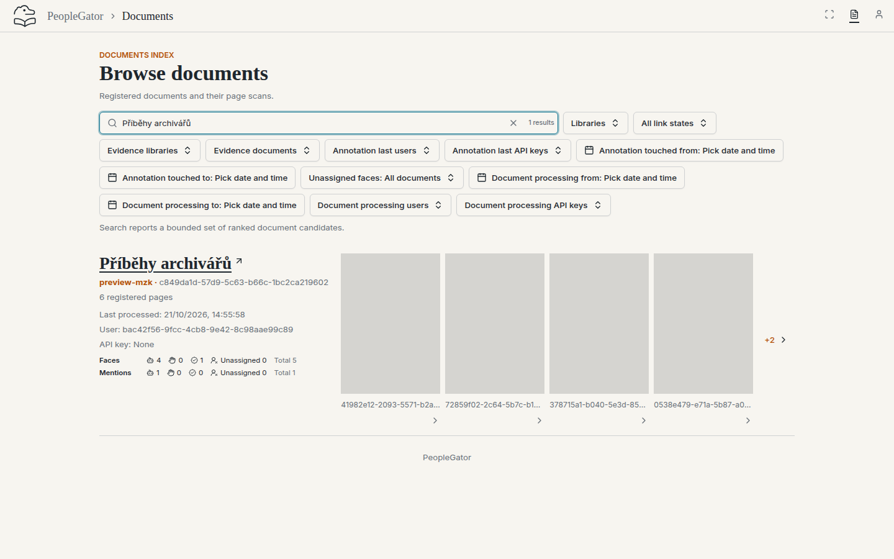

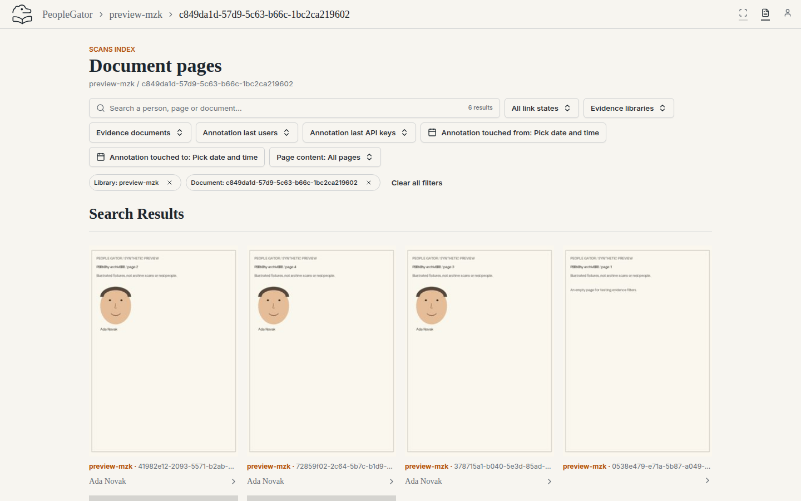

### 3. Najít osobu a prohlédnout její profil

**Chci najít osobu podle jména nebo aliasu.**

1. Vpravo nahoře klikněte na **People**, tedy ikonu postavy.
   Zobrazí se hledání osob.
2. Do hledání napište jméno nebo alias. Jméno patří do hledání v **People**,
   pokud chcete najít profil osoby; v **Documents** byste hledali dokumenty.
3. Klikněte na nalezenou osobu. Zobrazí se její profil se jménem, popisem
   a přehledem přiřazených podkladů.

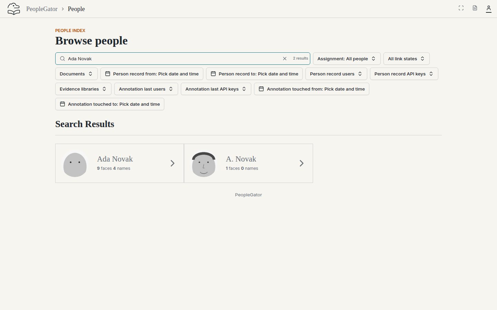

V profilu pod nadpisem **Evidence and identity discovery** přepínáte záložky:

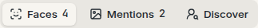

| Záložka profilu | Co se zobrazí |
| --- | --- |
| **Faces** | Tváře přiřazené této osobě. Náhled tváře otevře její zdrojový sken. |
| **Mentions** | Textové zmínky o osobě. Kliknutím na zmínku otevřete příslušný sken. |
| **Discover** | Návrhy dalších podobných tváří a možných duplicitních osob. |

Cesta nahoře v profilu má podobu **PeopleGator › People › identifikátor osoby**.
Kliknutím na **People** se vrátíte na hledání osob; kliknutím na logo nebo
**PeopleGator** na seznam dokumentů.

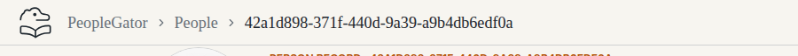

### 4. Prohlížet skeny a vrátit se k dokumentu

**Chci otevřít sken nebo se ze skenu vrátit na seznam stránek.**

Pro seznam skenů klikněte vpravo nahoře na **Scans**, ikonu rámečku.
Pokud už máte otevřený konkrétní dokument, zobrazí se jeho stránky.
Hledání i aktivní omezení najdete nad výsledky. Pro výběr jiného dokumentu
klikněte na **Documents** a vyhledejte jej tam.

Otevřený sken si můžete vyzkoušet na
[připravené anotované stránce](https://live-preview.peoplegator.dev/libraries/svkhk/documents/6c50c29e-1994-46e6-b2ac-0289006fb764/pages/2a484f45-2393-11ed-afbf-00155d01210b).

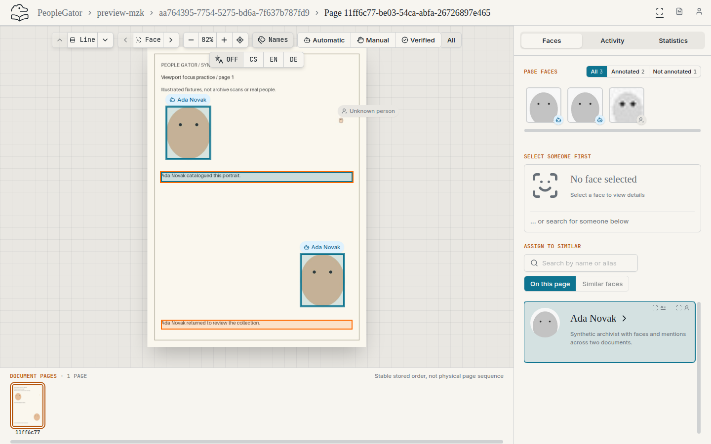

| Část obrazovky skenu | Jak ji použít |
| --- | --- |
| **Přepis textu nad obrazem nebo vlevo** | Kliknutím na označené jméno vyberete zmínku a zvýrazníte její místo na stránce. |
| **Obraz stránky uprostřed** | Kliknutím na rámeček tváře ji vyberete. Tlačítky **+ / −** obraz přiblížíte nebo oddálíte; obraz můžete posouvat. |
| **Panel vpravo — Faces** | Obsahuje tváře ze stránky, detail vybrané tváře a hledání osoby pro její přiřazení. |
| **Activity / Statistics v pravém panelu** | Přepínají mezi přehledem změn a statistikami stránky. |
| **Document pages pod obrazem** | Kliknutím na jiný náhled přejdete na další stránku téhož dokumentu. |

Cesta v horní liště má podobu
**PeopleGator › knihovna › identifikátor dokumentu › Page identifikátor stránky**:

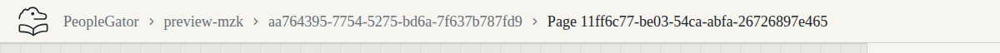

- Kliknutí na **identifikátor dokumentu** otevře jeho seznam stránek.
- Kliknutí na **knihovnu** otevře skeny dané knihovny.
- Poslední položka **Page …** označuje právě otevřenou stránku.
- Logo nebo **PeopleGator** vás vrátí na seznam dokumentů.

### 5. Zúžit výsledky filtry

**Chci například zobrazit dokumenty pouze z knihovny svkhk.**

1. Otevřete **Documents** a pod hledáním klikněte na **Libraries**.
2. Vyberte `svkhk` a zavřete nabídku tlačítkem **Done**.
3. Seznam se zúží a pod panelem se zobrazí štítek vybraného filtru.

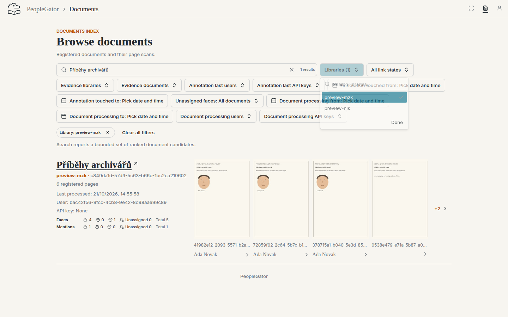

V **People** najdete například **Documents**, **Assignment** a **Link state**.
Další filtry vybírají uživatele, API klíč a datum. Popisky **Document processing**,
**Person record** a **Annotation last** rozlišují, kterého záznamu se změna týká.

Křížkem na štítku odstraníte jeden filtr. **Clear all filters** zruší filtry
a ponechá hledaný text. Samostatný křížek uvnitř hledání vymaže text.
Po přechodu na jinou obrazovku zkontrolujte aktivní filtry, zvlášť pokud výsledky chybí.

### 6. Přiřadit tvář k existující osobě

**Chci říct, že vybraná tvář patří osobě, která už má profil.**

1. Otevřete sken a klikněte na rámeček požadované tváře nebo její náhled
   v galerii **Page faces** vpravo.
2. V pravém panelu **Faces** najděte kartu **Current face**.
   Ta ukazuje vybranou tvář a její současné přiřazení.
3. Pokud je tvář nepřiřazená, klikněte na **Link**. Pokud je přiřazená chybně,
   klikněte na **Reassign**. Aktivuje se hledání osob pod kartou.
4. Do pole **Search by name or alias** napište jméno. Pod polem se zobrazí
   kandidáti. U správné osoby klikněte na **Assign**, případně **Reassign**.
5. Na kartě **Current face** se zobrazí vybrané jméno a stav **Manual**.
   Kliknutím na jméno otevřete profil této osoby.

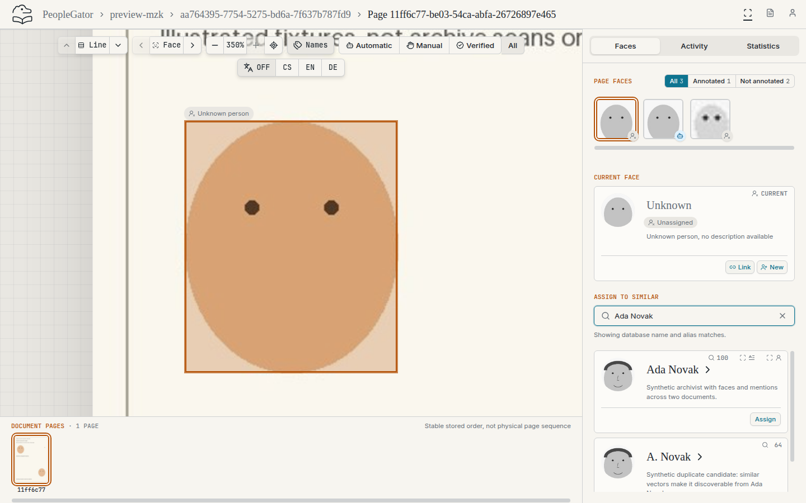

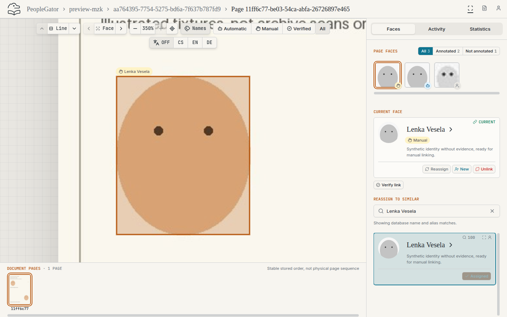

**Chci jen zrušit nesprávné přiřazení.** Na kartě **Current face** klikněte
na **Unlink**. Zobrazí se **Unknown / Unassigned**; detekce tváře zůstane zachovaná.

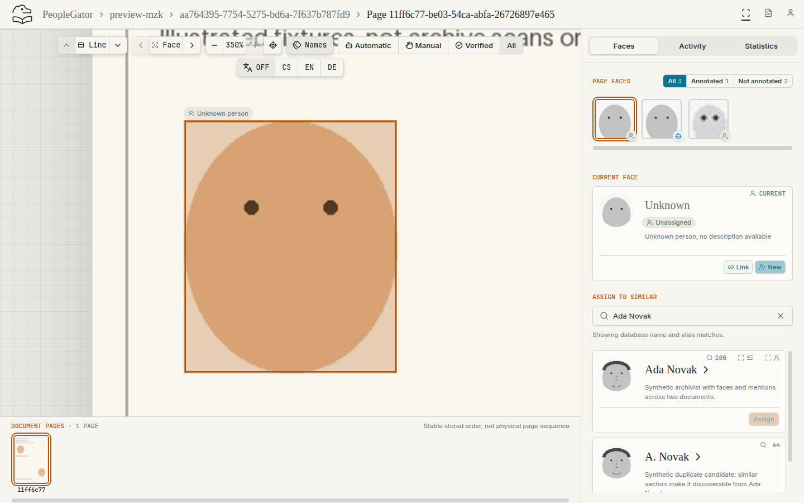

### 7. Vytvořit novou osobu přímo ze skenu

**Chci k vybrané tváři založit osobu, která v aplikaci ještě nemá profil.**

1. Na skenu vyberte konkrétní tvář kliknutím na její rámeček nebo náhled
   v **Page faces**.
2. V pravém panelu otevřete **Faces** a na kartě **Current face** klikněte
   na **New** vedle tlačítka **Link** nebo **Reassign**.

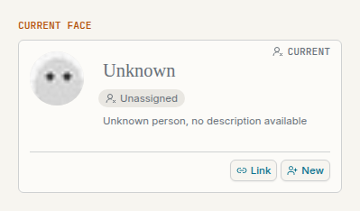

3. Na stejné kartě se místo jména zobrazí pole **Full name**,
   **Short description (optional)** a tlačítka **Save / Cancel**.
4. Vyplňte jméno; krátký popis je volitelný. Klikněte na **Save**.

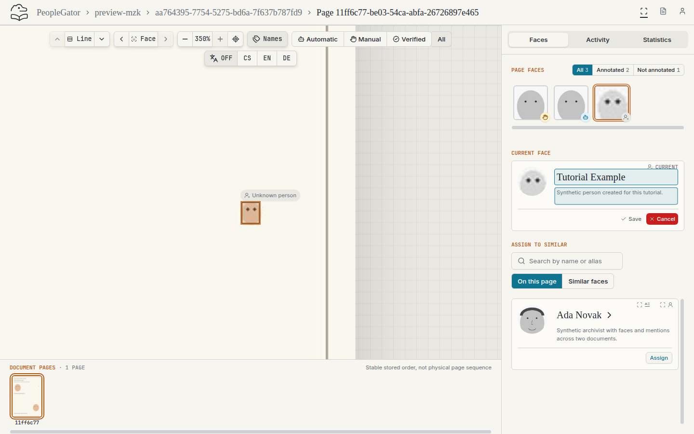

5. Zůstanete na skenu. Karta **Current face** ukáže nové jméno a stav
   **Manual**: profil byl vytvořen a vybraná tvář k němu přiřazena.
6. Klikněte na nové jméno. V profilu v záložce **Faces** uvidíte právě tuto tvář.

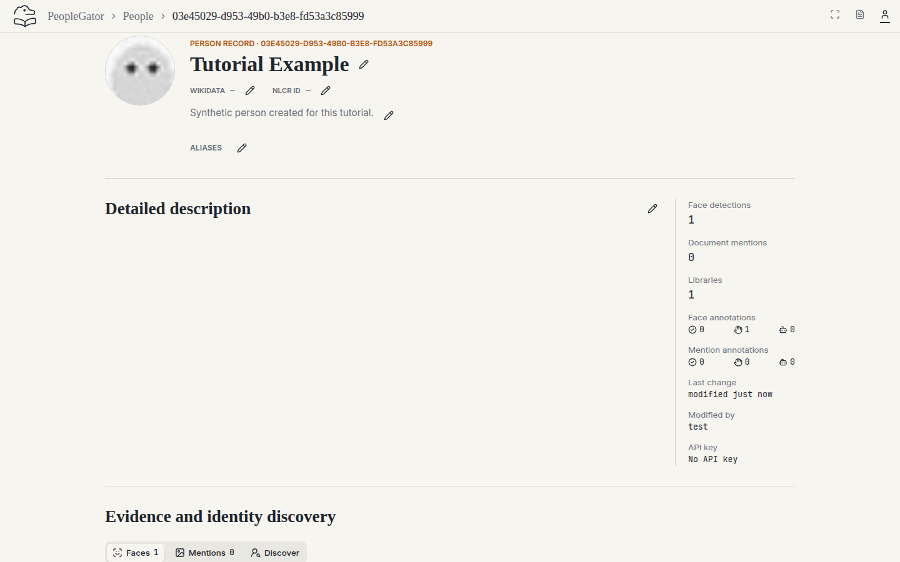

**Cancel** zavře rozepsaný formulář bez vytvoření osoby. Pokud měla vybraná
tvář předtím jinou osobu, uložení nové osoby přeřadí tuto tvář k novému profilu.

### 8. Dohledat podobné tváře

**Chci k otevřené osobě najít další výskyty tváře.**

1. Otevřete profil osoby a pod **Evidence and identity discovery** klikněte
   na záložku **Discover**.
2. V části **Similar faces to review** se zobrazí návrhy. Osoba potřebuje
   alespoň jednu přiřazenou tvář použitelnou pro porovnání.
   V **Discovery assignment** můžete vybrat **Unassigned** nebo **Assigned elsewhere**.
3. Nejprve klikněte na náhled navržené tváře a zkontrolujte ji ve zdrojovém skenu.
   Pak se vraťte tlačítkem Zpět v prohlížeči.
4. Výběrovým políčkem v rohu náhledu označte vhodné tváře. Zobrazí se
   lišta s tlačítkem **Assign to [jméno]**. Klikněte na něj.
5. V záložce **Faces** zkontrolujte nové přiřazené tváře.

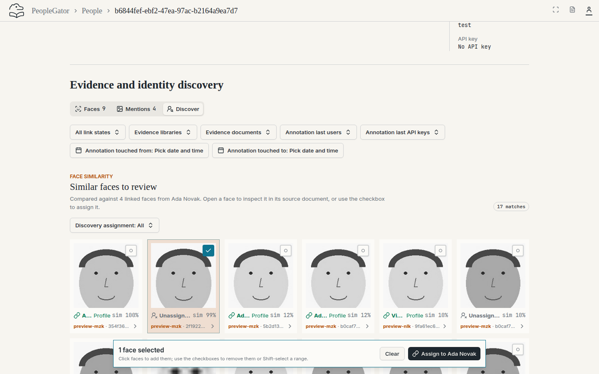

Tváře přiřazené jiné osobě se tím přeřadí. Skóre podobnosti je návrh,
nikoli potvrzení totožnosti.

### 9. Sloučit duplicitní profily osob

**Chci spojit dva profily, které představují tutéž osobu.**

1. Otevřete profil, který chcete **zachovat**.
2. Přejděte na **Discover** a posuňte se do části **Other similar people**
   pod návrhy tváří. Podle potřeby upravte **Search by name or alias**.
3. Prohlédněte si kandidáty. Výběrovým tlačítkem v rohu karty označte
   pouze duplicitní profily, které chcete sloučit.
4. Dole se zobrazí lišta **Merge into [jméno]**. Jméno v tlačítku je cíl:
   otevřený profil, který zůstane zachovaný.
5. Klikněte na **Merge into [jméno]**. Akce se provede přímo, bez dalšího
   potvrzovacího dialogu a bez tlačítka pro vrácení sloučení.

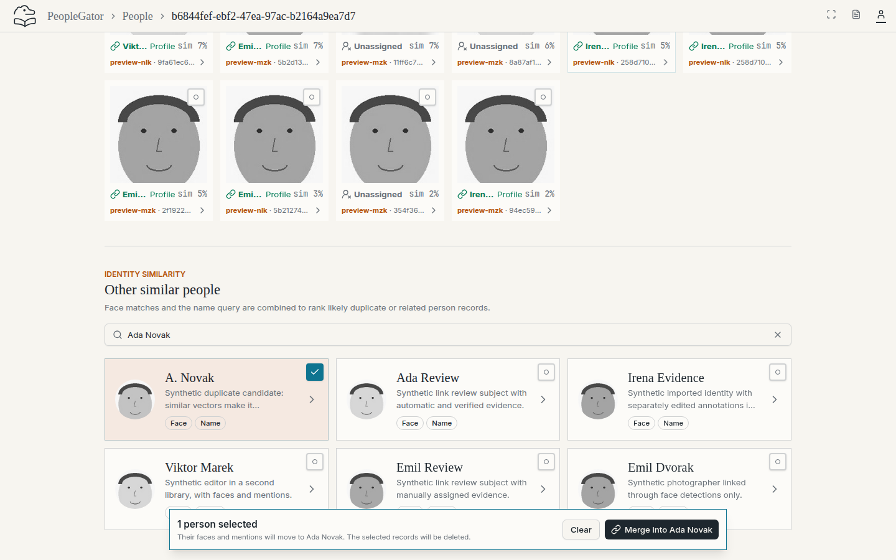

Vybrané původní profily se odstraní a jejich tváře a zmínky přejdou
do zachovaného profilu. V jeho **Faces** a **Mentions** zkontrolujte výsledek.
Přesunutá přiřazení budou **Manual**; případné původní ověření se zruší.

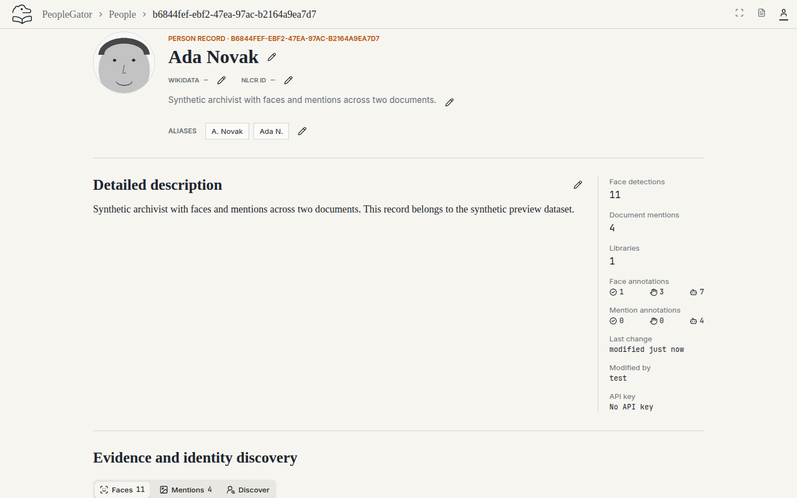

Sloučení vyžaduje oprávnění správce. Pro změnu přiřazení jediné tváře
použijte **Assign / Reassign** na skenu.

### 10. Ověřit nebo opravit přiřazení

**Chci potvrdit, že tvář nebo textová zmínka patří správné osobě.**

| Stav | Význam |
| --- | --- |
| **Automatic** | Automatické přiřazení. |
| **Manual** | Ruční přiřazení. |
| **Verified** | Přiřazení potvrzené uživatelem. |
| **Unassigned** | Tvář nebo zmínka nemá přiřazenou osobu. |

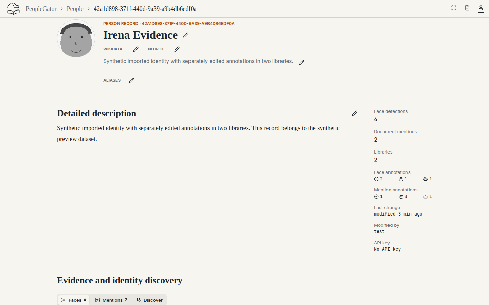

**Jedna tvář:** na skenu vyberte tvář, zkontrolujte jméno v **Current face**
a pod kartou klikněte na **Verify link**. Stav se změní na **Verified**.
U ověřeného přiřazení se zobrazí autor a čas ověření, pokud jsou zaznamenány.

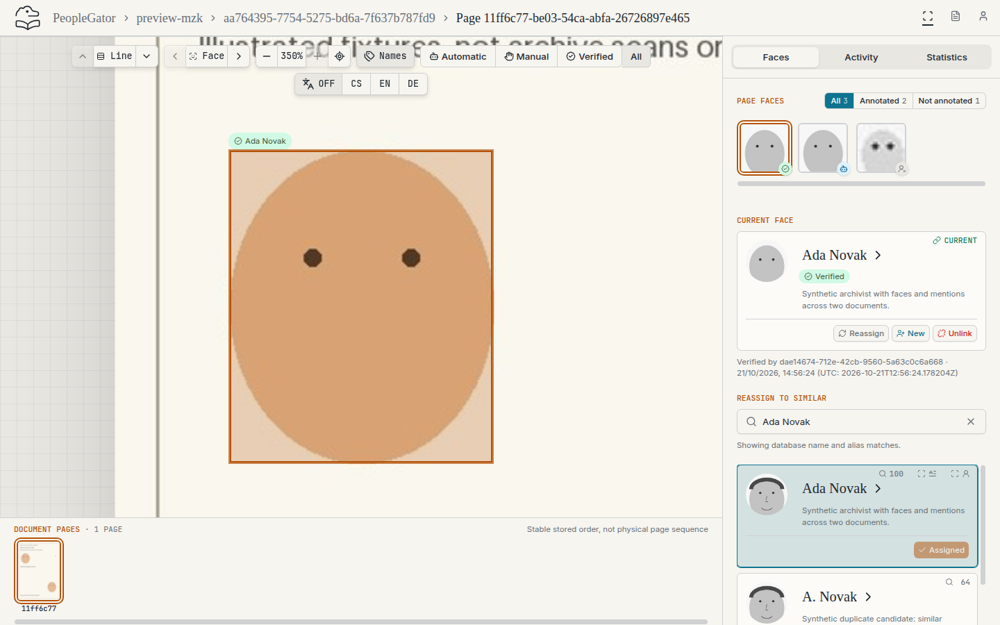

**Více tváří:** v profilu otevřete **Faces**, označte tváře výběrovými políčky
v rohu náhledů a ve spodní liště klikněte na **Verify selected (počet)**.
Po dokončení se výběr zruší a zobrazí se potvrzení ověření.

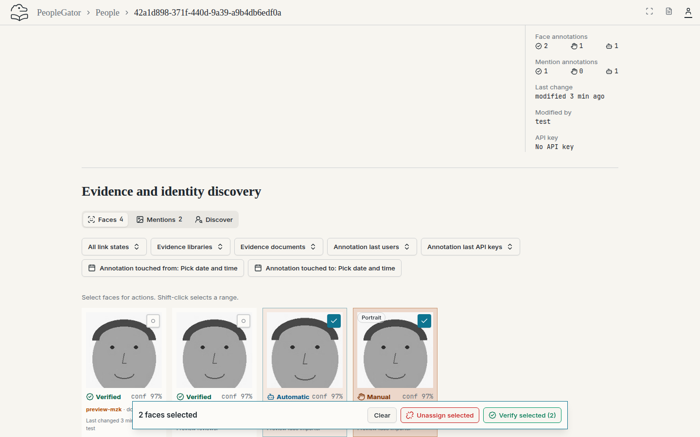

**Textová zmínka:** v profilu přepněte na **Mentions**, zkontrolujte zmínku
a u ní klikněte na **Verify link**.

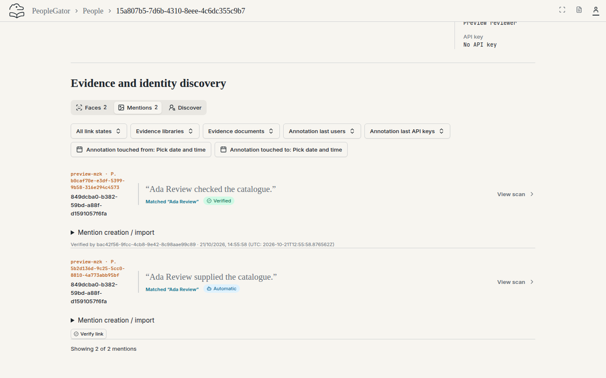

Ověřujete vazbu k osobě, nikoli celý sken nebo správnost přepisu OCR.
Chybné přiřazení tváře nejprve opravte přes **Reassign**, případně **Unlink**.
V profilu lze vybrané tváře odpojit pomocí **Unassign selected**.
Po změně na jinou osobu bude přiřazení **Manual** a můžete je znovu ověřit.
Dostupnost úprav závisí na oprávněních daného prostředí.

## English

The shared live demo contains **7 processed documents**.
Click a link to open the pages of that document:

| Library | Document |
| --- | --- |
| svkhk | [6c50c29e-1994-46e6-b2ac-0289006fb764](https://live-preview.peoplegator.dev/scans?library=svkhk&document=6c50c29e-1994-46e6-b2ac-0289006fb764) |
| knav | [2e31b2f2-7936-4234-bede-a6a2f9c452b5](https://live-preview.peoplegator.dev/scans?library=knav&document=2e31b2f2-7936-4234-bede-a6a2f9c452b5) |
| svkhk | [6c466752-a299-4bde-a8b0-92a560976826](https://live-preview.peoplegator.dev/scans?library=svkhk&document=6c466752-a299-4bde-a8b0-92a560976826) |
| svkhk | [1faae15d-13ed-4ca5-ac61-6a085a48de33](https://live-preview.peoplegator.dev/scans?library=svkhk&document=1faae15d-13ed-4ca5-ac61-6a085a48de33) |
| svkhk | [e5acee37-b093-41aa-9656-d7477f8c2730](https://live-preview.peoplegator.dev/scans?library=svkhk&document=e5acee37-b093-41aa-9656-d7477f8c2730) |
| knav | [3aa8d947-24a8-40b0-981c-a3b9cea401e6](https://live-preview.peoplegator.dev/scans?library=knav&document=3aa8d947-24a8-40b0-981c-a3b9cea401e6) |
| knav | [b67494e1-4eb3-4ecd-bc99-405721f778e9](https://live-preview.peoplegator.dev/scans?library=knav&document=b67494e1-4eb3-4ecd-bc99-405721f778e9) |

### 1. First screen and navigation

Open [PeopleGator](https://live-preview.peoplegator.dev). No login or registration
is needed. The opening **Browse documents** screen contains search, filters and
a document list with page previews. Screenshots use example data, such as
Ada Novak and the `preview-mzk` library.

**The top bar stays visible on every screen.** The logo is on the left,
the path to the current record is in the middle, and the three main sections
are on the right.

In a narrower window, you may see icons without names. Their left-to-right
order stays the same:

| Top-bar control | Where it takes you |
| --- | --- |
| **PeopleGator logo on the left** | The opening document list. |
| **Scans — first icon on the right, a frame** | A list of individual scanned pages. |
| **Documents — second icon, a sheet of paper** | The document list, where you can search by title. |
| **People — third icon, a person** | Person search and profiles. A person profile represents one identity. |
| **Path beside the logo, separated by `›` arrows** | The parent library, document or people list, depending on the current screen. |

The current section is underlined on the right. These icons switch whole screens;
the **Faces**, **Mentions** and **Discover** tabs inside a profile serve a different purpose.

### 2. Find a document and open a page

**I want to find a document by title or identifier.**

1. Click **Documents**, the sheet-of-paper icon at the top right.
   **Browse documents** appears.
2. Enter a document title or UUID in the search field below the heading.
   Try `6c50c29e-1994-46e6-b2ac-0289006fb764`.
   Matching documents appear below the panel.
3. Click the **underlined document title**. **Document pages** opens,
   listing pages from that document.
4. Click a **page preview** to open its scan and annotations.

Clicking a page preview directly in the document list opens that scan immediately.

### 3. Find a person and inspect their profile

**I want to find a person by name or alias.**

1. Click **People**, the person icon at the top right.
   Person search opens.
2. Enter a name or alias in the search field. Use **People** to find a person
   profile; searching in **Documents** finds documents instead.
3. Click a matching person. Their profile shows a name, description
   and summary of linked evidence.

Within the profile, use the tabs below **Evidence and identity discovery**:

| Profile tab | What appears |
| --- | --- |
| **Faces** | Faces linked to this person. Click a face preview to open its source scan. |
| **Mentions** | Text mentions of the person. Click a mention to open its scan. |
| **Discover** | Suggested similar faces and potentially duplicate people. |

The profile's top path reads **PeopleGator › People › person identifier**.
Click **People** to return to person search; click the logo or **PeopleGator**
to return to the document list.

### 4. Browse scans and return to a document

**I want to open a scan or return from a scan to the document's page list.**

Click **Scans**, the frame icon at the top right, to list scans.
If you already have a document open, its pages are shown.
Search and active restrictions appear above the results. To choose another
document, click **Documents** and find it there.

Try the scan workspace using the
[prepared annotated page](https://live-preview.peoplegator.dev/libraries/svkhk/documents/6c50c29e-1994-46e6-b2ac-0289006fb764/pages/2a484f45-2393-11ed-afbf-00155d01210b).

| Part of the scan screen | How to use it |
| --- | --- |
| **Transcription above or to the left of the image** | Click a marked name to select its mention and highlight its location on the page. |
| **Page image in the centre** | Click a face box to select it. Use **+ / −** to zoom in or out; you can also pan the image. |
| **Right panel — Faces** | Contains page faces, the selected face's details and person search for assignment. |
| **Activity / Statistics in the right panel** | Switch between the change history and page statistics. |
| **Document pages below the image** | Click another preview to open a different page of the same document. |

The top-bar path reads
**PeopleGator › library › document identifier › Page page identifier**:

- Click the **document identifier** to open its page list.
- Click the **library** to open scans in that library.
- The final **Page …** item identifies the page currently open.
- Click the logo or **PeopleGator** to return to the document list.

### 5. Narrow results with filters

**I want to show documents from the svkhk library only.**

1. Open **Documents** and click **Libraries** below search.
2. Select `svkhk`, then close the choices with **Done**.
3. The list narrows and a tag for the selected filter appears below the panel.

In **People**, available controls include **Documents**, **Assignment** and
**Link state**. Other filters select users, API keys and dates. The labels
**Document processing**, **Person record** and **Annotation last** distinguish
which record's change is being filtered.

Remove one filter with the X on its tag. **Clear all filters** removes filters
and preserves the search text. The separate X inside search clears the text.
After changing screens, check the active filters, especially if results are missing.

### 6. Link a face to an existing person

**I want to say that the selected face belongs to a person who already has a profile.**

1. Open a scan and click the required face box or its preview
   in **Page faces** on the right.
2. In the right-hand **Faces** panel, find **Current face**.
   This card shows the selected face and its current assignment.
3. For an unassigned face, click **Link**. For a wrong assignment,
   click **Reassign**. Person search below the card receives focus.
4. Enter the name in **Search by name or alias**. Candidates appear below it.
   Click **Assign**, or **Reassign**, on the correct candidate.
5. **Current face** shows the chosen name and **Manual** state.
   Click the name to open that person's profile.

**I only want to remove an incorrect assignment.** Click **Unlink** on
**Current face**. It becomes **Unknown / Unassigned**; the face detection remains.

### 7. Create a new person from a scan

**I want to create a person who does not yet have a profile for the selected face.**

1. On the scan, select the face by clicking its box or preview in **Page faces**.
2. Open **Faces** in the right panel. On **Current face**, click **New**
   beside **Link** or **Reassign**.

3. The same card replaces the name with **Full name**,
   **Short description (optional)** and **Save / Cancel** controls.
4. Fill in the name; the short description is optional. Click **Save**.

5. You remain on the scan. **Current face** shows the new name and **Manual**:
   the profile has been created and the selected face linked to it.
6. Click the new name. The profile's **Faces** tab contains that face.

**Cancel** closes the unfinished form without creating a person. If the face
previously belonged to another person, saving the new person reassigns that face
to the new profile.

### 8. Find similar faces

**I want to find more appearances of the person whose profile is open.**

1. Open their profile and click **Discover** below **Evidence and identity discovery**.
2. **Similar faces to review** shows suggestions. The person needs at least
   one linked face usable for comparison. **Discovery assignment** lets you
   choose **Unassigned** or **Assigned elsewhere**.
3. First click a suggested face preview and inspect its source scan.
   Then return with the browser's Back button.
4. Select suitable faces using the controls in their preview corners.
   An action bar appears with **Assign to [name]**. Click it.
5. Check the newly linked faces in **Faces**.

Faces linked to another person will be reassigned. The similarity score
is a suggestion, not proof of identity.

### 9. Merge duplicate person profiles

**I want to combine two profiles that represent the same person.**

1. Open the profile you want to **keep**.
2. Go to **Discover** and scroll down to **Other similar people**, below
   the face suggestions. Adjust **Search by name or alias** if needed.
3. Inspect the candidates. Use the selection control in a card's corner
   to select only the duplicate profiles you want to merge.
4. A **Merge into [name]** action bar appears at the bottom. The button's name
   identifies the destination: the open profile that will remain.
5. Click **Merge into [name]**. The action is submitted directly, with no
   additional confirmation dialog or undo button.

The selected source profiles are deleted and their faces and mentions move
to the retained profile. Check its **Faces** and **Mentions**.
Moved assignments become **Manual**, and any previous verification is cleared.

Merging requires administrator permission. Use **Assign / Reassign** on a scan
to change a single face's assignment.

### 10. Verify or correct assignments

**I want to confirm that a face or text mention belongs to the right person.**

| State | Meaning |
| --- | --- |
| **Automatic** | Automatically assigned. |
| **Manual** | Manually assigned. |
| **Verified** | Assignment confirmed by a user. |
| **Unassigned** | The face or mention has no assigned person. |

**One face:** select it on the scan, check the name in **Current face**,
then click **Verify link** below the card. The state becomes **Verified**.
Verification details show who verified it and when, if recorded.

**Several faces:** open **Faces** in the profile and select faces using the
controls in their preview corners. Click **Verify selected (count)** in the
bottom action bar. The selection clears and a confirmation appears.

**Text mention:** switch to **Mentions** in the profile, inspect the mention
and click **Verify link** beside it.

Verification confirms the link to a person, rather than the whole scan or OCR
accuracy. Correct a wrong face assignment with **Reassign** or **Unlink** first.
In a profile, **Unassign selected** removes the selected faces' assignments.
Changing to another person makes the link **Manual**, ready to verify again
after review. Editing availability depends on the environment's permissions.
