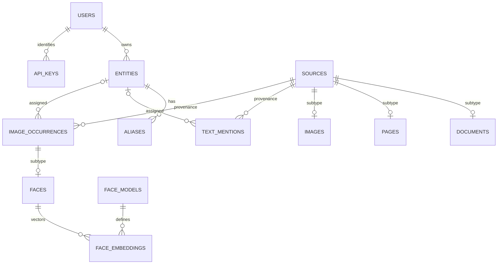

# PostgreSQL schema and ingestion

The primary store is PostgreSQL 16 with `vector`, `pg_trgm` and `unaccent`
extensions. The current relational definition is
[`persistence/postgres/models.py`](../people-gator-api/src/people_gator_api/persistence/postgres/models.py);
reviewed schema changes live in [`alembic/versions/`](../people-gator-api/alembic/versions/).
The historical `pg_demo_` table prefix remains in the active application schema.

## Tables

| SQL table | Purpose and relationships |
| --- | --- |
| `pg_demo_users` | Actor identities; referenced users cannot be deleted |
| `pg_demo_api_keys` | Stable API-key identifier/display name and owning user; no credentials |
| `pg_demo_entities` | Person/entity profile, original owner and nullable last-touch actor/time |
| `pg_demo_aliases` | Entity aliases; cascade when their identity is deleted |
| `pg_demo_sources` | Unique canonical URL, source kind and processing attribution |
| `pg_demo_documents` | Source subtype: library, archive document UUID and optional name |
| `pg_demo_pages` | Source subtype: library, document UUID and page UUID |
| `pg_demo_images` | Source subtype for arbitrary image URLs |
| `pg_demo_text_mentions` | Text/OCR occurrence, source, optional entity and link-review metadata |
| `pg_demo_image_occurrences` | Visual occurrence base, source and optional entity/link-review metadata |
| `pg_demo_faces` | Visual subtype: geometry, creator and face-specific attributes |
| `pg_demo_face_models` | Registered model stub and fixed embedding dimension |
| `pg_demo_face_embeddings` | One vector per face/model pair; cascades with the face |
| `alembic_version` | Migration history marker used during runtime validation |

Sources and visual occurrences use joined-table inheritance: subtype IDs are
also foreign keys to their base rows. A page's archive `document_id` is not a
foreign key to a registered document row. Pages can exist before document
registration; document evidence is scoped by `(library, document_id)`.



## Identity, integrity and search indexes

Source URLs are globally unique. Document identity is `(library, document_id)`;
page identity adds `page_id`; image identity is its normalized URL. Internal
`source_id` UUIDs differ from archive document/page IDs. Source registration is
idempotent and returns created/existing outcomes without changing these identities.

Deleting an entity unassigns its evidence rather than deleting the source.
Deleting a source cascades its faces and mentions. Link constraints require a
state exactly when assigned and verification actor/time exactly when verified.
Touch fields permit historical unknown metadata; missing history must not be
invented during repair. See [Data maintenance](DATA_MAINTENANCE.md).

Normalized names use `demo_unaccent(text)` and trigram indexes; text retrieval
also uses PostgreSQL full-text primitives. Documents index normalized nullable
names and archive identifiers. Model registration creates a partial cosine HNSW
index casting each model's vectors to its fixed dimension. Vectors must be finite
and match that dimension. Dynamic model indexes are owned by registration, not
ordinary Alembic autogeneration. See the
[persistence contract](../people-gator-api/src/people_gator_api/persistence/README.md)
for bounded candidate search and backend-specific guarantees.

## Ingestion order

1. Configure the database and filesystem, migrate, and provision users/access.
2. Register face models through the admin API before ingesting their vectors.
3. Register document, page or image sources through the ingest API. Keep returned
   internal source UUIDs; do not substitute an archive ID.
4. Create identities with annotation access, then faces and OCR mentions with
   ingestion access. Every referenced source, user, entity and face must exist.
5. Upload page images/layouts using the page source UUID and ingestion scope.
   Use the filesystem contract and canonical media-key helpers for direct tools.
6. Review assignments using annotation access; reserve deletion and merging for
   administrative workflows. Carry the real actor context through every mutation.

Batch results preserve input order, but portable interfaces do not promise
atomicity across all adapters. Check operation results and make import retries
idempotent. Patch omission preserves a value; explicit null clears nullable
fields. Use validated schemas instead of ORM shortcuts for ingestion.

The synthetic seeder follows these same contracts, adds missing fixtures and
preserves review edits/checkpoints. It needs migrated PostgreSQL and local
storage, but no inference services. See
[preview seeding](../people-gator-api/docs/preview-seeding.md).

## Schema lifecycle

From `people-gator-api`, with the chosen database settings:

```sh
uv run --locked python -m people_gator_api.cli.database migrate
uv run --locked python -m people_gator_api.cli.database check
```

Use `schema_mode=validate` for migration-managed stores. `bootstrap` creates
missing objects for development but does not upgrade existing columns. Existing
bootstrap stores require the reviewed `migrate --adopt-bootstrap` procedure in
[Database migrations](../people-gator-api/docs/database-migrations.md).
Never stamp `head` to suppress schema drift. Test migration changes in a separate
disposable store before applying them to retained data.
