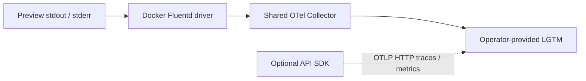

# Logs, traces, metrics and dashboards

## What runs today

The API writes standard Python logs to stderr with UTC ISO timestamps,
severity, logger/module/line and process/thread IDs. Uvicorn adds startup/access
logs. `PEOPLE_GATOR_API__LOG_LEVEL` controls application verbosity; startup logs
include database validation and missing optional service configuration.
Health is available at `/api/v1/health` after lifespan initialization succeeds.
It returns `status: ok`; it is not a continuous audit of every storage/external
service or a metrics endpoint.

PR preview stdout/stderr flows from Docker's Fluentd driver to a shared
OpenTelemetry Collector and then to an operator-provided LGTM backend. This
captures frontend nginx output and one-shot storage-init/migrate/seed logs too,
without requiring SDK instrumentation. The preview infrastructure creates the
collector, not the LGTM stack or provisioned Grafana dashboards.



## Local and preview diagnosis

For local native processes, inspect their terminal output. For Compose Watch:

```sh
docker compose -f compose.dev.yaml ps
docker compose -f compose.dev.yaml logs --tail 100 backend frontend db
```

On the installed preview host, use the actual PR number:

```sh
docker compose --project-name people-gator-pr-123 \
  --env-file /var/lib/people-gator-preview/pr-123/compose.env \
  -f /opt/people-gator-preview/compose.pr.yaml logs --tail 100 backend
```

Use `candidate.env` when diagnosing a failed candidate. Never dump rendered
configuration or private state into shared logs. Inspect collector logs through
the infrastructure Compose project if application logs are missing. A working
application does not prove remote log delivery.

## Resource attributes and dashboard queries

The collector groups and labels preview logs with:

| Attribute | Use |
| --- | --- |
| `people-gator.preview.pr` | Select the PR number as a string |
| `vcs.ref.head.revision` | Select the tested commit SHA |
| `service.name` | `people-gator-preview.frontend`, `.backend`, `.migrate`, `.seed`, `.storage-init` |
| `service.instance.id`, `container.id`, `container.name` | Distinguish container attempts/restarts |
| `deployment.environment.name` | `preview` |
| `log.iostream` | stdout/stderr on each log record |

In Grafana Explore, select the environment's log datasource and filter those
attributes. Loki's actual indexed labels depend on the operator's OTLP mapping;
verify them before copying a LogQL selector. Suggested panels are errors by
service/PR, migration/seed completion by SHA, startup validation failures and
collector delivery failures. These are dashboard recipes, not committed dashboards
or existing alerts. Review retention and access for sensitive collection data.

Docker buffers at most 8,192 events per container and keeps a local dual-log cache
of three 10 MiB files. The collector persists its sending queue in `otel-data`
and retries while space is available. Full buffers, daemon shutdown, long outages
or short-lived containers exiting during an outage can lose logs. This transport
is not a durable audit archive. Preserve maintenance outcomes separately.

## Optional API traces and metrics

The SDK is disabled by default, including in the current per-PR template. Enable
it only when the API can reach your OTLP HTTP receiver:

```dotenv
PEOPLE_GATOR_API__OTEL__ENABLED=true
PEOPLE_GATOR_API__OTEL__HTTP_ENDPOINT=http://lgtm:4318
```

The endpoint is an operator-provided base URL; export paths default to
`/v1/traces`, `/v1/metrics` and `/v1/logs`. Runtime uses HTTP exporters, despite the
presence of a gRPC endpoint setting. FastAPI, aiohttp, asyncpg, SQLAlchemy,
Weaviate and system metrics instrumentation are initialized in
[`utils/opentelemetry.py`](../people-gator-api/src/people_gator_api/utils/opentelemetry.py).
SQLAlchemy instrumentation attaches to the selected async engine. The `trace`
decorator provides custom async spans.

SDK resources currently hardcode `service.name=dev.people-gator-api` and
`service.version=0.1.0`, with hostname as instance ID. Do not assume these match
the image SHA or collector labels. A log provider/exporter is initialized, but
`configure_logging()` installs only a stream handler; do not assume standard
Python logs are directly exported by the SDK. Preview container logging remains
the documented log path. There is no implemented profiling exporter despite a
profiles-path setting, and no frontend trace instrumentation or `/metrics`
Prometheus endpoint supplied here.

## Add signals safely and validate them

Instrument a specific operation or failure that answers an operator question.
Use bounded labels such as operation/outcome, avoid document text, biometric
vectors, credential hashes, tokens, media bytes and unbounded IDs in metric labels.
Check which request/SQL attributes automatic instrumentation exports before
enabling it against private data. Avoid logging arguments indiscriminately.

When changing instrumentation, verify success/failure spans, context propagation,
timeouts and collector outages using synthetic data; verify receipt at the sink
instead of relying only on an open port. Controller/logging checks from root:

```sh
python3 deploy/preview/tests/test_observability.py -v
```

Its optional end-to-end test uses disposable Docker containers and an OTLP sink:

```sh
PREVIEW_TEST_OTEL=1 python3 deploy/preview/tests/test_observability.py -v
```

See the [host guide](../deploy/preview/README.md#validation) for image prerequisites.
The default run skips that live test. Keep skipped transport checks distinct from
confirmed delivery and avoid recursive logging of the collector into itself.

