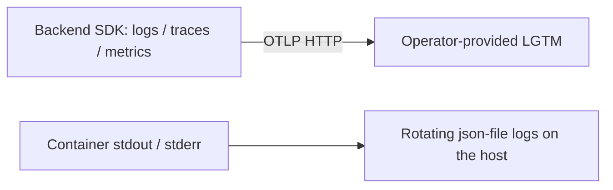

# Logs, traces, metrics and dashboards

## What runs today

The API writes standard Python logs to stderr with UTC ISO timestamps,
severity, logger/module/line and process/thread IDs. Uvicorn adds startup/access
logs. `PEOPLE_GATOR_API__LOG_LEVEL` controls application verbosity; startup logs
include database validation and missing optional service configuration.
Health is available at `/api/v1/health` after lifespan initialization succeeds.
It returns `status: ok`; it is not a continuous audit of every storage/external
service or a metrics endpoint.

In PR previews and staging the backend's OpenTelemetry SDK is enabled by the
deployment and sends application logs, traces and metrics **directly** to the
operator-provided OTLP HTTP collector (`DEPLOY_OTEL_HTTP_ENDPOINT`, default
`http://lgtm:4318`, on the `logging` network). There is no Docker log driver or
intermediate collector: container stdout/stderr stays on the host in rotating
`json-file` logs for `docker logs`, which still covers frontend nginx output and
the one-shot storage-init/migrate/seed containers.



## Local and preview diagnosis

For local native processes, inspect their terminal output. For Compose Watch:

```sh
docker compose -f compose.dev.yaml ps
docker compose -f compose.dev.yaml logs --tail 100 backend frontend db
```

On the preview host, as the deployment account, with the `preview`
environment's `DEPLOY_*` values exported ([operator commands](../deploy/people-gator-deploy/README.md#one-time-host-setup)),
use the actual PR number:

```sh
PYTHONPATH=deploy/people-gator-deploy/src python3 -m people_gator_deploy pr status --pr 123
PYTHONPATH=deploy/people-gator-deploy/src python3 -m people_gator_deploy pr logs --pr 123 --tail 100
```

Failed service output is kept in the environment's private `last-error.log`;
`pr-123/candidate.env` describes a failed candidate. Never dump rendered
configuration or private state into shared logs. If application logs are
missing at the collector, check the backend container's own output for exporter
errors. A working application does not prove remote log delivery.

## Resource attributes and dashboard queries

The backend SDK labels every record with:

| Attribute | Use |
| --- | --- |
| `service.name` | `people-gator-api` |
| `deployment.environment.name` | `preview`, `staging` or `release` |
| `people-gator.preview.pr` | Select the PR number as a string (empty outside previews) |
| `vcs.ref.head.revision` | Select the tested commit SHA |
| `service.version` | Commit SHA for previews/staging, release tag for releases |
| `service.instance.id` | Hostname, distinguishing container restarts |

In Grafana Explore, select the environment's log datasource and filter those
attributes. Loki's actual indexed labels depend on the operator's OTLP mapping;
verify them before copying a LogQL selector. Suggested panels are errors by
PR/commit, startup validation failures and exporter failures. These are
dashboard recipes, not committed dashboards or existing alerts. Review retention
and access for sensitive collection data.

The SDK's batch exporters retry while the process lives; a collector outage
during a short-lived container or a crash loses buffered records, and container
stdout/stderr is only kept locally. This transport is not a durable audit
archive. Preserve maintenance outcomes separately.

## Direct backend OTLP traces, metrics and logs

The SDK is disabled by default in the application; the preview and staging
stacks enable it and point it at `DEPLOY_OTEL_HTTP_ENDPOINT` (set
`DEPLOY_OTEL_ENABLED=false` to turn it off), and reject these keys in their
telemetry secret. Releases enable it through their runtime or telemetry secret
when the API can reach the OTLP HTTP receiver:

```dotenv
PEOPLE_GATOR_API__OTEL__ENABLED=true
OTEL_EXPORTER_OTLP_TRACES_ENDPOINT=http://lgtm:4318/v1/traces
OTEL_EXPORTER_OTLP_LOGS_ENDPOINT=http://lgtm:4318/v1/logs
OTEL_EXPORTER_OTLP_METRICS_ENDPOINT=http://lgtm:4318/v1/metrics
```

Each setting is a complete HTTP endpoint URL and is passed unchanged to its
exporter. Defaults are the three URLs shown above. The project names
`PEOPLE_GATOR_API__OTEL__TRACES_ENDPOINT`, `PEOPLE_GATOR_API__OTEL__LOGS_ENDPOINT`
and `PEOPLE_GATOR_API__OTEL__METRICS_ENDPOINT` are also accepted; they take priority
when both environment names are supplied. There are no base/path or gRPC settings.

FastAPI, aiohttp, asyncpg, SQLAlchemy,
Weaviate and system metrics instrumentation are initialized in
[`utils/opentelemetry.py`](../people-gator-api/src/people_gator_api/utils/opentelemetry.py).
SQLAlchemy instrumentation attaches to the selected async engine. The `trace`
decorator provides custom async spans.

SDK resources use `service.name=people-gator-api`, deployment-supplied version,
environment, commit and PR context, with hostname as instance ID. Container-log
service names remain separate from SDK service names.

When enabled, the backend connects **directly** to the configured OTLP HTTP
collector for traces, metrics and application logs in PR, staging and release:

```text
FastAPI / service / database instrumentation + Python application logging
  → backend SDK exporters → http://lgtm:4318 → OpenObserve
```

The locked `opentelemetry-instrumentation-logging` package installs an OTLP
`LoggingHandler` automatically during `LoggingInstrumentor.instrument()` and
preserves it when `configure_logging()` applies the stderr configuration. Python
application/library logs that propagate to the root logger therefore retain
structured severity, extra attributes, exceptions and the active trace/span IDs.
Disabling logging auto-instrumentation through standard OTEL environment flags
also disables this automatic handler. Loggers with their own non-propagating
handlers and raw stdout/stderr are still container output.

Container logging is an independent local diagnostic path: every stack stores
container output in rotating `json-file` logs on the host (`docker logs`, or
`people-gator-deploy <env> logs`). Frontend nginx and one-off tool logs do not
use the backend SDK and are not shipped anywhere.
A subprocess integration test, `tests/test_telemetry_export.py`, runs the actual
API SDK bootstrap against a local HTTP OTLP receiver for all three deployment
identities. It decodes protobuf trace/log/metric payloads and checks incoming
browser-parent continuation, a child operation, correlated info/error logs,
exception attributes, a metric, resource identity and exporter authorization.
This requires no database or external service and does not establish live sink
retention or availability.

Profiling and a Prometheus `/metrics` endpoint are not provided. Browser RUM and W3C trace
propagation are configured through the [OpenObserve RUM guide](OPENOBSERVE-RUM.md).

## Add signals safely and validate them

Instrument a specific operation or failure that answers an operator question.
Use bounded labels such as operation/outcome, avoid document text, biometric
vectors, credential hashes, tokens, media bytes and unbounded IDs in metric labels.
Check which request/SQL attributes automatic instrumentation exports before
enabling it against private data. Avoid logging arguments indiscriminately.

When changing instrumentation, verify success/failure spans, context propagation,
timeouts and collector outages using synthetic data; verify receipt at the sink
instead of relying only on an open port. The backend's
`tests/test_telemetry_export.py` runs the SDK bootstrap against a local OTLP
receiver; the deploy tests render every stack and check the backend's OTel
settings (`deploy/people-gator-deploy/tests/test_telemetry.py`). Keep skipped
transport checks distinct from
confirmed delivery and avoid recursive logging of the collector into itself.
