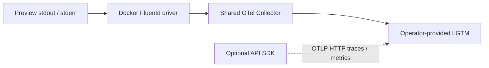

# Logs, traces, metrics and dashboards

## What runs today

The API writes standard Python logs to stderr with UTC ISO timestamps,
severity, logger/module/line and process/thread IDs. Uvicorn adds startup/access
logs. `PEOPLE_GATOR_API__LOG_LEVEL` controls application verbosity; startup logs
include database validation and missing optional service configuration.
Health is available at `/api/v1/health` after lifespan initialization succeeds.
It returns `status: ok`; it is not a continuous audit of every storage/external
service or a metrics endpoint.

PR preview stdout/stderr flows from Docker's Fluentd driver to a shared
OpenTelemetry Collector and then to an operator-provided LGTM backend. This
captures frontend nginx output and one-shot storage-init/migrate/seed logs too,
without requiring SDK instrumentation. The preview infrastructure creates the
collector, not the LGTM stack or provisioned Grafana dashboards.



## Local and preview diagnosis

For local native processes, inspect their terminal output. For Compose Watch:

```sh
docker compose -f compose.dev.yaml ps
docker compose -f compose.dev.yaml logs --tail 100 backend frontend db
```

On the preview host, as the deployment account, use the actual PR number:

```sh
people-gator-deploy pr status --pr 123
people-gator-deploy pr logs --pr 123 --tail 100
```

Failed service output is kept in the environment's private `last-error.log`;
`pr-123/candidate.env` describes a failed candidate. Never dump rendered
configuration or private state into shared logs. Inspect collector logs through
the infrastructure Compose project if application logs are missing. A working
application does not prove remote log delivery.

## Resource attributes and dashboard queries

The collector groups and labels preview logs with:

| Attribute | Use |
| --- | --- |
| `people-gator.preview.pr` | Select the PR number as a string |
| `vcs.ref.head.revision` | Select the tested commit SHA |
| `service.name` | `people-gator-preview.frontend`, `.backend`, `.migrate`, `.seed`, `.storage-init` |
| `service.instance.id`, `container.id`, `container.name` | Distinguish container attempts/restarts |
| `deployment.environment.name` | `preview` |
| `log.iostream` | stdout/stderr on each log record |

In Grafana Explore, select the environment's log datasource and filter those
attributes. Loki's actual indexed labels depend on the operator's OTLP mapping;
verify them before copying a LogQL selector. Suggested panels are errors by
service/PR, migration/seed completion by SHA, startup validation failures and
collector delivery failures. These are dashboard recipes, not committed dashboards
or existing alerts. Review retention and access for sensitive collection data.

Docker buffers at most 8,192 events per container and keeps a local dual-log cache
of three 10 MiB files. The collector persists its sending queue in `otel-data`
and retries while space is available. Full buffers, daemon shutdown, long outages
or short-lived containers exiting during an outage can lose logs. This transport
is not a durable audit archive. Preserve maintenance outcomes separately.

## Direct backend OTLP traces, metrics and logs

The SDK is disabled by default, including in the current per-PR template. Enable
it only when the API can reach your OTLP HTTP receiver:

```dotenv
PEOPLE_GATOR_API__OTEL__ENABLED=true
PEOPLE_GATOR_API__OTEL__HTTP_ENDPOINT=http://lgtm:4318
```

The endpoint is an operator-provided base URL; export paths default to
`/v1/traces`, `/v1/metrics` and `/v1/logs`. Runtime uses HTTP exporters, despite the
presence of a gRPC endpoint setting. FastAPI, aiohttp, asyncpg, SQLAlchemy,
Weaviate and system metrics instrumentation are initialized in
[`utils/opentelemetry.py`](../people-gator-api/src/people_gator_api/utils/opentelemetry.py).
SQLAlchemy instrumentation attaches to the selected async engine. The `trace`
decorator provides custom async spans.

SDK resources use `service.name=people-gator-api`, deployment-supplied version,
environment, commit and PR context, with hostname as instance ID. Container-log
service names remain separate from SDK service names.

When enabled, the backend connects **directly** to the configured OTLP HTTP
collector for traces, metrics and application logs in PR, staging and release:

```text
FastAPI / service / database instrumentation + Python application logging
  → backend SDK exporters → http://lgtm:4318 → OpenObserve
```

The locked `opentelemetry-instrumentation-logging` package installs an OTLP
`LoggingHandler` automatically during `LoggingInstrumentor.instrument()` and
preserves it when `configure_logging()` applies the stderr configuration. Python
application/library logs that propagate to the root logger therefore retain
structured severity, extra attributes, exceptions and the active trace/span IDs.
Disabling logging auto-instrumentation through standard OTEL environment flags
also disables this automatic handler. Loggers with their own non-propagating
handlers and raw stdout/stderr are still container output.

Container logging is an independent diagnostic path. PR/staging continue to ship
stderr copies through Fluent Forward; these can duplicate the structured SDK
records. Use `service.name=people-gator-api` for SDK application logs and the
`people-gator-preview.*` / `people-gator-staging.*` services for container output.
The release template stores container output locally using rotating `json-file`
logs; enabling SDK telemetry supplies its direct application-log export without
requiring Fluent Forward. Frontend nginx and one-off tool logs do not use the
backend SDK.
A subprocess integration test, `tests/test_telemetry_export.py`, runs the actual
API SDK bootstrap against a local HTTP OTLP receiver for all three deployment
identities. It decodes protobuf trace/log/metric payloads and checks incoming
browser-parent continuation, a child operation, correlated info/error logs,
exception attributes, a metric, resource identity and exporter authorization.
This requires no database or external service and does not establish live sink
retention or availability.

There is no implemented profiling exporter despite a profiles-path setting,
and no `/metrics` Prometheus endpoint supplied here. Browser RUM and W3C trace
propagation are configured through the [OpenObserve RUM guide](OPENOBSERVE-RUM.md).

## Add signals safely and validate them

Instrument a specific operation or failure that answers an operator question.
Use bounded labels such as operation/outcome, avoid document text, biometric
vectors, credential hashes, tokens, media bytes and unbounded IDs in metric labels.
Check which request/SQL attributes automatic instrumentation exports before
enabling it against private data. Avoid logging arguments indiscriminately.

When changing instrumentation, verify success/failure spans, context propagation,
timeouts and collector outages using synthetic data; verify receipt at the sink
instead of relying only on an open port. Controller/logging checks from root:

```sh
python3 -B deploy/people-gator-deploy/tests/test_observability.py -v
```

Its optional end-to-end test uses disposable Docker containers and an OTLP sink:

```sh
PREVIEW_TEST_OTEL=1 python3 -B deploy/people-gator-deploy/tests/test_observability.py -v
```

See the [utility guide](../deploy/people-gator-deploy/README.md#development) for prerequisites.
The default run skips that live test. Keep skipped transport checks distinct from
confirmed delivery and avoid recursive logging of the collector into itself.
