# Default filters on view navigation (#109)

Captured from the running issue implementation with the twice-run synthetic seed
and disposable PostgreSQL/local storage. Desktop: 1440 × 900 CSS pixels; mobile:
390 × 844. These are real Chromium screenshots.

Each source URL selects `library=preview-mzk`. Clicking any main navigation
control, including the active section, opens its default listing. Filtered images
show the starting state; default images show that section after reselection.

| State | Desktop — 1440 × 900 | Mobile — 390 × 844 |
| --- | --- | --- |
| Filtered Documents | 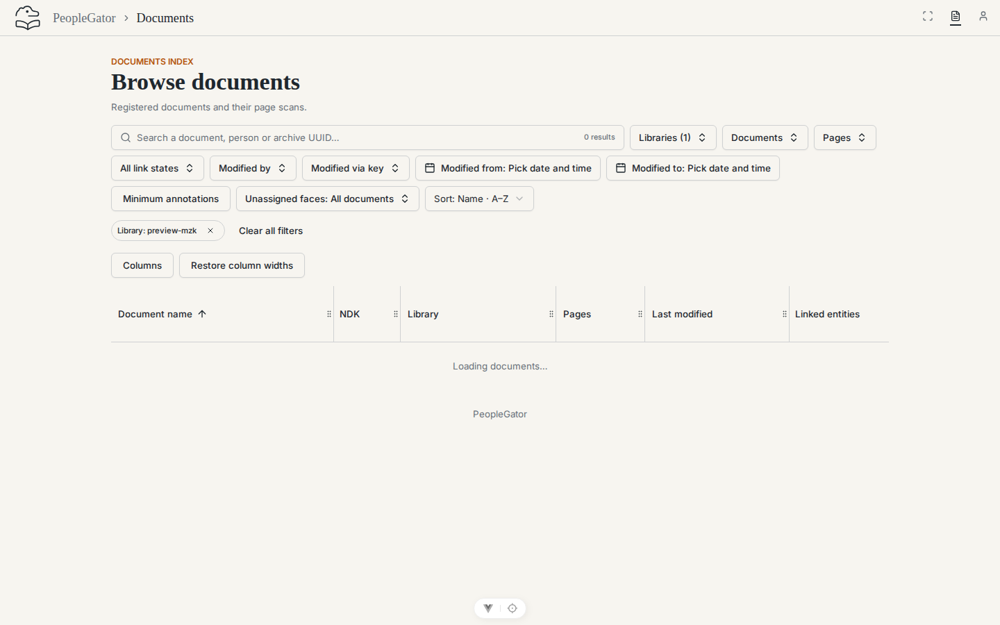 | 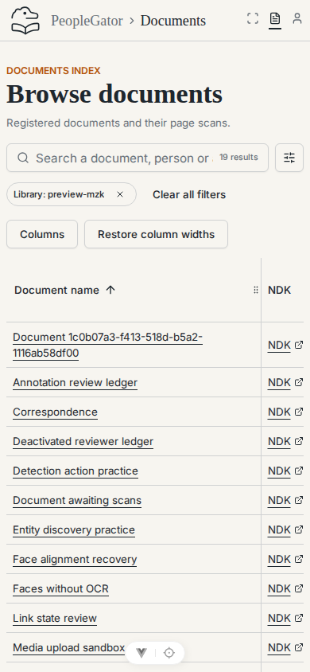 |
| Default Documents | 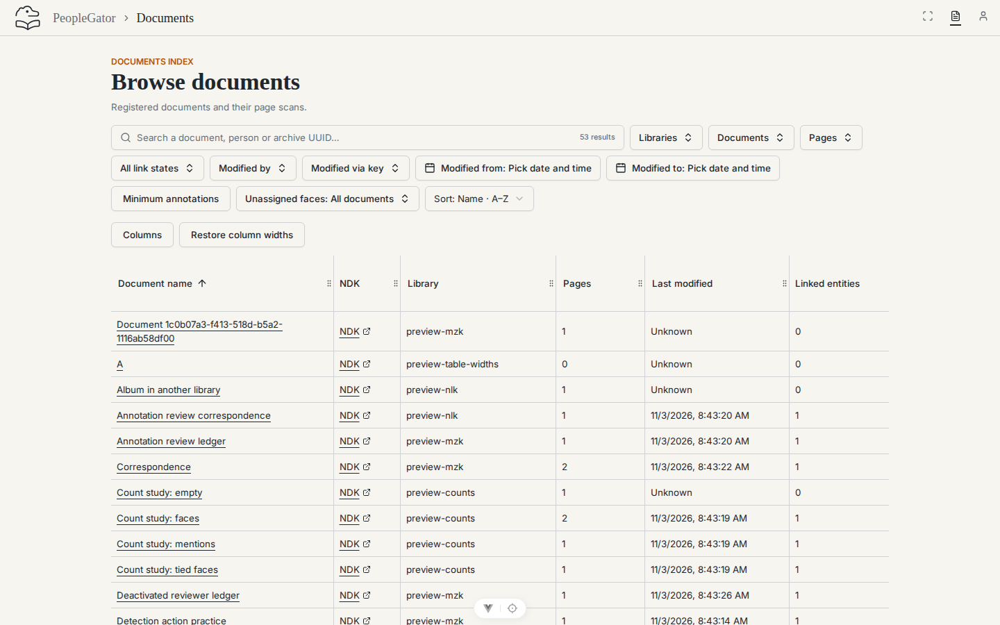 | 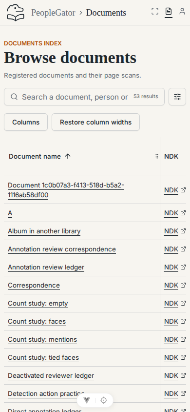 |
| Filtered Scans | 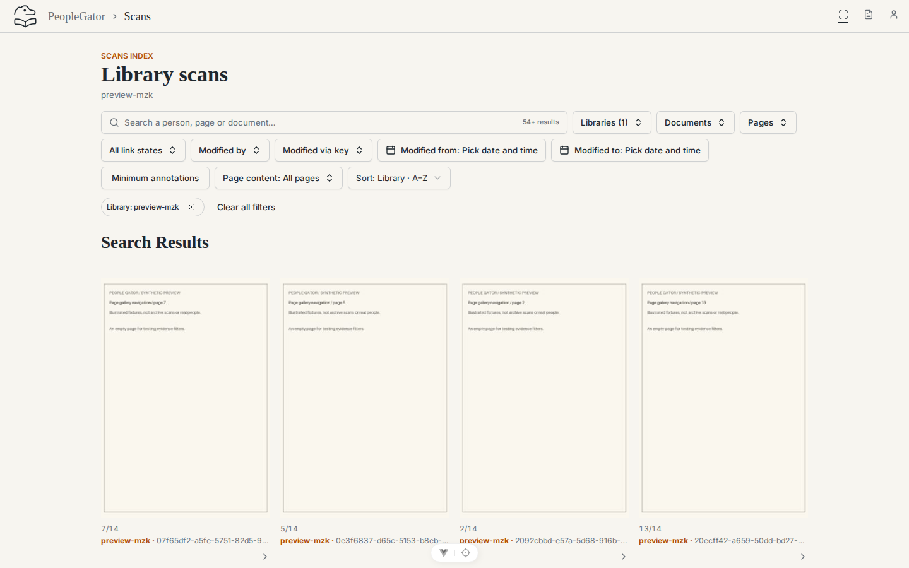 | 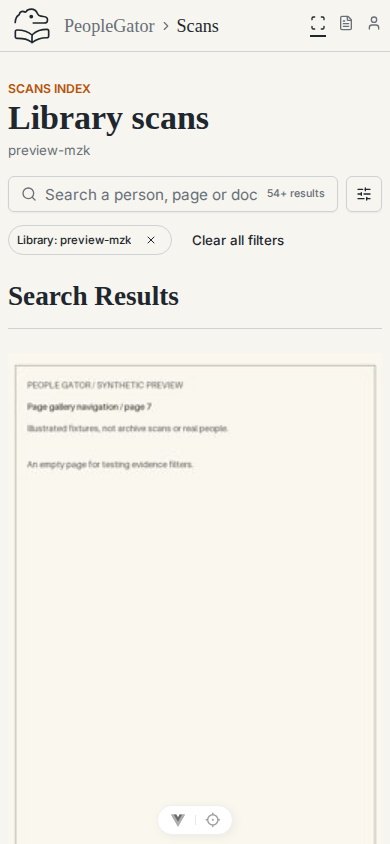 |
| Default Scans | 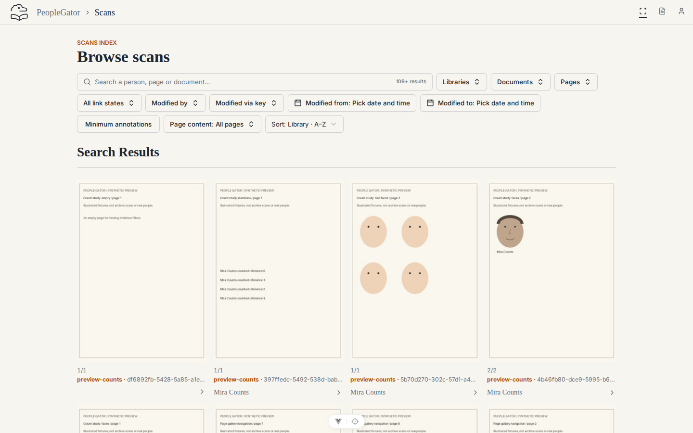 | 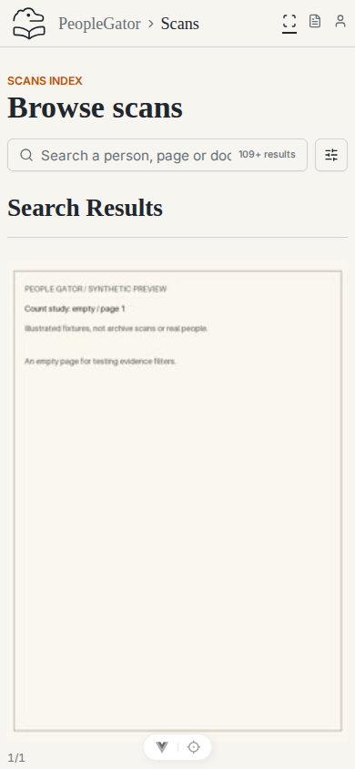 |
| Filtered People | 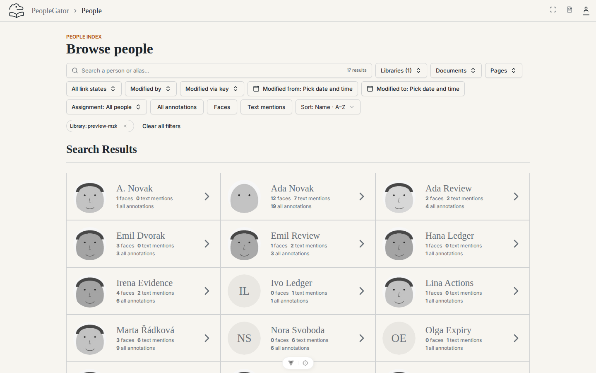 | 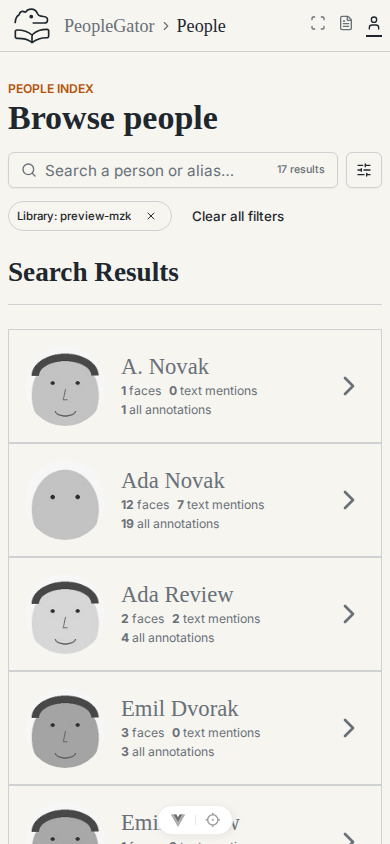 |
| Default People | 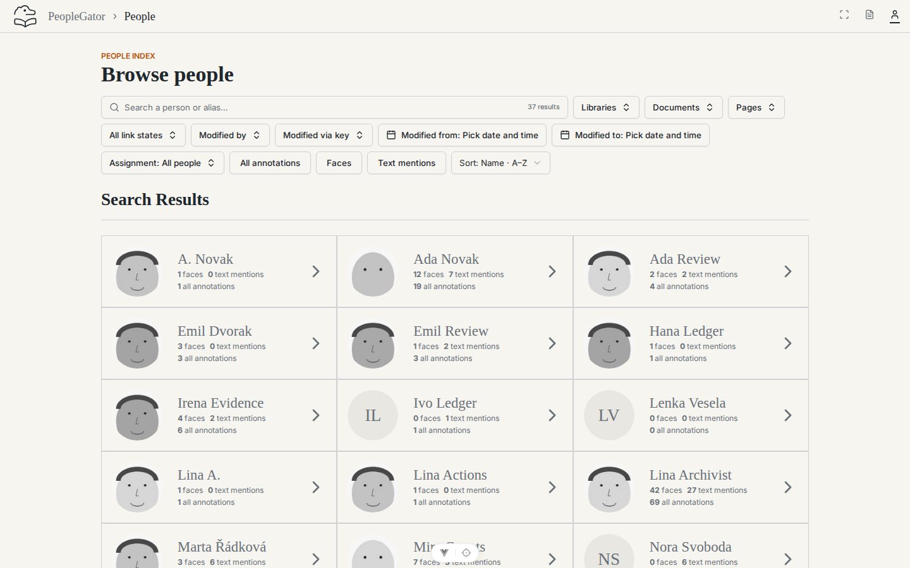 | 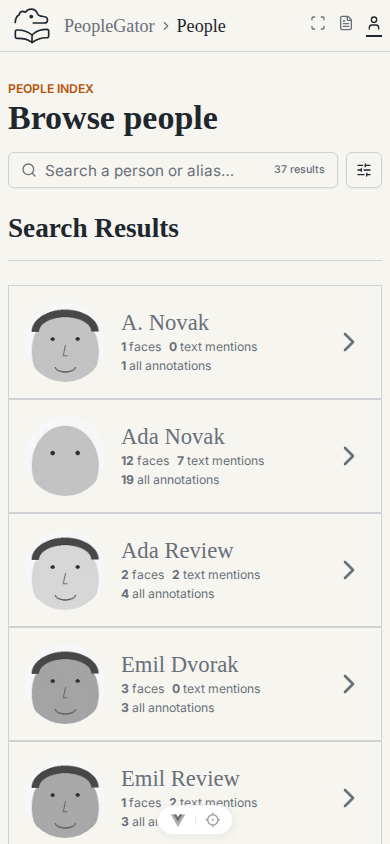 |
| Profile Mentions after leaving filtered Faces | 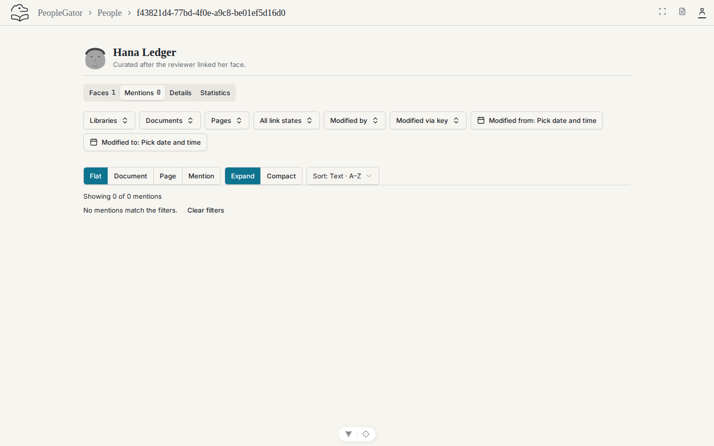 | 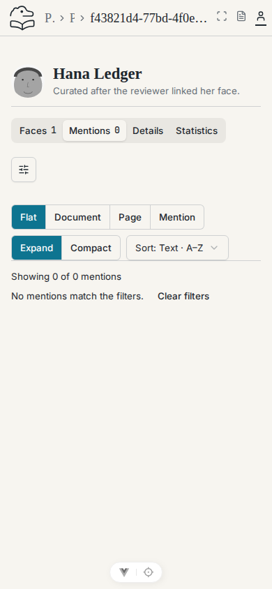 |
| Scan opened from a filtered list | 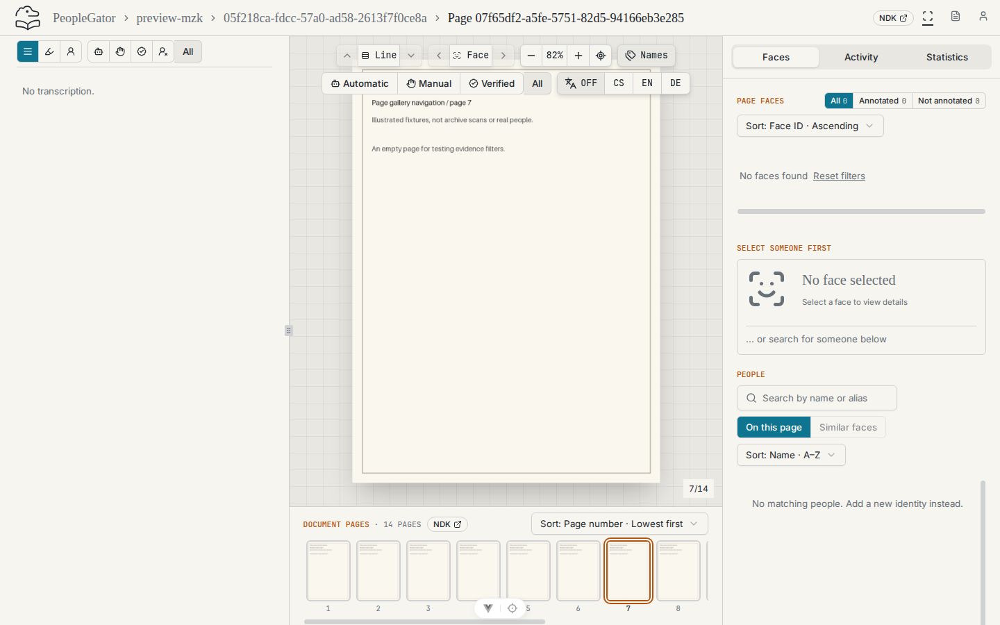 | 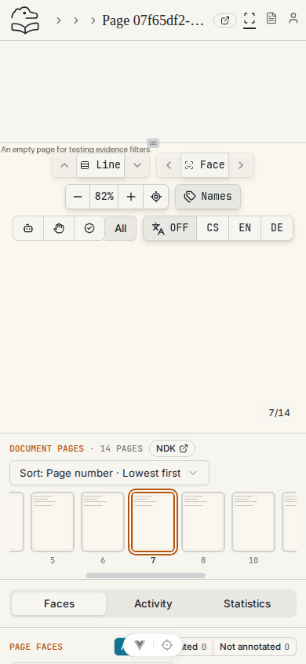 |

## Browser checks

[Recorded outcomes](browser-results.txt) cover both viewports:

- All nine source/destination combinations, active-section reselection and
  leave/return navigation: URLs and tags reset. List requests do not inherit
  `filter.library`.
- People result → profile → People breadcrumb; filtered profile Faces → Mentions;
  filtered Scans → page → gallery; logo → default Documents. Explicit record and
  action context remains intact.
- Keyboard Enter activates navigation. On mobile, Enter expands/collapses the
  settings toggle without clearing the current view's filter.
- Reload and Back restore the explicit filtered URL; Forward restores the default
  destination. No browser page errors were recorded.

The audit removed `relatedQuery` and `pageGalleryQuery`. Callers now construct
only explicit destination context: document UUID, library/archive breadcrumb
scope, selected face/person or similarity witness. Mention links no longer copy
link-state separately. Remaining route-query spreads edit the current view, plus
current-record breadcrumb self-links. No remembered-filter store was found;
layout and authentication storage are independent of filters.

## Reproduction

Start a synthetic local instance using [Development](../../DEVELOPMENT.md), then
open `reset-navigation-documents`, `reset-navigation-scans` and
`reset-navigation-people` from the seed report. Select each main navigation
control and verify the URL, tags and requests. Use `shared-filters-person-faces`
for the profile tab transition. Document links scope Scans to that document only;
face/mention links retain their target selection only.

Theme styling was unchanged; this issue changes navigation targets and state.
