# Workspace breadcrumb evidence (#114)

Captured in Chromium from this issue branch with the real local API and Vite,
a fresh migrated PostgreSQL database and disposable local storage, after two
successful real seed CLI runs. All records and scans are synthetic.

| State | Desktop — 1440 × 900 CSS pixels | Mobile — 390 × 844 CSS pixels |
| --- | --- | --- |
| Named, numbered | 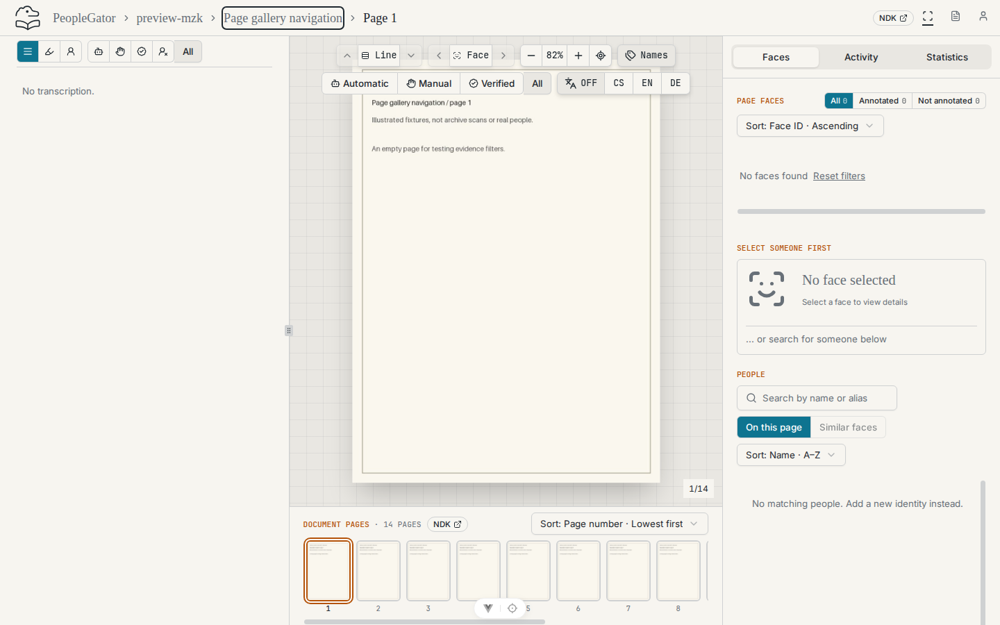 | 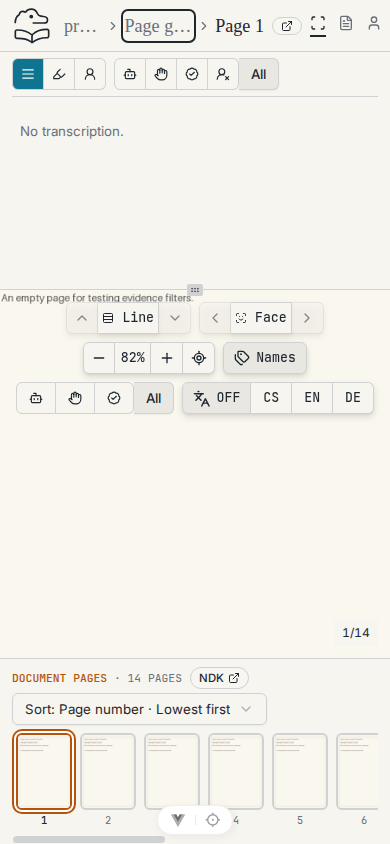 |
| Missing number | 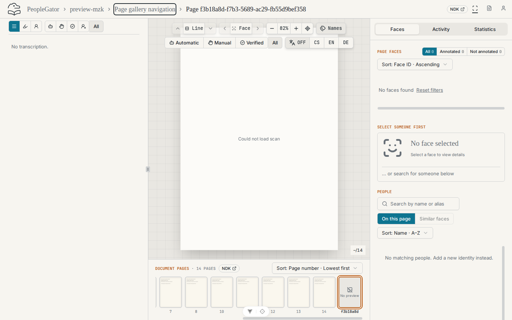 | 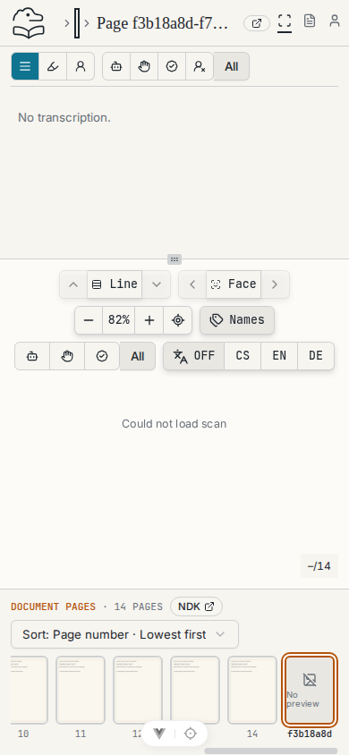 |
| Unnamed document | 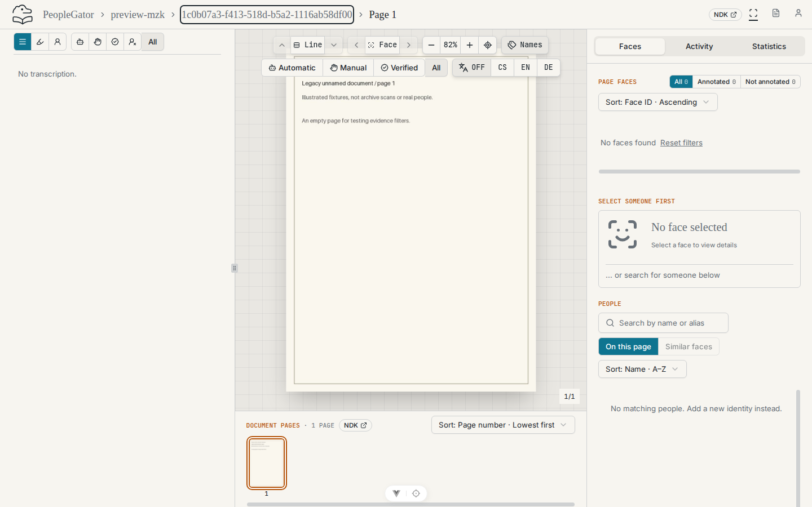 | 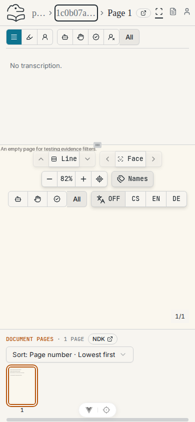 |
| Unregistered parent | 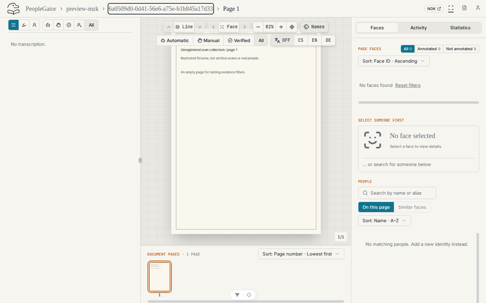 | 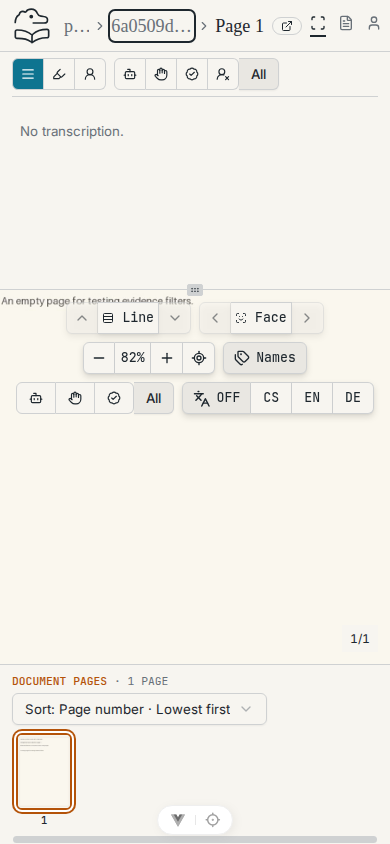 |
| Long title, keyboard focus | 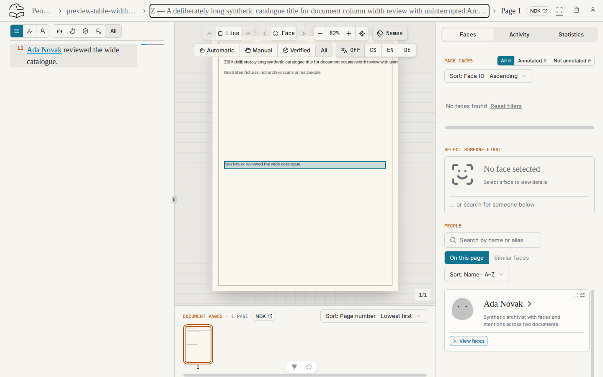 | 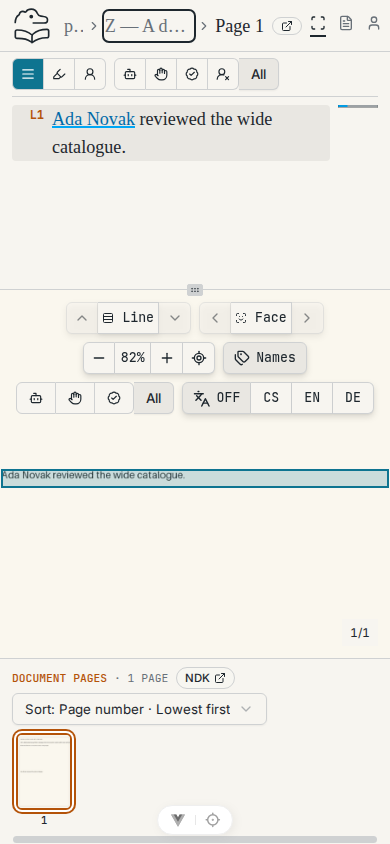 |
| Long title, dark mode | 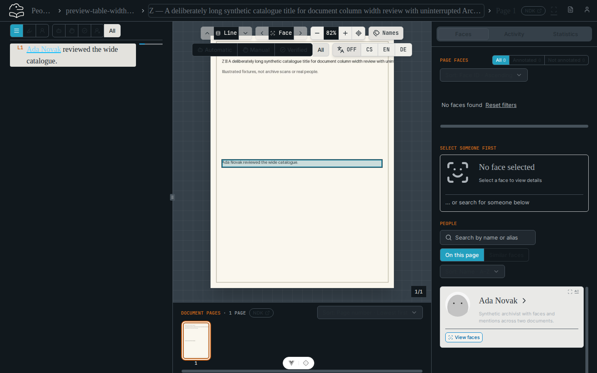 | 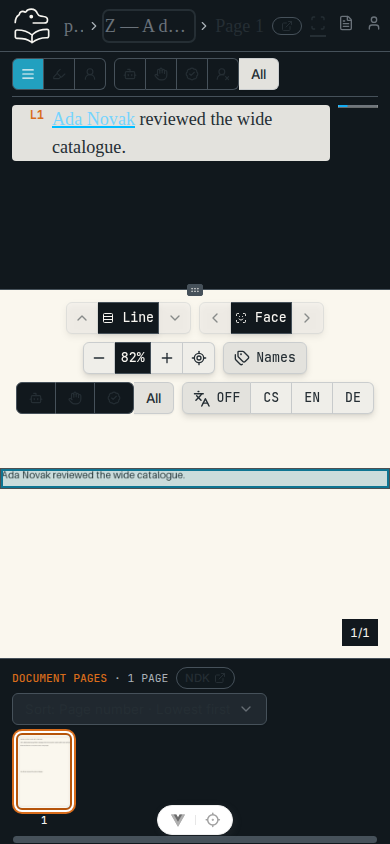 |

The missing-number scenario reuses the gallery's deliberately missing scan.
Its media error is expected and independent of breadcrumb metadata.

Run the browser check from `people-gator-app` against a disposable instance:

```sh
BREADCRUMB_ORIGIN=http://127.0.0.1:5115 \
BREADCRUMB_SEED_LOG=/tmp/issue114-seed-second.log \
node scripts/check-breadcrumbs.mjs
```

The seed log is the captured output of the second real seed CLI run. The script
uses its `breadcrumb-*` entry points and records fresh screenshots in this folder.
It checks both viewport sizes, independent metadata fallbacks and full title
attributes, canonical URLs and scoped document links, keyboard activation and
focus, Back/Forward, actual gallery page switching, no viewport overflow, visible
navigation controls, and a real page-number edit from 1 to 42 and back to 1.
Run it only on disposable data: it writes the named fixture's page number.
No uncaught browser errors occurred. Numbered page labels fit without truncation.
Long names retain their full accessible text and title; visible labels truncate.
The phone header uses the logo as its home link and omits the duplicate home crumb.
Screenshots supplement these executed checks; they do not prove accessibility.
