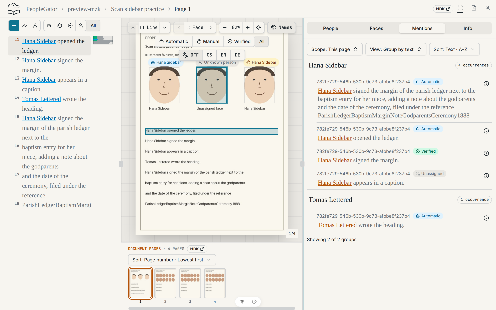
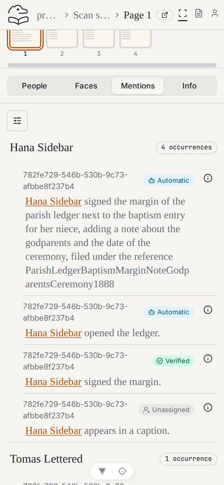
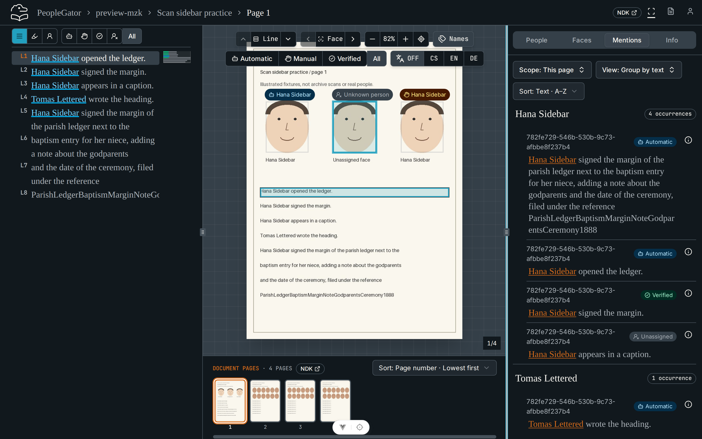
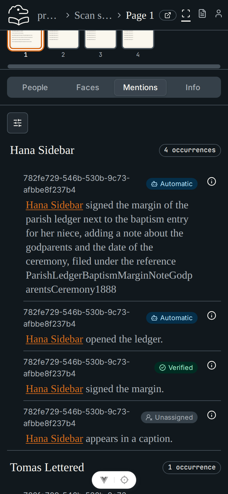

# Scan sidebar evidence (#121)

Captured in Chromium from this issue branch with the real local API and Vite,
a fresh migrated PostgreSQL database and disposable local storage, after two
successful real seed CLI runs. All records and scans are synthetic. The page is
`scan-sidebar-1` with the Mentions tab scoped to **This page**.

| State | Desktop — 1440 × 900 CSS pixels | Mobile — 390 × 844 CSS pixels |
| --- | --- | --- |
| Light |  |  |
| Dark |  |  |

Desktop captures focus the **Resize sidebar** handle with the keyboard; the light
capture is dragged from the default 400px to about 560px. The app has no theme
toggle, so dark captures add the `dark` class to the document root.
