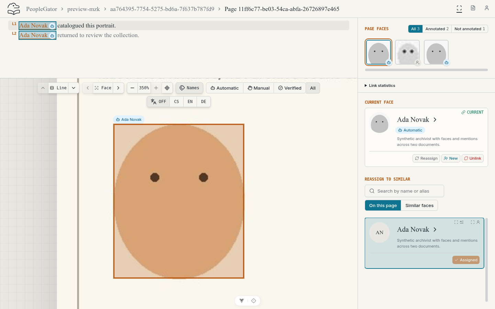
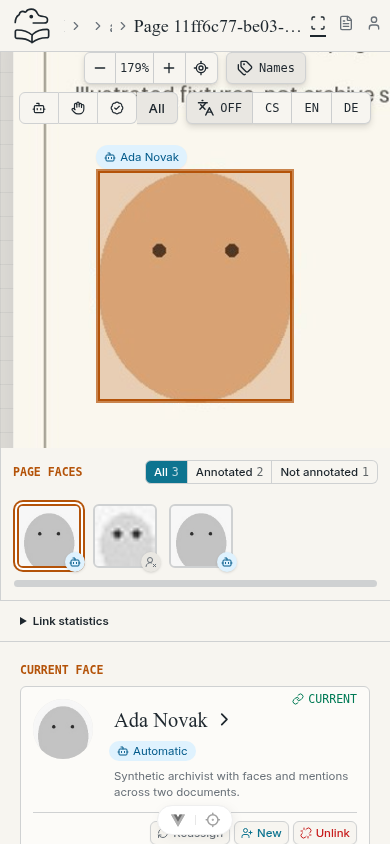
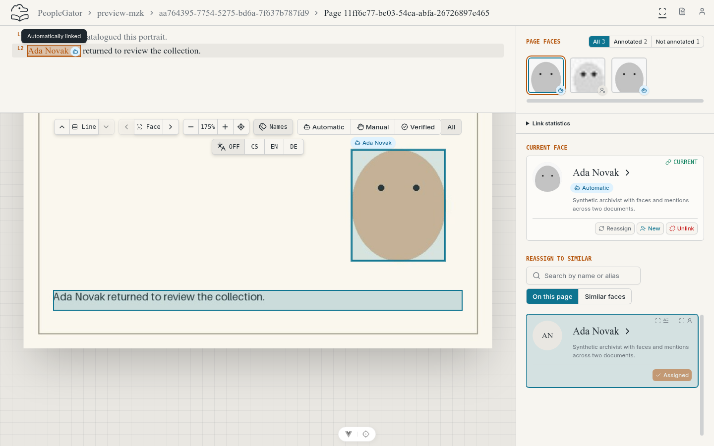
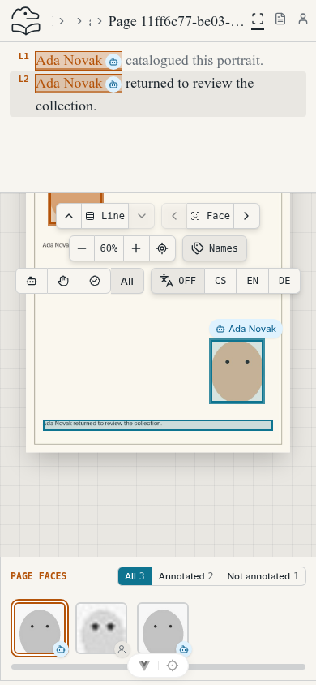

# Issue #34 browser evidence

Real Chrome captures of the running application with migrated, seeded PostgreSQL
and local synthetic media. Desktop: 1440 × 900 CSS pixels. Mobile: 390 × 844 CSS
pixels. Both show the new **Viewport focus practice** page. The name state selects
the lower of two Ada Novak occurrences; its containing OCR line is the fallback
focus target. The face state selects a regular portrait.

| State | Desktop | Mobile |
| --- | --- | --- |
| Selected face |  |  |
| Selected name |  |  |

Browser assertions checked full target visibility below the measured toolbar,
reselection after wheel zoom, Enter/Space activation of distinct names, the tiny
face's 350% cap, arrow navigation, transform preservation after resize, and no
uncaught page errors at either viewport. Mobile additionally exercised touch
activation. The gallery scrolls only its own horizontal viewport. Light captures
are shown; dark mode was also exercised without changing the native controls.
Screenshots supplement the regression tests; they do not establish exhaustive
accessibility or touch/pinch coverage.
