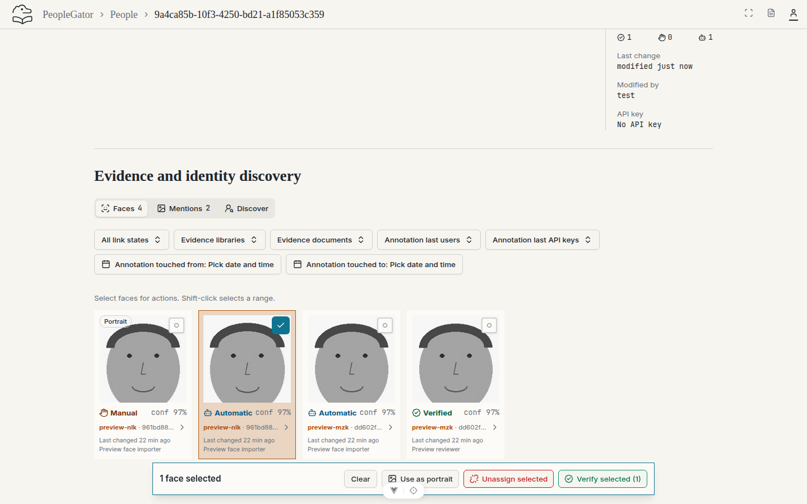
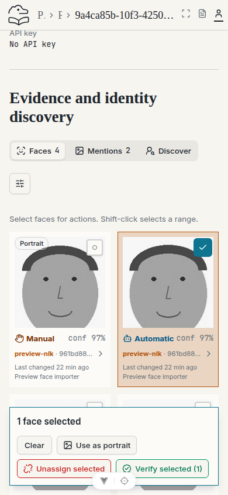
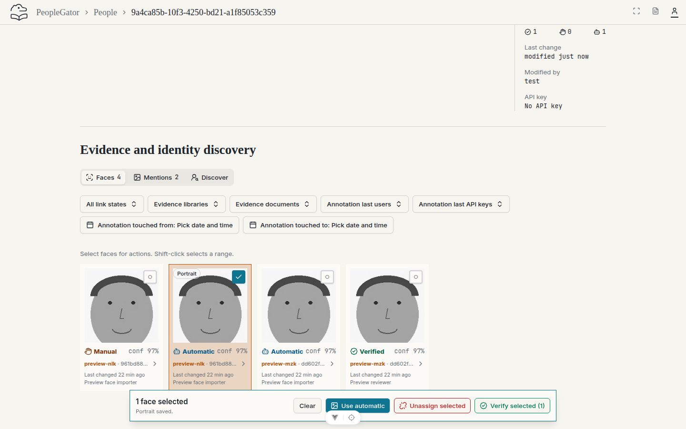
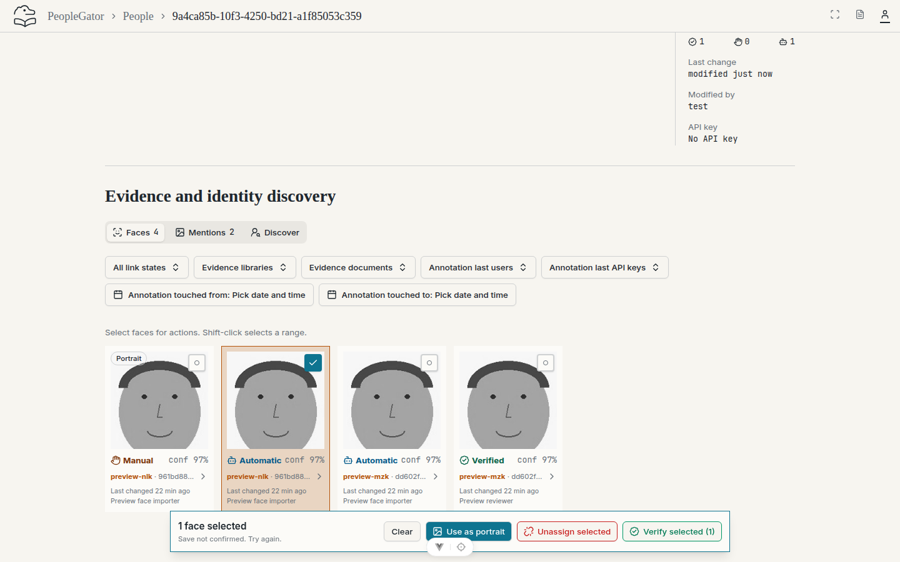
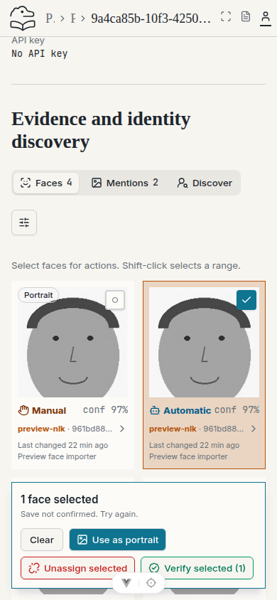
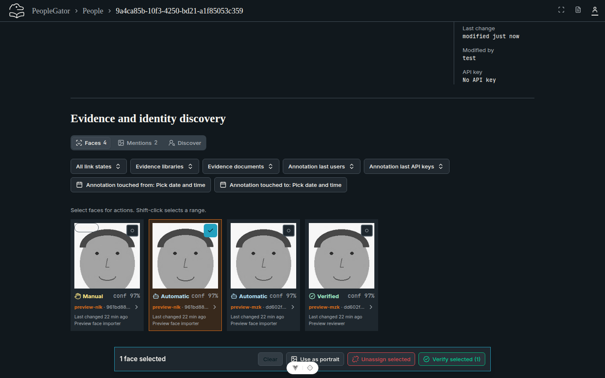
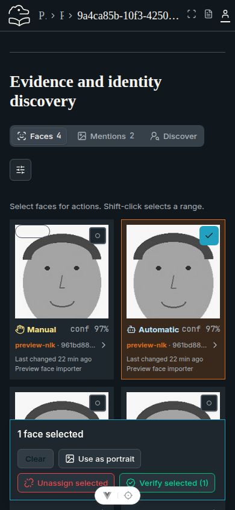
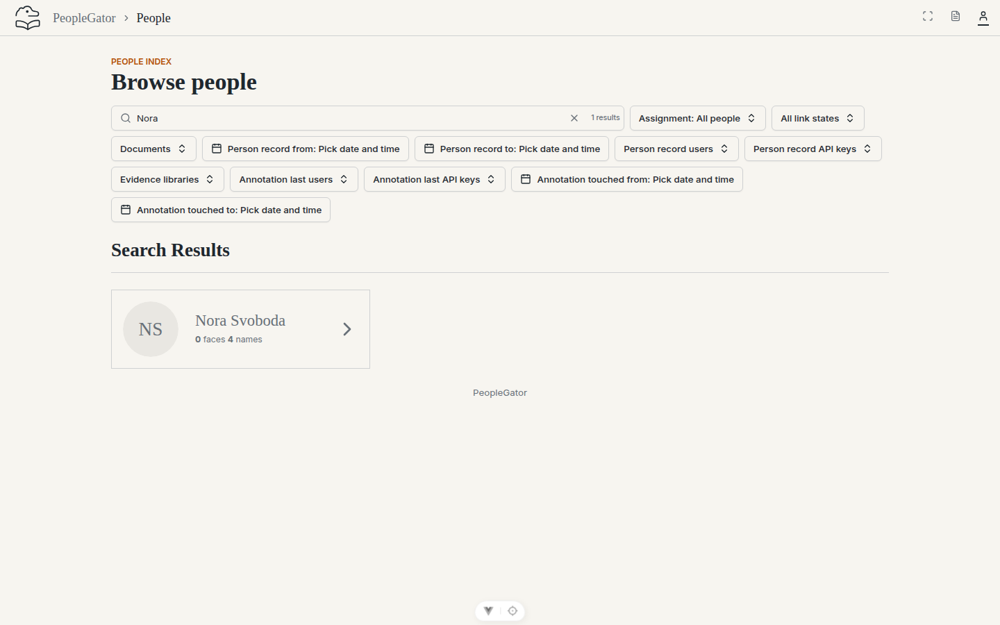
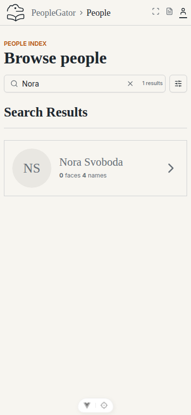

# Issue #35 browser evidence

Captured from the actual application at frontend revision `a0329b1`, using an
isolated migrated PostgreSQL preview and local synthetic media. No-face, no-face
search and media-error captures were refreshed at frontend revision `f571739`
after the review fixes, using a separate fresh migrated synthetic store. Desktop views
are **1440 × 900** CSS pixels; mobile views are **390 × 844** CSS pixels.

Executed Chromium checks:

- Select one evidence face with the keyboard and use **Use as portrait** in the
  bottom bar. Verify save failure retains selection and retry succeeds.
- Select the face marked **Portrait** and use **Use automatic**. Verify automatic
  mode and UUID selection persist through reload. No header button or selector
  popup is present.
- Exclude the selected face with the verified-evidence filter; the canonical
  portrait survives reload. Compare actual authenticated crop bytes across
  profile, People search, Discover people and scan assignment candidates.
- Exercise a selected unassigned scan face, no-face and failed-media placeholders,
  light/dark rendering and mobile overflow. No JavaScript page errors occurred.

Save errors use controlled HTTP 503 interception; missing-media captures use
controlled HTTP 404 interception. The real application handles both. Dark-mode
captures enable the existing `.dark` theme. No private data or inference service
was used. The real seed CLI ran twice against the isolated store and local media.

See the [portrait contract](../../../people-gator-api/docs/PERSON-THUMBNAILS.md)
and [preview guide](../../../people-gator-api/docs/PREVIEW-SEEDING.md).

## Use as portrait in the bottom action bar

| Desktop — 1440 × 900 | Mobile — 390 × 844 |
| --- | --- |
|  |  |

## Marked portrait and Use automatic reset

| Desktop — 1440 × 900 | Mobile — 390 × 844 |
| --- | --- |
|  |  |

## Recoverable portrait save error

| Desktop — 1440 × 900 | Mobile — 390 × 844 |
| --- | --- |
|  |  |

## Face actions in dark mode

| Desktop — 1440 × 900 | Mobile — 390 × 844 |
| --- | --- |
|  |  |

## Canonical profile portrait with selected evidence filtered out

| Desktop — 1440 × 900 | Mobile — 390 × 844 |
| --- | --- |
|  |  |

## Canonical portrait in People search

| Desktop — 1440 × 900 | Mobile — 390 × 844 |
| --- | --- |
|  |  |

## Canonical portrait in Discover people

| Desktop — 1440 × 900 | Mobile — 390 × 844 |
| --- | --- |
|  |  |

## Portrait in an unassigned scan face assignment choice

| Desktop — 1440 × 900 | Mobile — 390 × 844 |
| --- | --- |
|  |  |

## No-face initials

| Desktop — 1440 × 900 | Mobile — 390 × 844 |
| --- | --- |
|  |  |

## No-face initials in People search

| Desktop — 1440 × 900 | Mobile — 390 × 844 |
| --- | --- |
|  |  |

## Initials after an unavailable portrait response

| Desktop — 1440 × 900 | Mobile — 390 × 844 |
| --- | --- |
|  |  |

## Review follow-up validation

Chromium at **1440 × 900** and **390 × 844** confirmed 24px initials in both
profile headers and People search cards, with no horizontal overflow. A controlled
503 crop response produced initials without retries or a lingering skeleton (one
request, fallback within the 1.5-second assertion window). Keyboard activation of
**Use automatic** and face verification reused loaded crop bytes with no additional
crop downloads. No JavaScript page errors occurred. Earlier missing-media captures
used 404; the refreshed captures use 503. Component tests separately hold a background
refetch pending and check that the existing image remains visible.

The first assigned automatic face is saved in PostgreSQL and remains selected
through later lower-ID face additions, renames and merges while linked. Explicit
manual reset and invalidated-reference fallback use the documented UUID tie-break;
resetting an already automatic choice preserves it. Database tests also cover
multi-person reset responses, one repair per missing owner during bulk insertion,
and startup rejection of each weakened portrait CHECK constraint.
