# Issue #35 browser evidence

Captured from the actual application at frontend revision `4ea7668`, using the
isolated, migrated PostgreSQL preview seed and its local synthetic media.
Desktop viewports are **1440 × 900** CSS pixels; mobile viewports are
**390 × 844** CSS pixels. The failure screenshots use controlled browser request
interception, with the real application handling the resulting API/media errors.
Dark-mode captures enable the application's existing `.dark` theme.

Executed Chromium checks:

- Open the chooser with Enter, select with Space, close with Escape, and check
  focus returns to the trigger. Choose a linked face, reload, and reset to automatic.
- Exclude the selected face with the verified-evidence filter and verify its
  portrait survives reload. Compare the actual authenticated crop bytes across
  profile, People search, Discover people and a scan assignment candidate.
- Select an unassigned scan face and search for Irena Evidence as an assignment
  candidate. Keep scan evidence thumbnails tied to their own detections.
- Inject a failed portrait PATCH and verify the last confirmed choice remains
  visible and the chooser remains usable. Exercise no-face and failed-media
  placeholders. Check mobile overflow and light/dark rendering.
- No JavaScript page errors occurred. Selection and reset persisted through
  real API responses; no inference service or private data was used.

The seed CLI ran twice against the isolated migrated database and local storage.
The screenshot data was changed through authenticated API/UI operations to
exercise manual selection, reset and failure recovery. See the
[portrait contract](../../../people-gator-api/docs/PERSON-THUMBNAILS.md) and
[preview guide](../../../people-gator-api/docs/PREVIEW-SEEDING.md).

## Profile portrait with the selected face excluded by the verified-evidence filter

| Desktop — 1440 × 900 | Mobile — 390 × 844 |
| --- | --- |
| 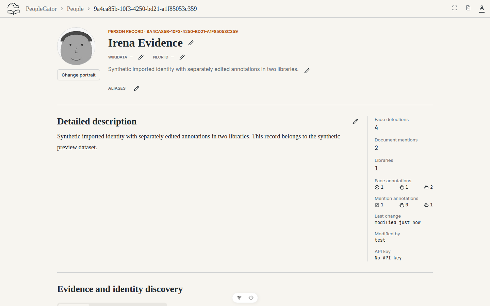 | 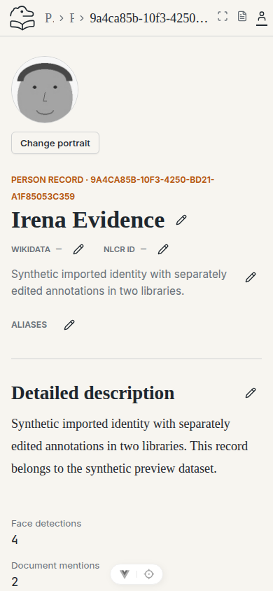 |

## All linked portrait choices and automatic reset

| Desktop — 1440 × 900 | Mobile — 390 × 844 |
| --- | --- |
| 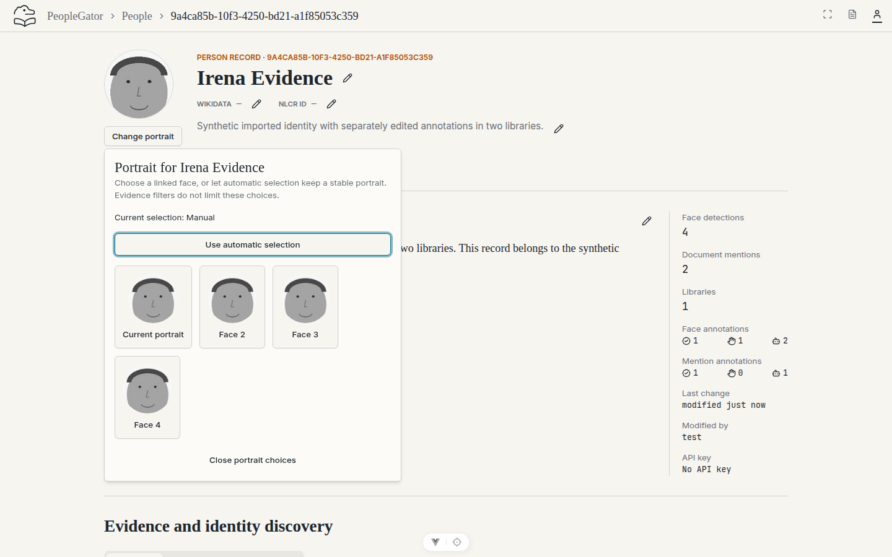 | 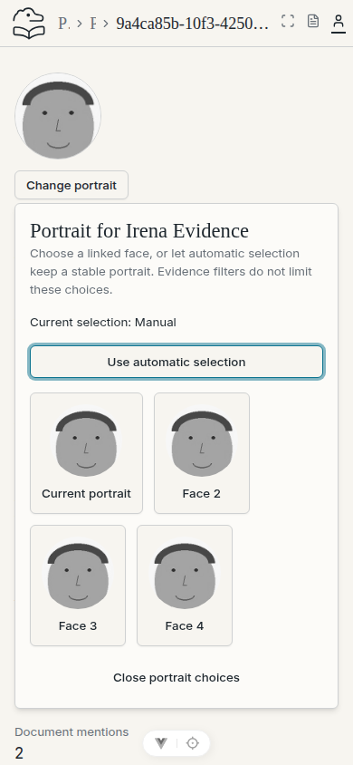 |

## Canonical portrait in People search

| Desktop — 1440 × 900 | Mobile — 390 × 844 |
| --- | --- |
| 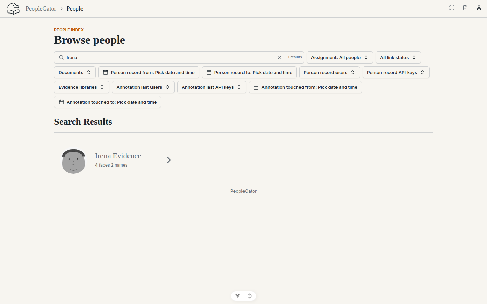 | 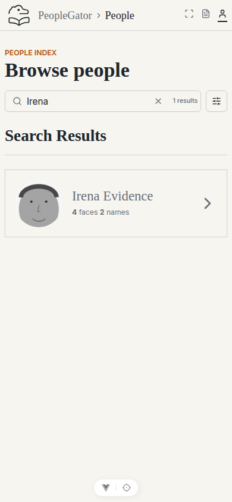 |

## Canonical portrait in Discover people, independent of matched evidence

| Desktop — 1440 × 900 | Mobile — 390 × 844 |
| --- | --- |
| 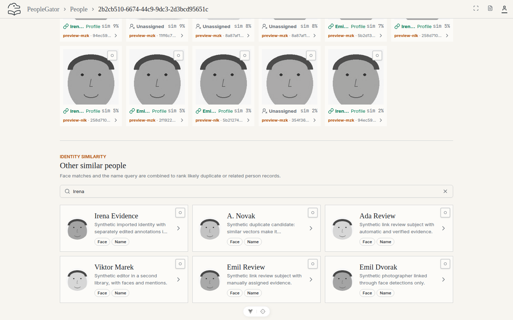 | 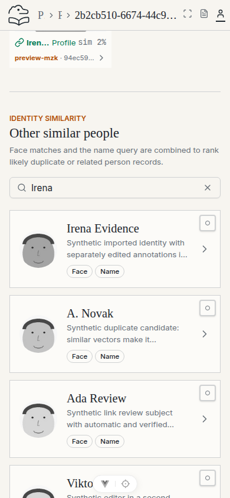 |

## Portrait in an assignment choice for an unassigned scan face

| Desktop — 1440 × 900 | Mobile — 390 × 844 |
| --- | --- |
| 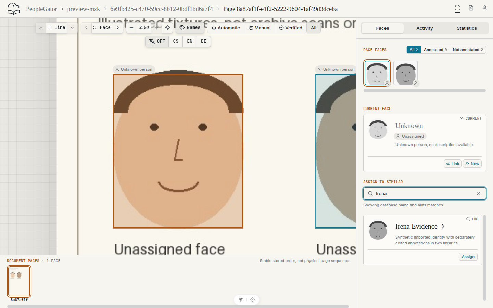 | 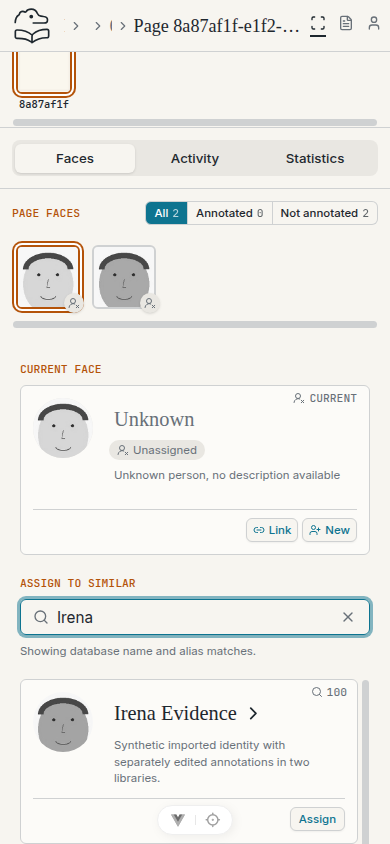 |

## Recoverable save error (controlled HTTP 503)

| Desktop — 1440 × 900 | Mobile — 390 × 844 |
| --- | --- |
| 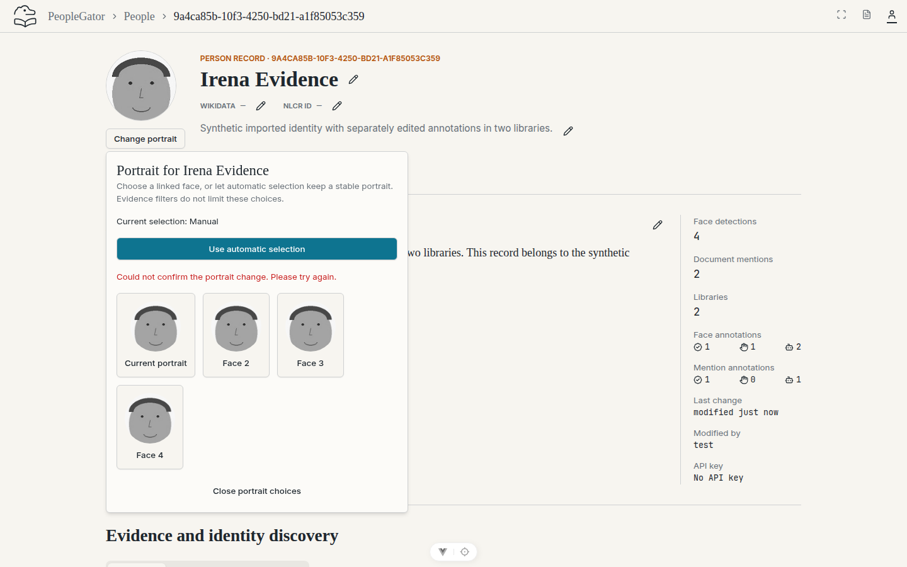 | 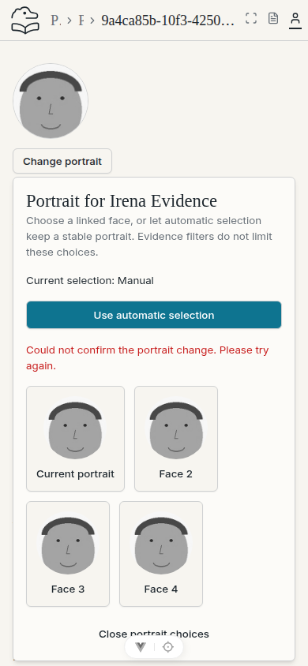 |

## No-face initials and empty portrait choices

| Desktop — 1440 × 900 | Mobile — 390 × 844 |
| --- | --- |
| 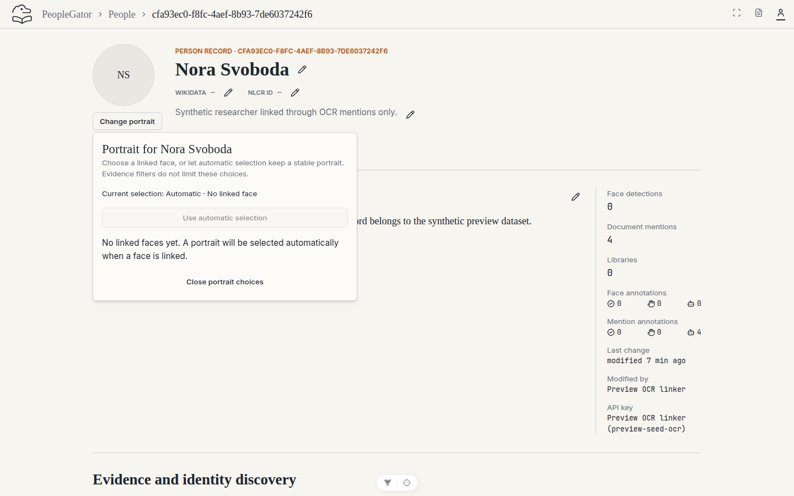 | 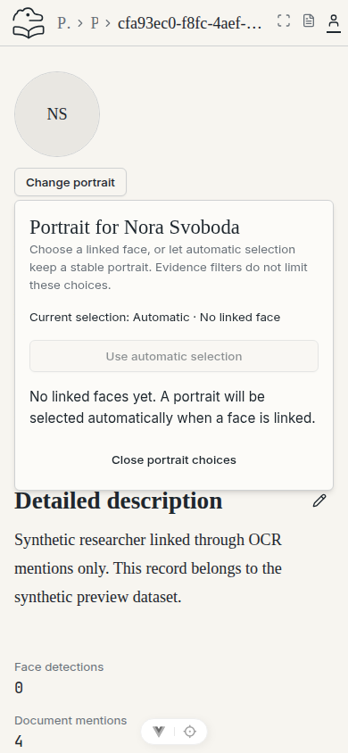 |

## Linked portrait choices in dark mode

| Desktop — 1440 × 900 | Mobile — 390 × 844 |
| --- | --- |
| 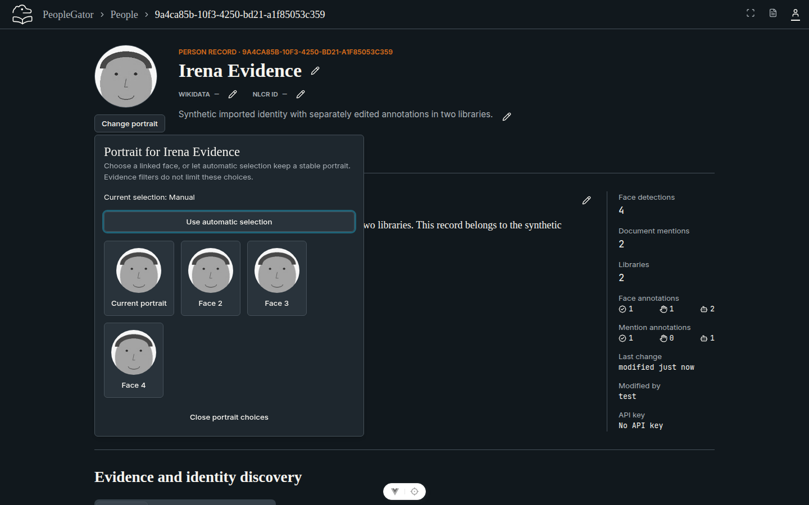 | 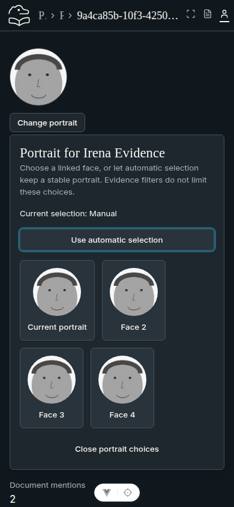 |

## Initials after an unavailable portrait response (controlled HTTP 404)

| Desktop — 1440 × 900 | Mobile — 390 × 844 |
| --- | --- |
| 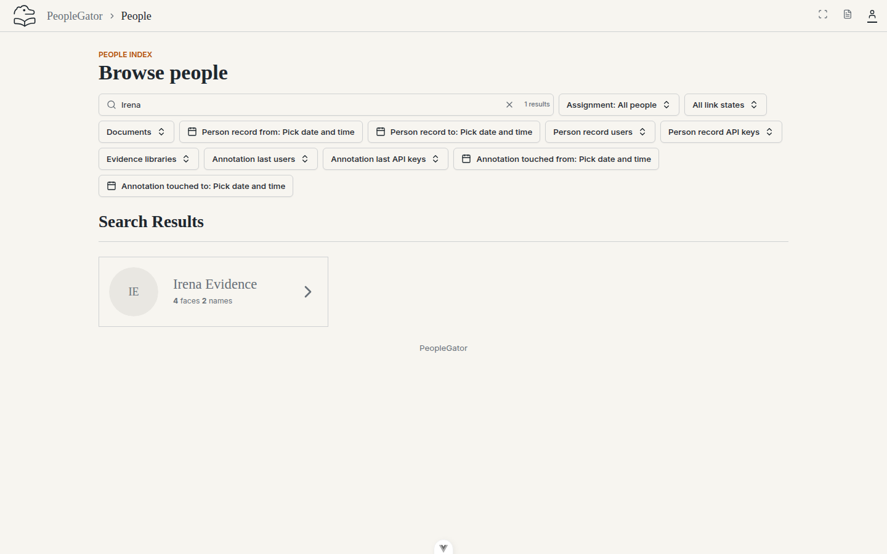 | 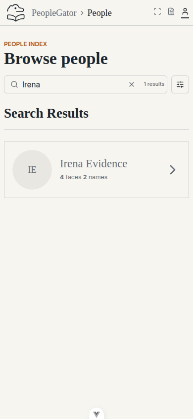 |

