# Issue #40 browser evidence

These are real Chromium captures of the running application. They use migrated,
twice-seeded PostgreSQL and local synthetic media. Desktop is 1440 × 900 CSS
pixels; mobile is 390 × 844 CSS pixels. The dev-only Vue devtools button is
hidden. The captures show the **Document pages** gallery in the scan workspace.

| State | Desktop | Mobile |
| --- | --- | --- |
| Gallery, page outside the first batch is current (`document-page-gallery`) | 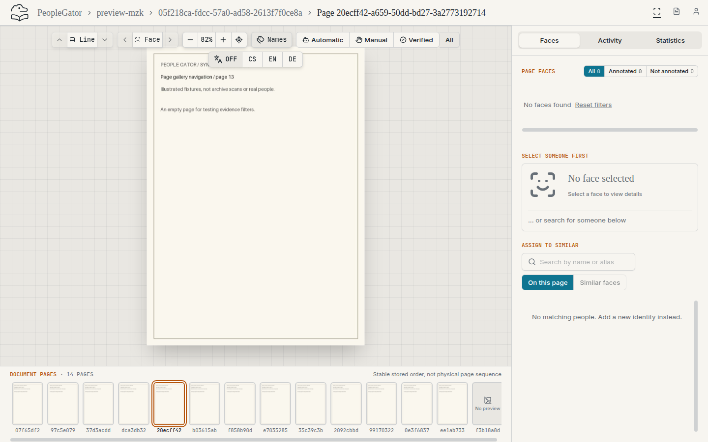 | 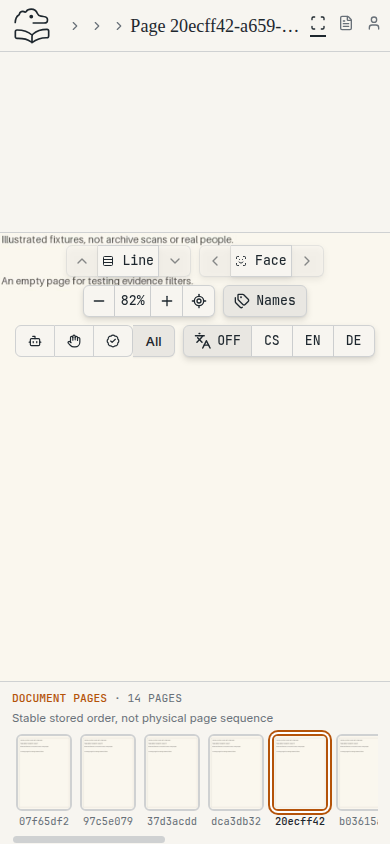 |
| Registered page without media | 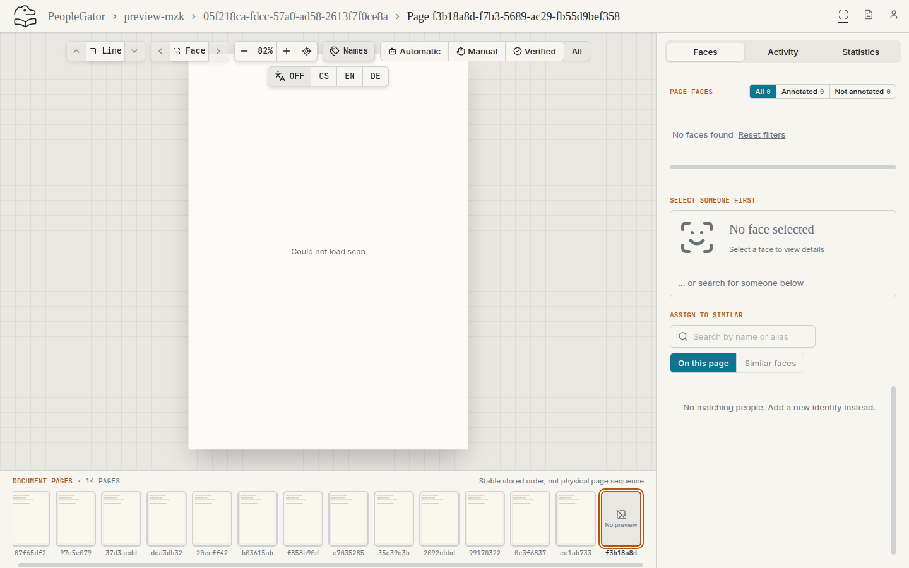 | 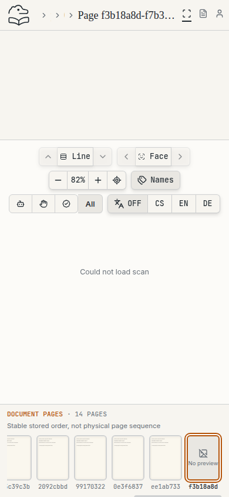 |
| Annotation filter active (`document-page-gallery-filtered`) | 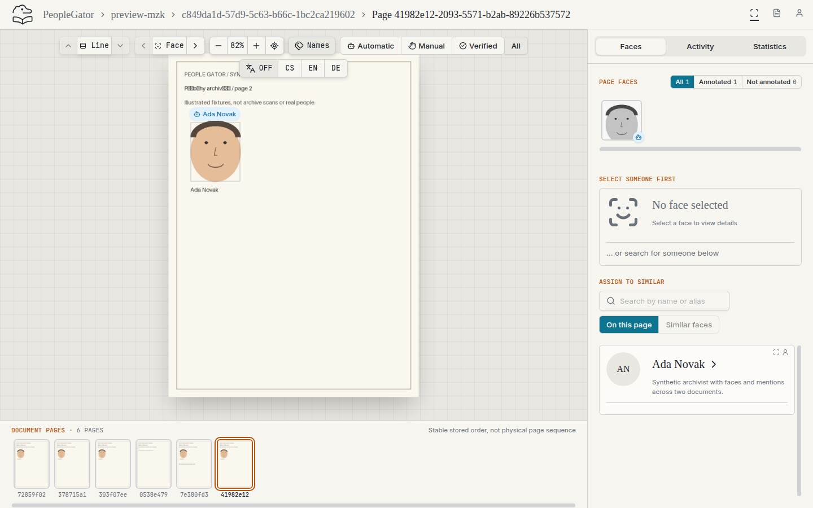 | 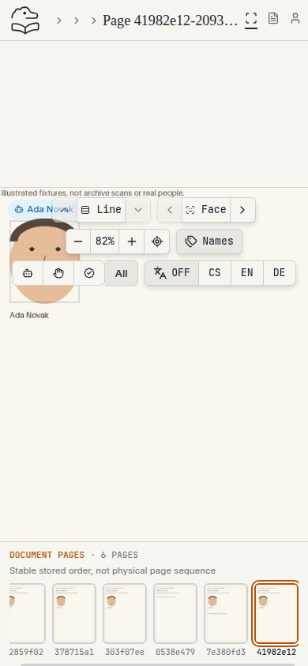 |
| Keyboard focus on a page link | 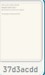 | 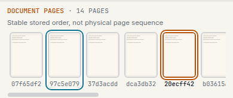 |
| Single-page document | 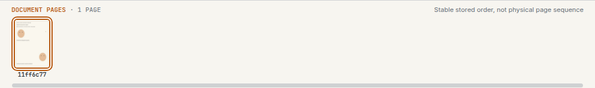 | 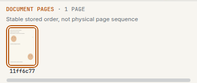 |
| Dark theme | 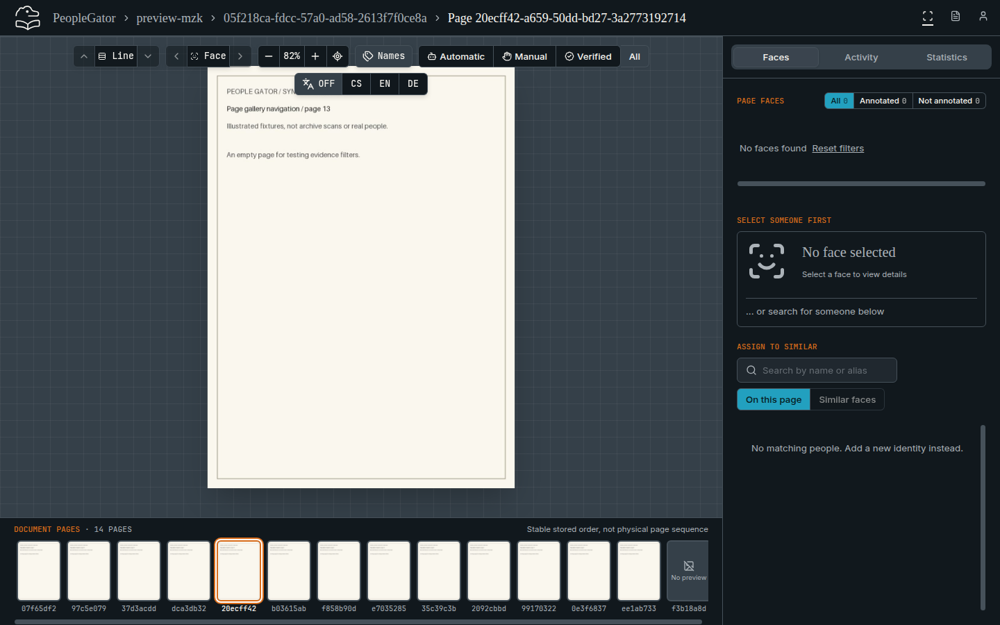 | 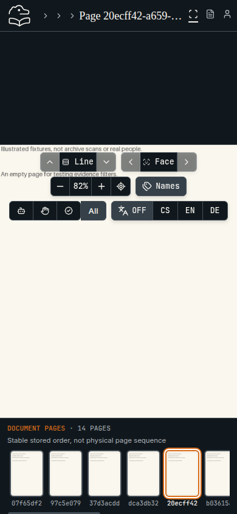 |

At both viewports, browser assertions checked the following:

- Direct entry marks the URL page and scrolls it into view.
- All 14 pages are reachable, with no duplicates.
- Selecting a distant page loads its scan.
- Three rapid selections settle on the last one.
- Back, Forward and reload keep the URL, marker and scan consistent.
- The page does not overflow horizontally.
- The evidence filter keeps all six pages and survives navigation.
- There are no uncaught page errors.

Desktop also checked that arrow keys on a focused page link leave the
face/line selection unchanged and that Enter activates the link. Mobile checked
that a touch swipe scrolls only the strip, leaving the URL, page scroll and scan
pan/zoom transform unchanged.

These screenshots supplement the regression tests. They do not establish
exhaustive accessibility or touch coverage.
