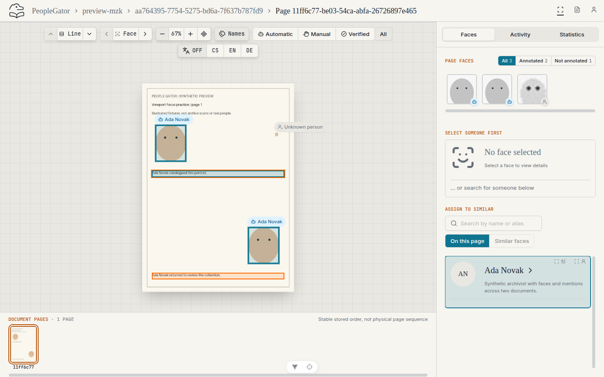
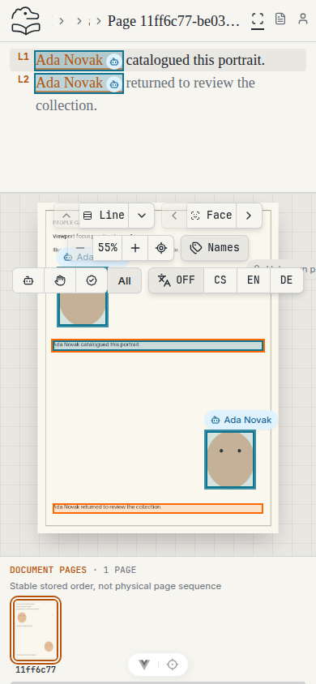
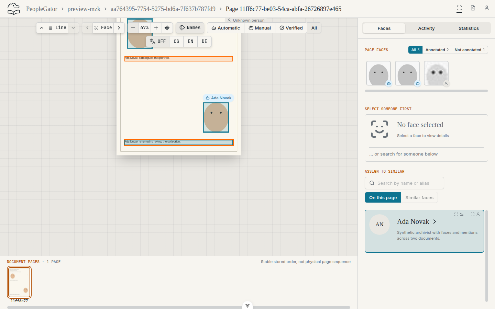
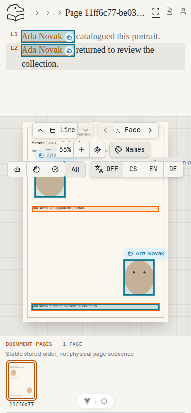
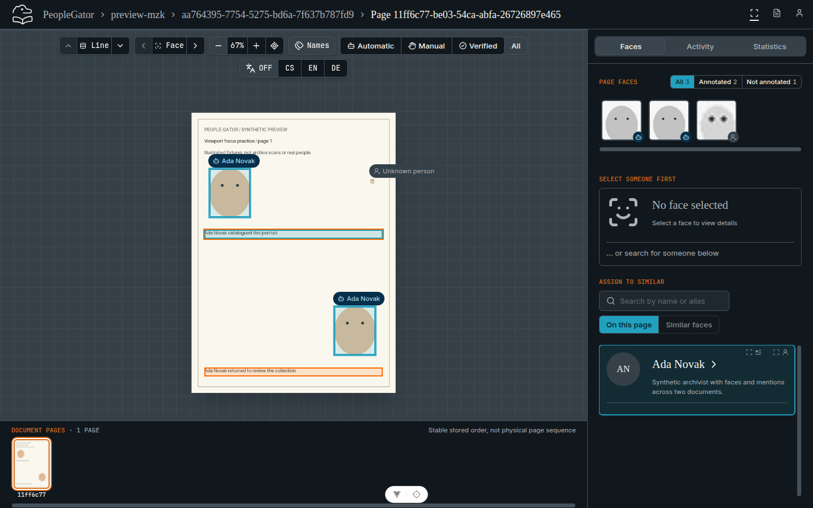
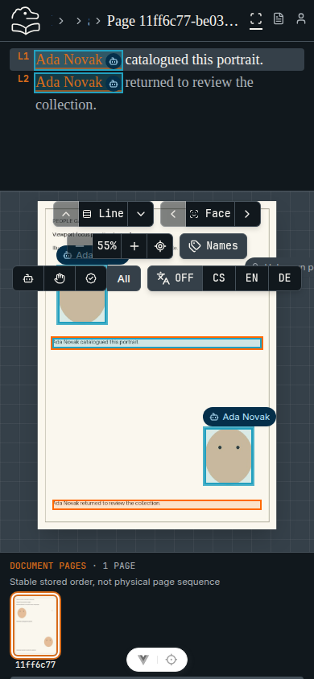
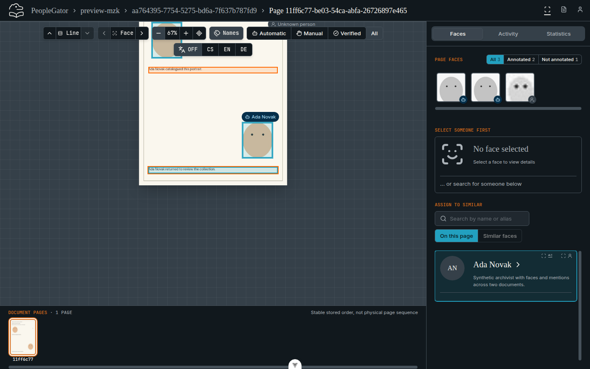
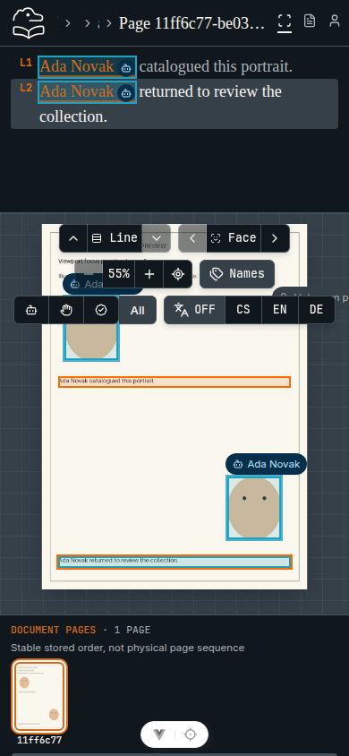
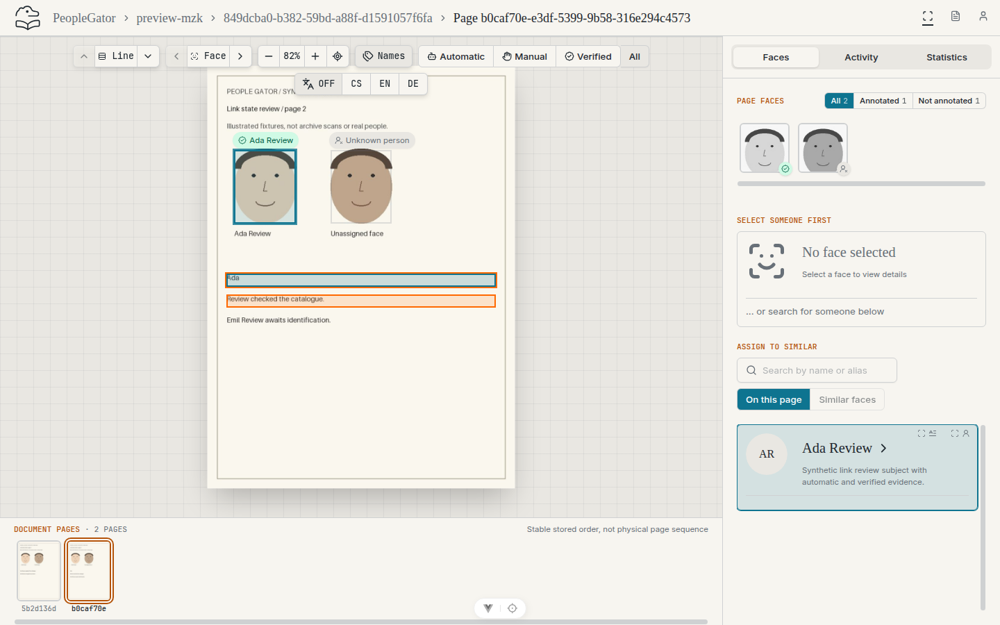
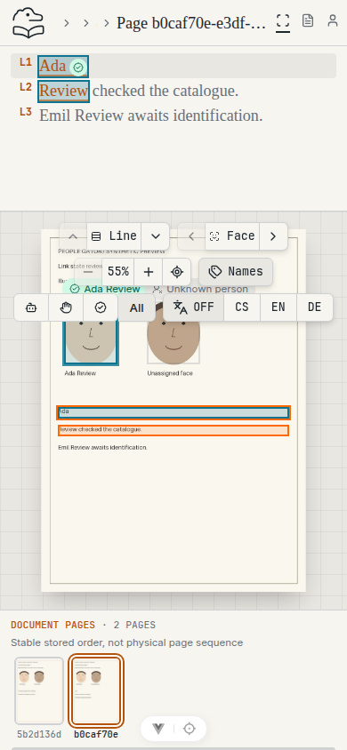

# Issue #45 browser evidence

Actual Chromium captures of this issue branch running against an isolated
migrated PostgreSQL database and synthetic local media. Open the seed CLI's
`person-mention-highlights` link for **Viewport focus practice** with Ada Novak
selected, and `person-mention-highlights-multiline` for **Link state review /
page 2** with Ada Review selected.

Desktop captures use 1440 × 900 CSS pixels; mobile uses 390 × 844 CSS pixels.
Each capture shows the full viewport. After a line is selected, the existing
Zoom out control (and a pan on mobile) brings both OCR lines into the viewer
below the floating toolbar. Dark captures enable the application's existing
`.dark` theme class. No screenshot changes application styles.

The current line keeps its accent highlight and adds an orange ring because it
also mentions the selected person; the other mention line is orange.

| State | Desktop | Mobile |
| --- | --- | --- |
| Light, upper line selected |  |  |
| Light, lower line selected |  |  |
| Dark, upper line selected |  |  |
| Dark, lower line selected |  |  |
| Light, multi-line mention |  |  |

Browser assertions (70, all passed) checked: the current line's accent plus
orange ring and `aria-pressed`, the other line's orange outline and hover
class, both lines' accessible names ending in "(mentions the selected
person)", selection by click (desktop) and tap (mobile), no orange outlines
without a selected person, both fragments of the multi-line mention
highlighted, and the unlinked Emil Review line left plain. All captures
completed without uncaught page errors. Screenshots supplement the component
and seed integration tests; these checks are not exhaustive
browser/accessibility coverage.
