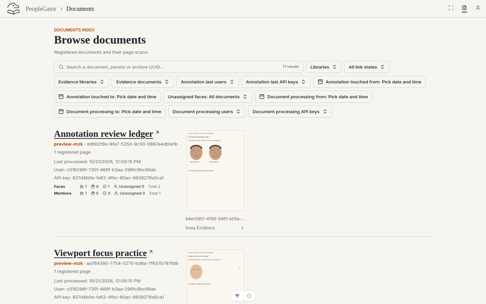
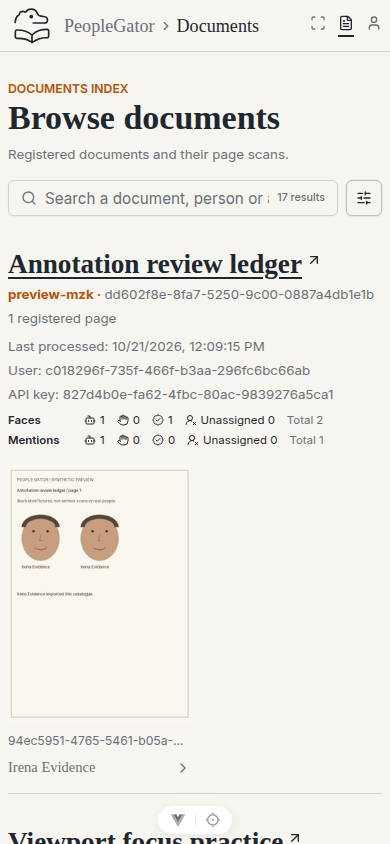

# Documents landing evidence (#50)

Captured from the running issue branch in Chromium using the migrated synthetic
preview on a fresh PostgreSQL database and disposable local storage. The real
migration → seed → seed → schema-check CLI sequence passed before capture.

| Root entry → Documents | Desktop (1440 × 900 CSS pixels) | Mobile (390 × 844 CSS pixels) |
| --- | --- | --- |
| Documents is current; registered documents and local page thumbnails are visible |  |  |

The browser checks passed at both sizes:

- Opening `/` and an unmatched nested URL lands on `/documents`, with the
  Documents title, heading and current navigation item.
- Explicit Scans navigation opens `/scans`; Enter on the logo returns home.
- A document thumbnail opens its page workspace; Enter on the home breadcrumb
  returns to Documents. Direct person links also retain their destination.
- Shared library and verified-link filters survive Documents → Scans → Documents.
- The seeded `default-documents-scans` link opens Portrait album's page results.
- Page thumbnails load, there is no horizontal overflow, and no uncaught browser
  errors occurred during these journeys.
- At 390px, filters start collapsed; Enter expands and collapses them through
  the accessible sliders button.

These are real browser captures and interaction checks. The screenshots alone
do not establish interaction or accessibility coverage. The existing views and
filter layout are unchanged by this routing fix.
