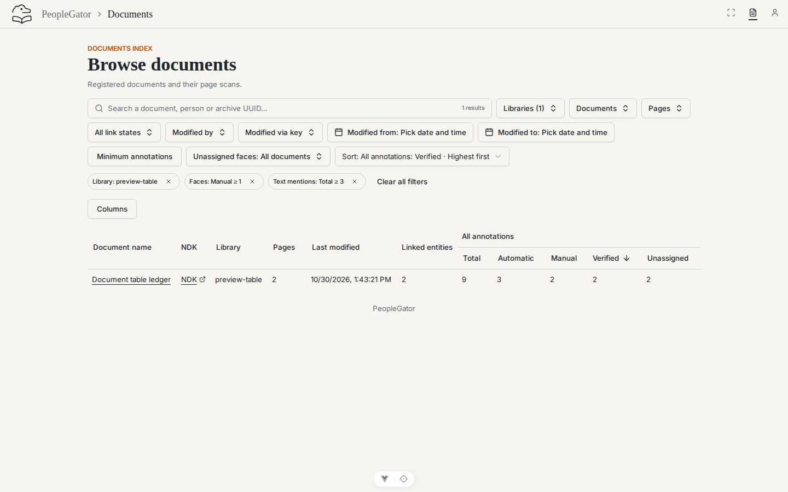
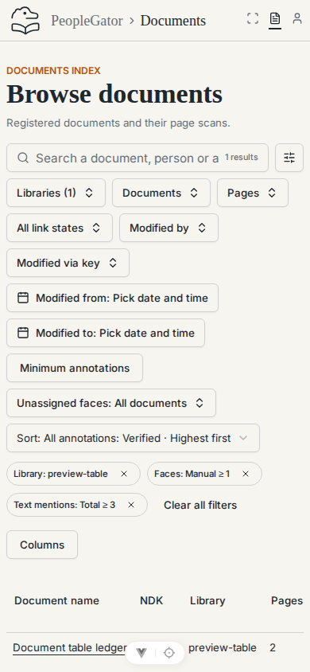
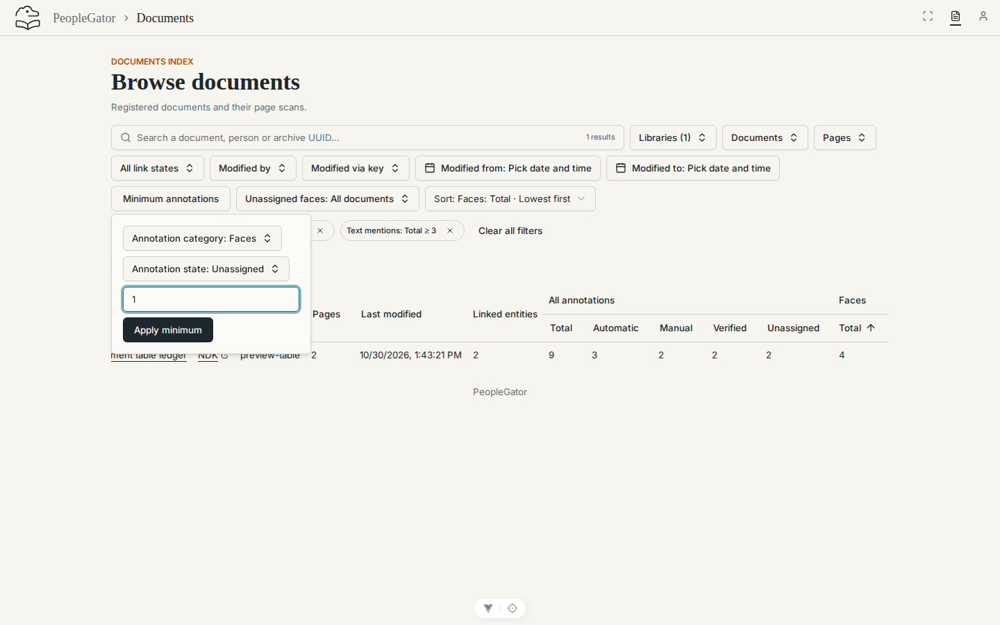
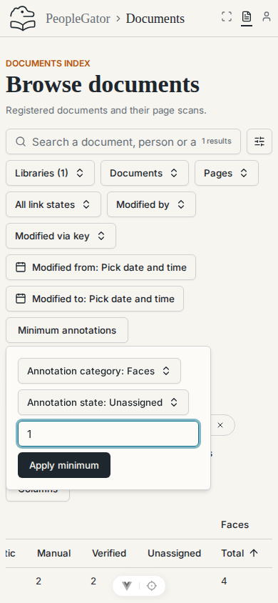
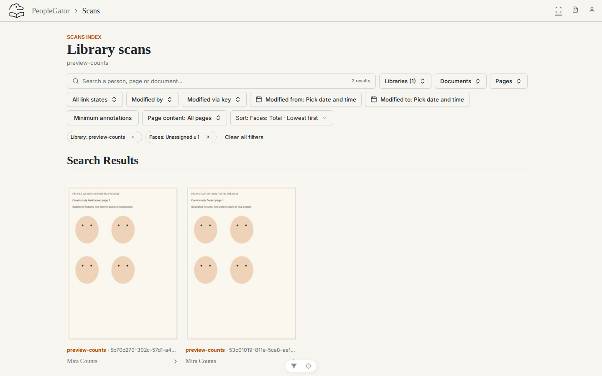
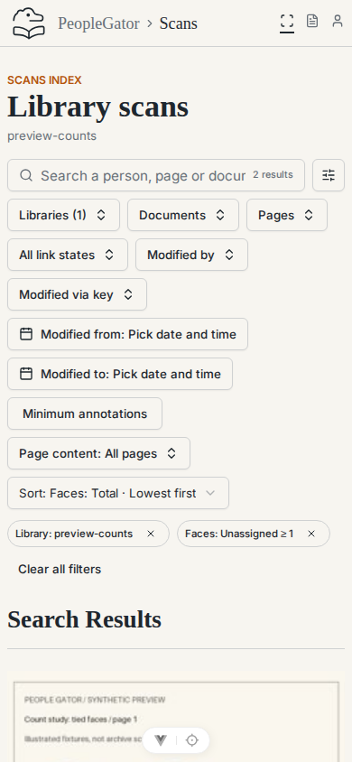
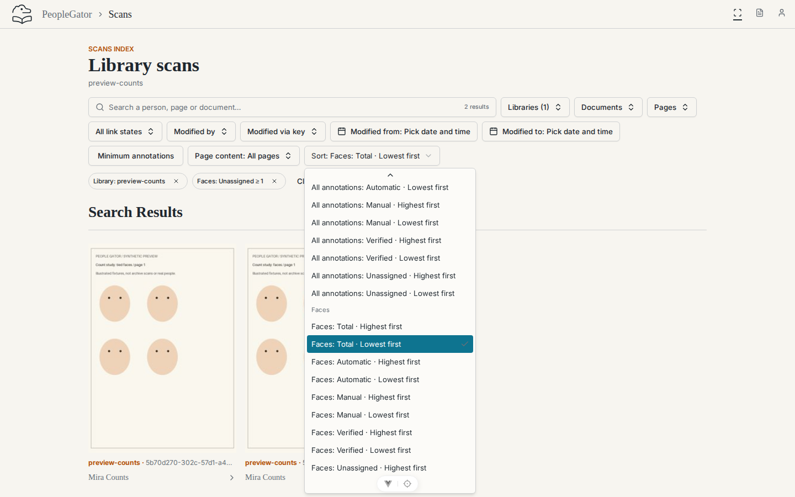
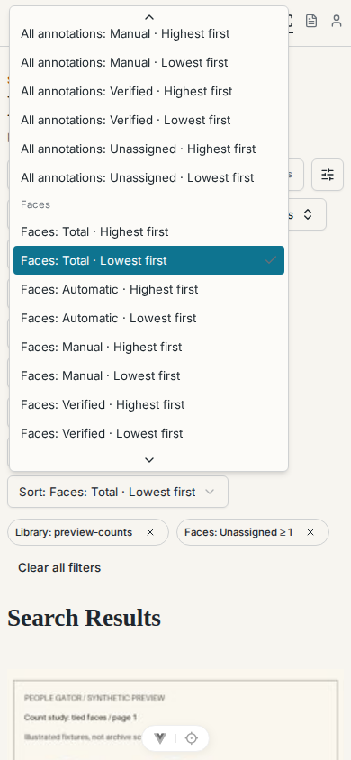
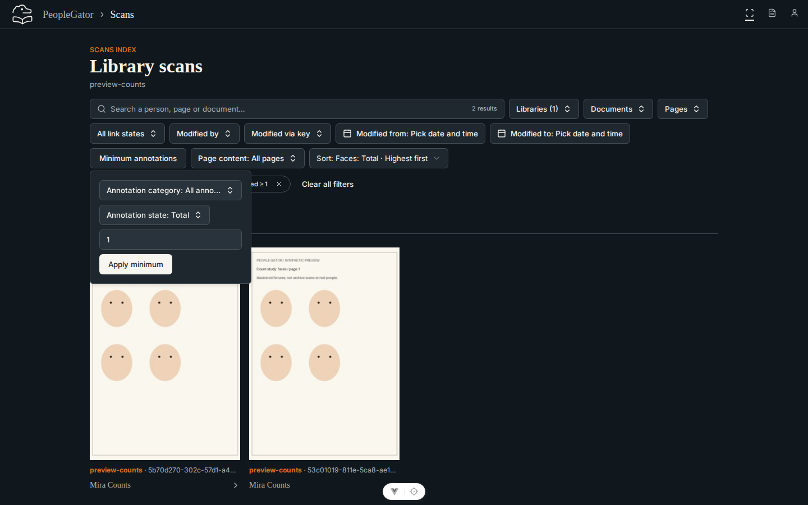
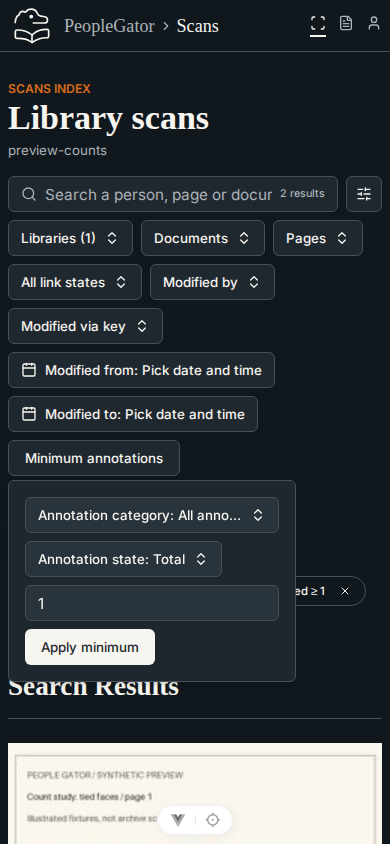

# Annotation count controls (#78)

Captured from the running application using a fresh migrated PostgreSQL database
and a separate local storage directory, seeded twice with the synthetic fixtures.
The rendered application is revision `6b3b1b2`; subsequent commits add validation
and evidence. Desktop captures use 1440 × 900 CSS pixels; mobile captures use
390 × 844. `browser-checks.json` records the browser assertions.

## Documents: combined minima and verified-count ordering

| Desktop — 1440 × 900 | Mobile — 390 × 844 |
| --- | --- |
|  |  |

[Collapsed mobile filters retain the count tags](documents-collapsed-mobile.png).

## Minimum editor: category, state and whole-number input

| Desktop — 1440 × 900 | Mobile — 390 × 844 |
| --- | --- |
|  |  |

## Scan search: unassigned-face minimum and numeric ordering

| Desktop — 1440 × 900 | Mobile — 390 × 844 |
| --- | --- |
|  |  |

## Grouped count sort selector

| Desktop — 1440 × 900 | Mobile — 390 × 844 |
| --- | --- |
|  |  |

## Dark theme: scan minimum editor

| Desktop — 1440 × 900 | Mobile — 390 × 844 |
| --- | --- |
|  |  |

## Checks

The browser assertions exercise combined minima, individually removable tags,
header/selector synchronization, visibility preserving the query, fractional
input rejection, Back/Forward, clear-search versus clear-all, reload, keyboard
Select/Escape focus recovery, mobile collapsed/expanded filters, light/dark
controls, contained horizontal table scrolling and absence of console errors.

Authenticated HTTP checks cover document/page membership, numeric ordering,
UUID ties, rejected fractions and the maximum supported integer. Unit tests
exercise cache invalidation for count-filtered browse/search queries after
review and count forwarding/resetting through page browsing and search.

The PostgreSQL matrix tests all fifteen keys in both directions, minima
(including zero and the maximum supported integer), ties, cursor traversal,
search parity, cross-library isolation, direct/page scope, combined evidence,
mutations, preservation and interrupted-checkpoint recovery. A 1,000-face
synthetic plan check executed one grouped count projection in about 1.4 ms on
this local run; the result and batch summaries used six queries without a
requested total. Query count stays constant as response batches grow.

Run `capture.cjs` against the documented synthetic local instance, with a local
Playwright installation available through `PLAYWRIGHT_MODULE`. `CAPTURE_URL`
defaults to `http://localhost:5178`; the script accepts only localhost addresses.
Do not point screenshot checks at retained collection data.
