# PR capture evidence

[Český a anglický návod / Czech and English tutorial](../../../TUTORIAL.md)

## Capture details

- Date: 2026-10-21.
- Application revision: `3302dadaadf6cca7c8db4da5ed113ffb712dfca1`. Subsequent changes in this PR affect documentation and screenshots only.
- Actual Chromium captures of the production build (`npm run build` followed by `npm run preview`), without image editing, mockups or application style overrides.
- Desktop: **1440 × 900** CSS pixels. Mobile: **390 × 844** CSS pixels. Device scale factor: 1; light theme; English UI; `en-GB` locale; `Europe/Prague` timezone.
- Fresh isolated PostgreSQL 16/pgvector database and disposable local storage, initialized with the real migration → seed → seed → schema-check CLI sequence.
- Synthetic examples only: Příběhy archivářů, Viewport focus practice, Irena Evidence, Ada Novak, A. Novak and Ada Review. The live `svkhk`/`knav` collections were neither captured nor modified.
- Both tutorial languages use the desktop captures of the same English UI. Paired desktop/mobile captures remain here as PR evidence.

## Reproduce the examples

Follow the repository's [local development guide](../../DEVELOPMENT.md) with a fresh disposable store. Use the generated seed report for profile/page links; entity and annotation UUIDs belong to that database.

1. In Documents, search for **Příběhy archivářů**, select **preview-mzk** in Libraries, remove its active tag, then try Clear all filters. Open the document heading to view its pages.
2. Search People for **Ada Novak**. Open **Irena Evidence** to inspect Automatic, Manual and Verified faces. Select two unverified faces and use Verify selected.
3. Open **Viewport focus practice** to inspect the scan and Ada's OCR lines. Select a linked face, reassign it to **Lenka Vesela**, then correct it back to **Ada Novak**. Verify it, unlink it, then link it again through the name-search candidate.
4. Open **Ada Review → Mentions** and verify the unverified mention.
5. Open **Ada Novak → Discover**, inspect face suggestions and assign the high-scoring unassigned face. Select **A. Novak** under Other similar people, check **Merge into Ada Novak**, and merge. Inspect the surviving profile's Faces afterwards.

Use disposable data for these mutations. Repeating the seed intentionally preserves review edits and merge tombstones; use a new disposable store to reproduce the original before states.

## Checked results

- Document/person text search and document → page-list navigation succeeded.
- At 390px, filters started collapsed. Enter on the focused sliders button expanded them with `aria-expanded=true`; collapsing retained the selection.
- Individual filter removal and Clear all filters updated the URL and retained the search text.
- Face reassignment to Lenka and correction to Ada produced Manual links. Individual verification produced Verified with actor/time; unlink kept the detection and removed its identity; linking again produced Manual.
- Two selected Irena faces were verified together; both responses included the verification actor/time, the selection cleared and the UI reported **2 faces verified.**
- Text-mention verification produced Verified.
- Clicking the scan overlay selected the unassigned face. **New → Save** created **Tutorial Example** and linked the face as Manual. **Unassign selected** on that profile removed its identity link while retaining the detection.
- Discover assigned the selected unassigned face to Ada.
- Merge retained Ada, moved A. Novak's face to Ada as Manual, and removed A. Novak's source identity (subsequent lookup returned 404). This source candidate has no text mentions; mention-moving semantics were checked against the repository implementation, rather than claimed as a browser-tested merge of mentions.
- Mutation results were checked through authenticated API reads/responses after the UI action completed. No uncaught JavaScript errors or page-level horizontal overflow occurred during the main captured journeys.
- Mutation clicks were exercised at desktop size; each state was also rendered and captured at mobile size. Mobile-specific filter keyboard interaction was exercised separately. These images do not by themselves prove all touch/keyboard interactions.
- Frontend type checking and production build passed. The build emitted the existing large-chunk advisory. No application runtime code or seed fixtures changed, so backend unit/integration suites were not rerun for this documentation change.

## Images

Click an image to inspect its full-size version.

### Hledání dokumentu / Document search

| Desktop — 1440 × 900 CSS px | Mobile — 390 × 844 CSS px |
| --- | --- |
|  | 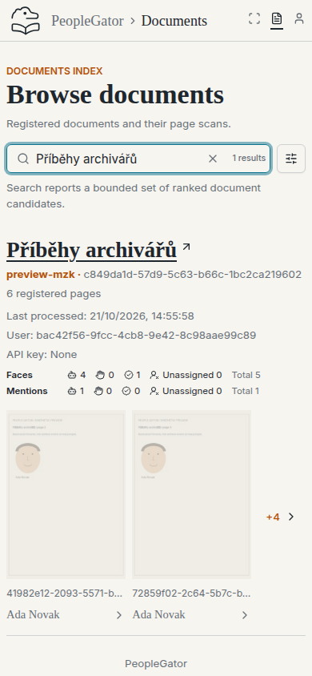 |

### Aktivní filtry a sbalené nastavení na mobilu / Active filters and collapsed mobile settings

| Desktop — 1440 × 900 CSS px | Mobile — 390 × 844 CSS px |
| --- | --- |
|  | 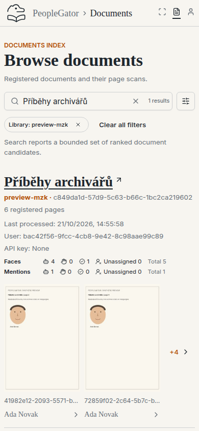 |

### Stránky dokumentu / Document pages

| Desktop — 1440 × 900 CSS px | Mobile — 390 × 844 CSS px |
| --- | --- |
|  | 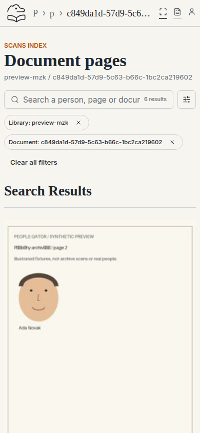 |

### Hledání osoby / Person search

| Desktop — 1440 × 900 CSS px | Mobile — 390 × 844 CSS px |
| --- | --- |
|  | 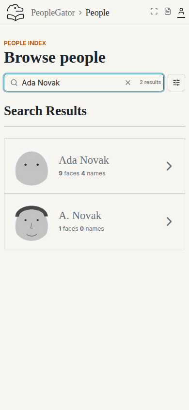 |

### Stavy přiřazení / Assignment states

| Desktop — 1440 × 900 CSS px | Mobile — 390 × 844 CSS px |
| --- | --- |
|  | 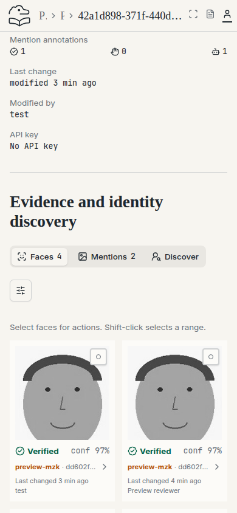 |

### Výběr dvou tváří k ověření / Select two faces for verification

| Desktop — 1440 × 900 CSS px | Mobile — 390 × 844 CSS px |
| --- | --- |
|  | 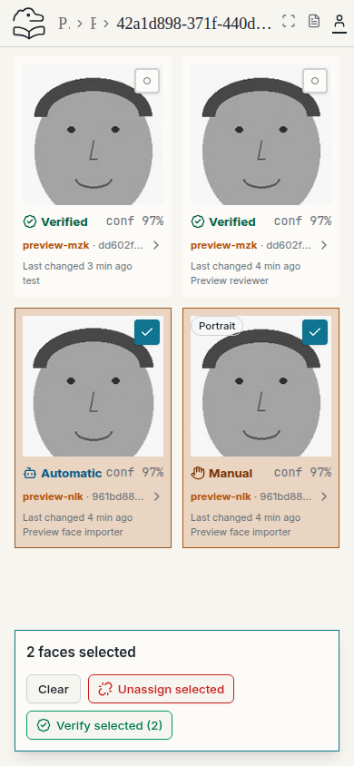 |

### Výsledek hromadného ověření / Batch verification result

| Desktop — 1440 × 900 CSS px | Mobile — 390 × 844 CSS px |
| --- | --- |
| 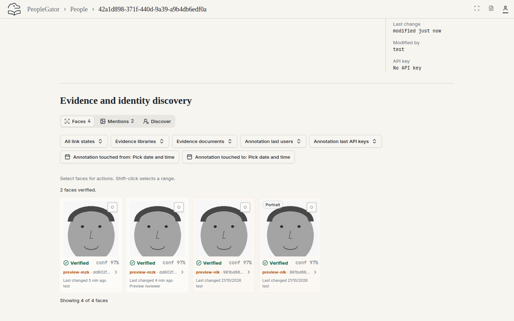 | 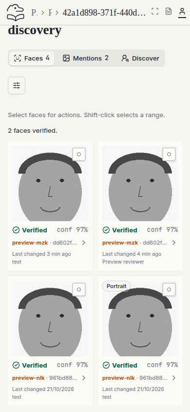 |

### Sken a textové zmínky / Scan and text mentions

| Desktop — 1440 × 900 CSS px | Mobile — 390 × 844 CSS px |
| --- | --- |
|  | 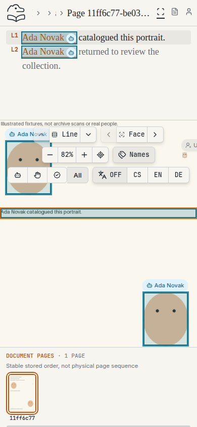 |

### Ruční přeřazení / Manual reassignment

| Desktop — 1440 × 900 CSS px | Mobile — 390 × 844 CSS px |
| --- | --- |
|  | 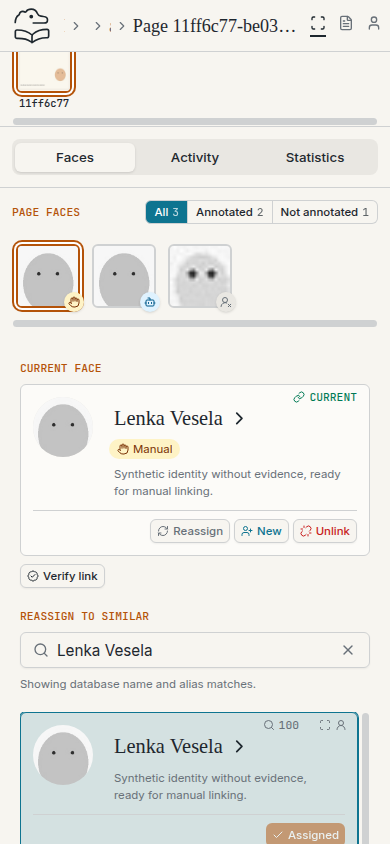 |

### Přiřazení před ověřením / Assignment before verification

| Desktop — 1440 × 900 CSS px | Mobile — 390 × 844 CSS px |
| --- | --- |
| 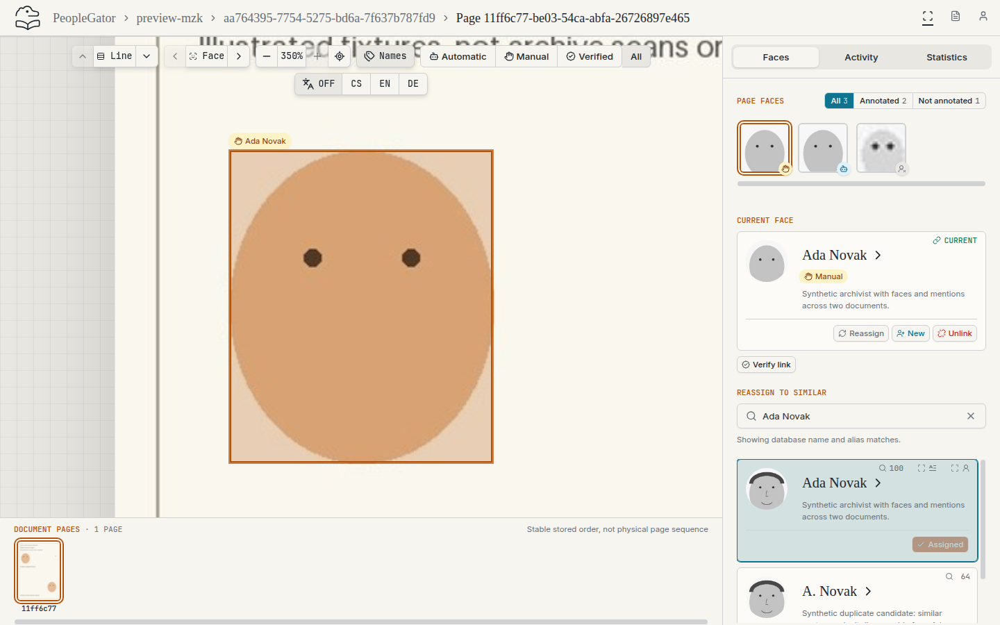 | 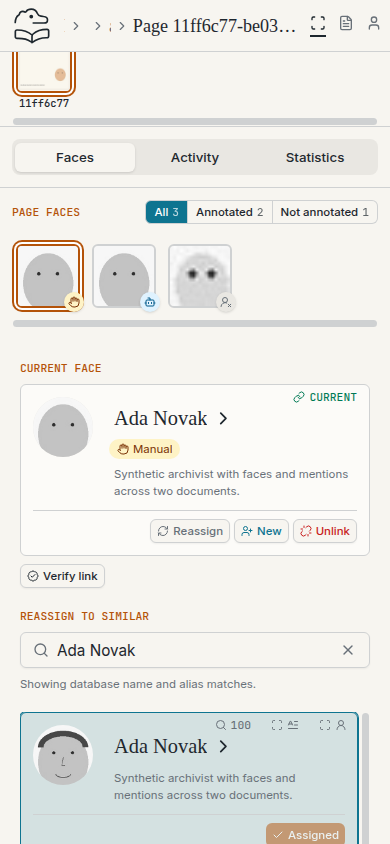 |

### Ověřené přiřazení / Verified assignment

| Desktop — 1440 × 900 CSS px | Mobile — 390 × 844 CSS px |
| --- | --- |
|  | 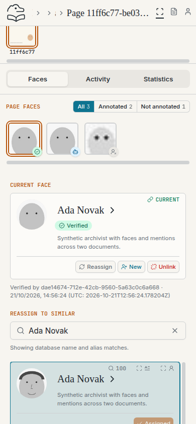 |

### Zrušené přiřazení / Unassigned face

| Desktop — 1440 × 900 CSS px | Mobile — 390 × 844 CSS px |
| --- | --- |
|  | 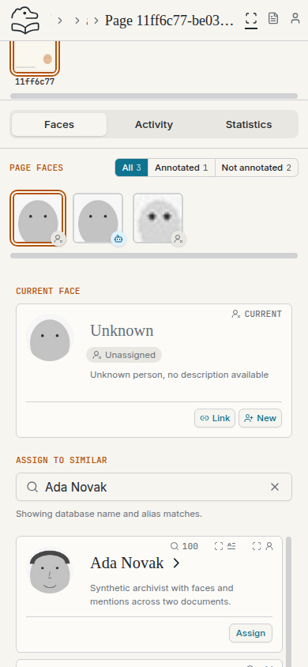 |

### Výběr osoby k přiřazení / Choose an assignment candidate

| Desktop — 1440 × 900 CSS px | Mobile — 390 × 844 CSS px |
| --- | --- |
|  | 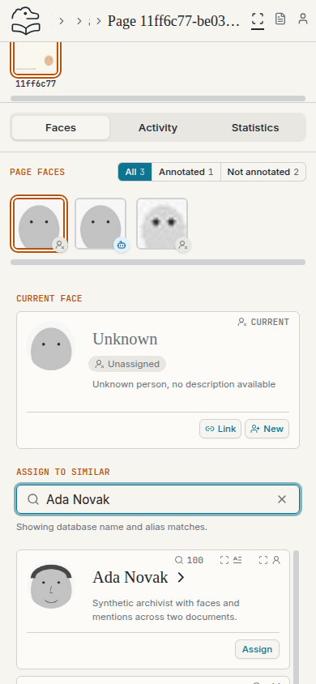 |

### Ověření textové zmínky / Verify a text mention

| Desktop — 1440 × 900 CSS px | Mobile — 390 × 844 CSS px |
| --- | --- |
|  | 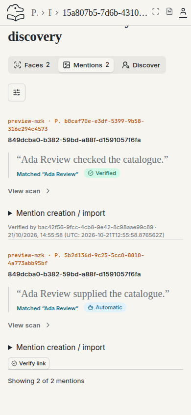 |

### Návrhy podobných tváří / Similar-face suggestions

| Desktop — 1440 × 900 CSS px | Mobile — 390 × 844 CSS px |
| --- | --- |
| 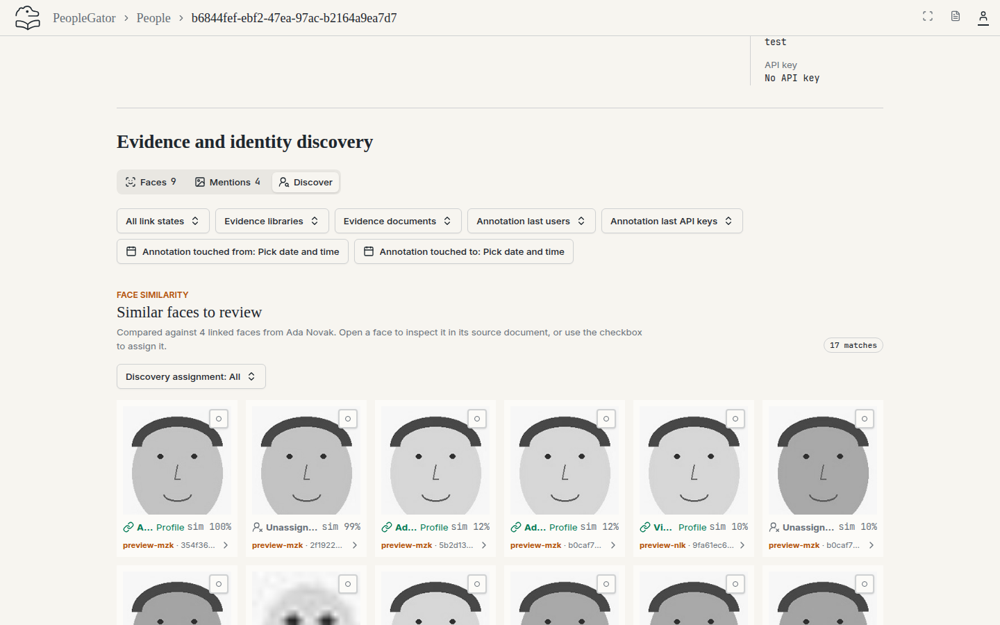 | 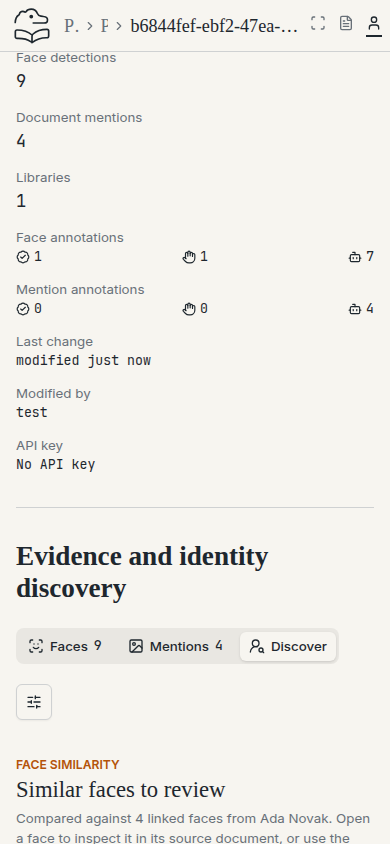 |

### Přiřazení podobné tváře / Assign a similar face

| Desktop — 1440 × 900 CSS px | Mobile — 390 × 844 CSS px |
| --- | --- |
|  | 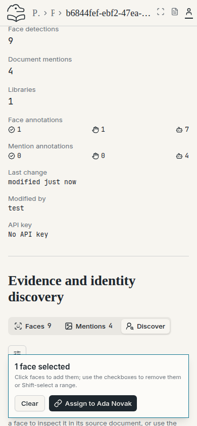 |

### Výběr duplicity a cíle / Select a duplicate and destination

| Desktop — 1440 × 900 CSS px | Mobile — 390 × 844 CSS px |
| --- | --- |
|  | 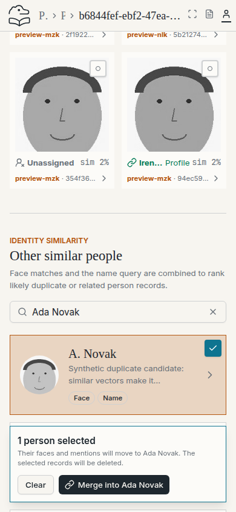 |

### Zachovaný profil po sloučení / Retained profile after merge

| Desktop — 1440 × 900 CSS px | Mobile — 390 × 844 CSS px |
| --- | --- |
|  | 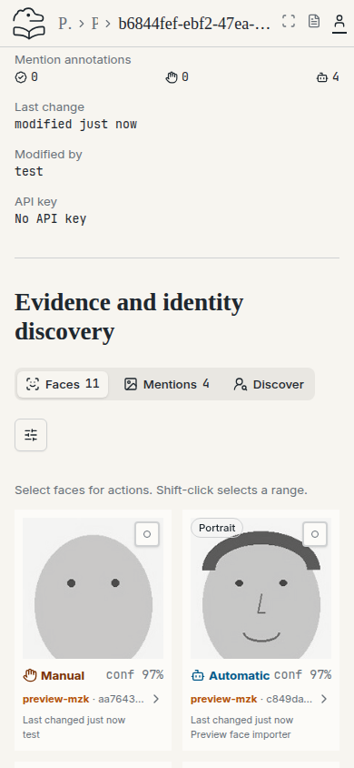 |

### Nový profil / New profile

| Desktop — 1440 × 900 CSS px | Mobile — 390 × 844 CSS px |
| --- | --- |
|  | 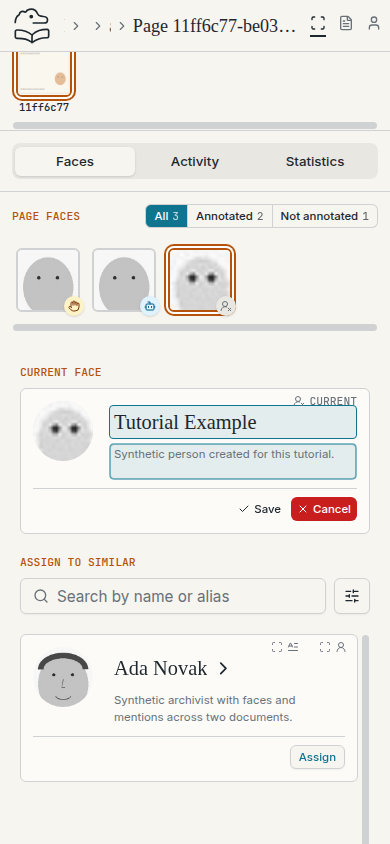 |

### Vytvořený profil / Created profile

| Desktop — 1440 × 900 CSS px | Mobile — 390 × 844 CSS px |
| --- | --- |
|  | 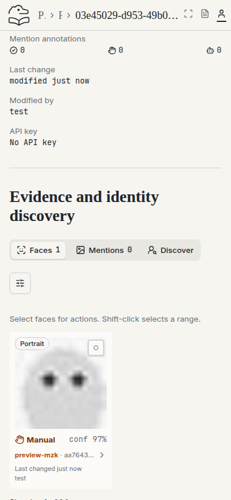 |

### Rozbalené filtry / Expanded filters

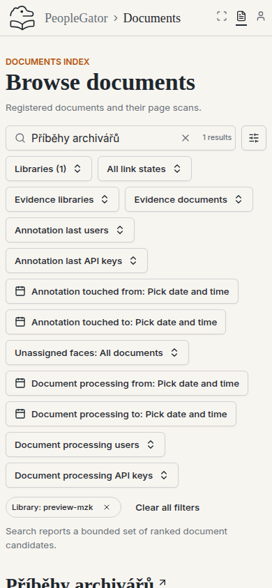

## Navigation orientation

These are unedited desktop Chromium captures of the same production application revision. The opening screen uses a 1440 × 900 CSS-pixel viewport; the labelled navigation uses 1600 × 900. Detail images are direct browser screenshot clips, not redrawn controls. Device scale factor: 1.

The navigation journey passed: root → Browse documents; top People → person search; top Documents → document search; document title → Document pages; top Scans retains the active document scope; document breadcrumb → its page list; profile Faces/Mentions/Discover tabs change the visible section; People breadcrumb → person search; logo → Documents. No uncaught page errors occurred.

### Úvodní obrazovka / Opening screen

### Ikony hlavní navigace / Main navigation icons

### Popisky hlavní navigace / Main navigation labels

### Cesta nad skenem / Scan breadcrumb

### Záložky profilu osoby / Person profile tabs

### Cesta v profilu osoby / Person profile breadcrumb

### New on the selected face card

The 1440 × 900 viewport capture selects an unassigned face, then captures the actual Current face panel. Clicking New exposes the name/description fields and Save/Cancel. Cancel was exercised and returned to the unchanged card without creating a profile.
