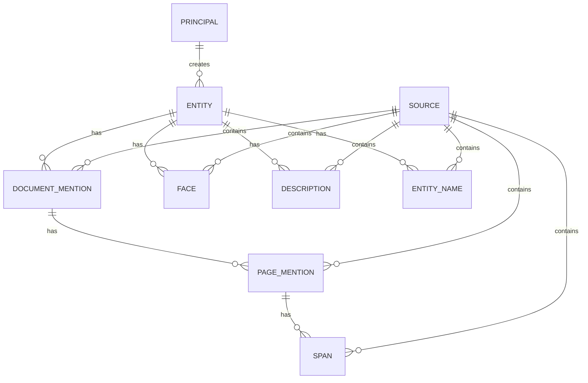

# People Gator API product spec

This document mirrors the schema and API model currently implemented in
`src/people_gator_api/services/vector_service/schema.py`.

## 0. Core functionality

People Gator stores person-centric evidence and supports:

- creating and browsing entities,
- attaching document-level and page-level mention evidence to entities,
- attaching face, description, and entity-name evidence to entities,
- vector search over annotation collections,
- entity ranking by aggregating annotation hits across enabled modalities.

There are two principal categories:

- **human users** who browse, review, and curate entities,
- **model agents** that create annotations and link them to entities.

## 1. Collection model

### 1.1 Non-annotation collections

These collections store canonical records and **do not have vector configs**:

- `Principal`
- `Source`
- `Entity`

### 1.2 Annotation collections

These collections store search evidence and carry named vectors:

- `PageMention`
- `DocumentMention`
- `Span`
- `Face`
- `Description`
- `EntityName`

## 2. Data architecture

### 2.0 IDs

All primary keys are UUIDs.

### 2.1 Principal `PRINCIPAL`

Represents a human user or model agent.

| Field | Type | Description |
| --- | --- | --- |
| `principal_id` | UUID | Primary key. |
| `principal_type` | STRING | `user`, `service_agent`, or `model_agent`. |
| `display_name` | STRING | Human-readable label. |
| `is_active` | BOOL | Active flag. |
| `external_subject` | STRING \| NULL | OIDC subject for user principals. |
| `external_issuer` | STRING \| NULL | OIDC issuer for user principals. |
| `email` | STRING \| NULL | User email. |
| `annotation_type` | STRING \| NULL | Annotation type handled by a model agent. |
| `role` | STRING \| NULL | Model-agent role prefix. |
| `model_slug` | STRING \| NULL | Model-agent slug. |
| `model_version` | STRING \| NULL | Model version. |
| `registry_source` | STRING \| NULL | Model registry source. |
| `registry_uri` | STRING \| NULL | Model registry URI. |

### 2.2 Source `SOURCE`

Represents a source document, page, or external authority record.

| Field | Type | Description |
| --- | --- | --- |
| `source_id` | UUID | Primary key. |
| `source_type` | STRING | Source kind. |
| `uri` | STRING | Stable source URI. |
| `metadata` | OBJECT | Strict source metadata payload. |

### 2.3 Entity `ENTITY`

Canonical person record.

| Field | Type | Description |
| --- | --- | --- |
| `entity_id` | UUID | Primary key. |
| `principal_id` | UUID | Creating principal. |
| `entity_type` | STRING \| NULL | Entity discriminator. |
| `name` | STRING \| NULL | Best aggregated entity name. |
| `description` | STRING \| NULL | Best aggregated entity description. |
| `wikidata_id` | STRING \| NULL | Aggregated Wikidata identifier. |
| `nlcr_authority_id` | STRING \| NULL | Aggregated NLCR authority identifier. |

### 2.4 Document Mention `DOCUMENT_MENTION`

Document-level aggregation linked directly to an entity.

| Field | Type | Description |
| --- | --- | --- |
| `document_mention_id` | UUID | Primary key. |
| `name` | STRING | Aggregated document-level name. |
| `information` | STRING | Aggregated document-level information. |
| `model_agent_id` | UUID | Producing model agent. |
| `source_id` | UUID | Source document. |
| `entity_id` | UUID | Linked entity. |

Named vectors:

- `name:harrier-oss-v1-0.6b`
- `fulltext:harrier-oss-v1-0.6b`

### 2.5 Page Mention `PAGE_MENTION`

Page-level aggregation linked to one document mention.

| Field | Type | Description |
| --- | --- | --- |
| `page_mention_id` | UUID | Primary key. |
| `name` | STRING | Page-level name hypothesis. |
| `information` | STRING | Page-level contextual information. |
| `confidence` | NUMBER | Extraction confidence. |
| `document_mention_id` | UUID | Owning document mention. |
| `source_id` | UUID | Source page. |
| `model_agent_id` | UUID | Extracting model agent. |

Named vectors:

- `name:harrier-oss-v1-0.6b`
- `fulltext:harrier-oss-v1-0.6b`

### 2.6 Span `SPAN`

Text span evidence attached to one page mention.

| Field | Type | Description |
| --- | --- | --- |
| `span_id` | UUID | Primary key. |
| `text` | STRING | Span text. |
| `polygons` | OBJECT_ARRAY | Ordered polygons in page space. |
| `page_mention_id` | UUID | Owning page mention. |
| `source_id` | UUID | Source page. |
| `entity_id` | UUID | Linked entity. |

Named vector:

- `name:harrier-oss-v1-0.6b`

### 2.7 Face `FACE`

Face detection evidence linked to an entity.

| Field | Type | Description |
| --- | --- | --- |
| `detection_id` | UUID | Primary key. |
| `bounding_box` | OBJECT | Bounding box coordinates. |
| `keypoints` | OBJECT_ARRAY | Ordered facial keypoints. |
| `confidence` | NUMBER | Detection confidence. |
| `source_id` | UUID | Source page or image. |
| `model_agent_id` | UUID | Detecting model agent. |
| `entity_id` | UUID | Linked entity. |

Named vector:

- `face:vit_small_patch8_gap_112.cosface_ms1mv3`

### 2.8 Description `DESCRIPTION`

Free-text descriptive evidence linked to an entity.

| Field | Type | Description |
| --- | --- | --- |
| `description_id` | UUID | Primary key. |
| `text` | STRING | Description text. |
| `language` | STRING | Language code. |
| `source_id` | UUID | Source record. |
| `entity_id` | UUID | Linked entity. |

Named vector:

- `fulltext:harrier-oss-v1-0.6b`

### 2.9 Entity Name `ENTITY_NAME`

Name evidence linked to an entity.

| Field | Type | Description |
| --- | --- | --- |
| `entity_name_id` | UUID | Primary key. |
| `name` | STRING | Name value. |
| `source_id` | UUID | Source record. |
| `entity_id` | UUID | Linked entity. |

Named vector:

- `name:harrier-oss-v1-0.6b`

## 3. Search behavior

Search operates over annotation collections only.

- Non-annotation collections are not vectorized.
- Query vectors may come from:
  - explicit annotation IDs,
  - a reference entity, by collecting vectors from that entity's linked annotations.
- Entity ranking is computed by aggregating annotation hits per modality.
- Supported per-modality entity aggregation modes are:
  - `best_annotation`
  - `average_annotation`
- Final ranking is a weighted combination of normalized modality scores.
- Annotation-level results can be returned alongside entity results.

The default configured modalities are:

- `face` over `Face`,
- `entity_name` over `EntityName`,
- `document_mention` over `DocumentMention`,
- `description` over `Description`.

## 4. Relationship summary

- `Principal` creates `Entity`.
- `Source` contains `DocumentMention`, `PageMention`, `Span`, `Face`, `Description`, and `EntityName`.
- `DocumentMention` belongs to one `Entity`.
- `PageMention` belongs to one `DocumentMention`.
- `Span` belongs to one `PageMention` and one `Entity`.
- `Face`, `Description`, and `EntityName` each belong to one `Entity`.

## 5. Entity relationship diagram

