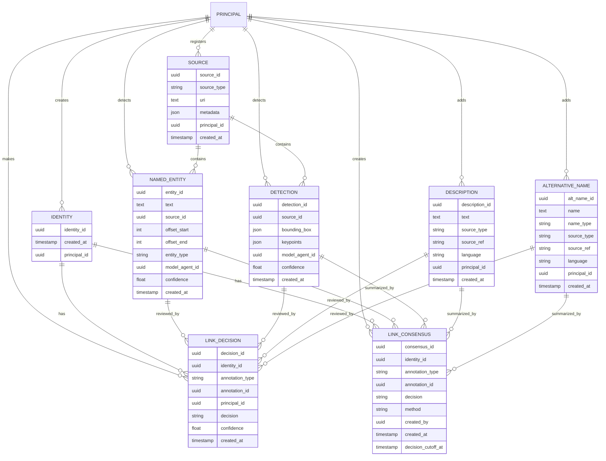

# A product for PeopleGator API: Simpler overview of basic functionalities

Core concept is to define bare minimum system specs that define just the datamodel for annotations. We have the following requirements:
- Track person identities as the central entity
- Store named entity mentions found in text with location and model metadata
- Store face detections with keypoints and detection metadata
- Store descriptions from Wikidata or authority records
- Store alternative names from Wikidata or authorities
- Support 1-to-N relationships between identities and annotations
- Support N-to-N relationships for identity variants (future: identity relationship mechanism)

## 1. Introduction

This specification defines a simplified data model for person identification and annotation tracking. The system centers around **Identity** records that represent distinct persons, with all other annotation types linking to identities through flexible relationships.

### 1.1 Core Principles

1. **Identity-Centric Design** — All annotations (names, faces, descriptions, alternatives) relate to one or more identities.
2. **Flexible Relationships** — Support both 1-to-N (single identity) and N-to-N (multiple identity variants) mappings.
3. **Immutable Annotations** — Once created, annotation records are not modified; new versions are created for updates.
4. **Source Attribution** — Every annotation tracks its origin (model, authority, manual curation).

### 1.2 The API provides an interface for:

1. Create and manage person **Identities**
2. Add **Named Entities** (text mentions with locations)
3. Add **Detections** (face detections with keypoints)
4. Add **Descriptions** (biographical text from authorities)
5. Add **Alternative Names** (variant names from authorities)
6. Link annotations to identities (1-to-N or N-to-N)
7. Search identities by associated annotations

## 2. Core Data Architecture

### 2.0 IDs

IDs are globally unique identifiers using UUIDv6 format for time-ordered uniqueness.

- `clk_seq_hi_res` (8 bits): High 8 bits of per-node incrementing 16-bit sequence counter
- `clk_seq_low` (8 bits): Low 8 bits of per-node incrementing 16-bit sequence counter  
- `node` (48 bits): Unique node identifier, random value initialized at startup

### 2.1 Identity `IDENTITY`

> The central entity representing a distinct person. All annotations link to one or more identities.

| Field Name | Type | Description |
|------------|------|-------------|
| `identity_id` | UUID | Unique [UUIDv6](#20-ids) time-driven identifier for this identity. |
| `created_at` | TIMESTAMP | Creation timestamp of this identity record. |
| `principal_id` | UUID | [UUIDv6](#20-ids) of the [PRINCIPAL](#28-principal-principal) who created this identity. |

Constraints:
- `identity_id` is unique across all identities.

Indices:
- `identity_id`
- `created_at`
- `principal_id`

### 2.2 Named Entity `NAMED_ENTITY`

> A named entity mention found in text, including location information and model metadata.

| Field Name | Type | Description |
|------------|------|-------------|
| `entity_id` | UUID | Unique [UUIDv6](#20-ids) time-driven identifier for this entity. |
| `text` | TEXT | The actual named entity text as found in the source. |
| `source_id` | UUID | [UUIDv6](#20-ids) of the [SOURCE](#27-source-source) where this entity was found. |
| `offset_start` | INTEGER | Character offset where the entity starts in the source text. |
| `offset_end` | INTEGER | Character offset where the entity ends in the source text. |
| `entity_type` | STRING | Type of entity (e.g., PERSON, ORGANIZATION, LOCATION). |
| `model_agent_id` | UUID | [UUIDv6](#20-ids) of the [MODEL_AGENT](#313-model-agent-model-agent) that detected this entity. |
| `confidence` | FLOAT | Confidence score of the entity detection (0.0 to 1.0). |
| `created_at` | TIMESTAMP | Creation timestamp of this entity record. |

Constraints:
- `entity_id` is unique across all named entities.

Indices:
- `entity_id`
- `source_id`
- `entity_type`
- `model_agent_id`
- `text` (for exact match lookups)

### 2.3 Detection `DETECTION`

> A face detection with bounding box, keypoints, and detection metadata.

| Field Name | Type | Description |
|------------|------|-------------|
| `detection_id` | UUID | Unique [UUIDv6](#20-ids) time-driven identifier for this detection. |
| `source_id` | UUID | [UUIDv6](#20-ids) of the [SOURCE](#27-source-source) (e.g., image) where face was detected. |
| `bounding_box` | JSON | Bounding box coordinates: `{"x": int, "y": int, "width": int, "height": int}`. |
| `keypoints` | JSON | Array of facial keypoints: `[{"type": "left_eye", "x": float, "y": float}, ...]`. |
| `model_agent_id` | UUID | [UUIDv6](#20-ids) of the [MODEL_AGENT](#313-model-agent-model-agent) that performed detection. |
| `confidence` | FLOAT | Confidence score of the detection (0.0 to 1.0). |
| `created_at` | TIMESTAMP | Creation timestamp of this detection record. |

Constraints:
- `detection_id` is unique across all detections.

Indices:
- `detection_id`
- `source_id`
- `model_agent_id`

### 2.4 Description `DESCRIPTION`

> Biographical or descriptive text from Wikidata, authorities, or other sources.

| Field Name | Type | Description |
|------------|------|-------------|
| `description_id` | UUID | Unique [UUIDv6](#20-ids) time-driven identifier for this description. |
| `text` | TEXT | The descriptive text content. |
| `source_type` | STRING | Type of source (e.g., WIKIDATA, AUTHORITY, MANUAL). |
| `source_ref` | STRING | Reference to external source (e.g., Wikidata Q-ID, authority ID). |
| `language` | STRING | ISO 639-1 language code of the description (e.g., "cs", "en"). |
| `principal_id` | UUID | [UUIDv6](#20-ids) of the [PRINCIPAL](#28-principal-principal) who added this description. |
| `created_at` | TIMESTAMP | Creation timestamp of this description record. |

Constraints:
- `description_id` is unique across all descriptions.

Indices:
- `description_id`
- `source_type`
- `source_ref`
- `language`
- `principal_id`

### 2.5 Alternative Name `ALTERNATIVE_NAME`

> Variant names for a person from Wikidata, authorities, or other sources.

| Field Name | Type | Description |
|------------|------|-------------|
| `alt_name_id` | UUID | Unique [UUIDv6](#20-ids) time-driven identifier for this alternative name. |
| `name` | TEXT | The alternative name variant. |
| `name_type` | STRING | Type of name variant (e.g., BIRTH_NAME, PSEUDONYM, TRANSLITERATION, ABBREVIATION). |
| `source_type` | STRING | Type of source (e.g., WIKIDATA, AUTHORITY, MANUAL). |
| `source_ref` | STRING | Reference to external source (e.g., Wikidata Q-ID, authority ID). |
| `language` | STRING | ISO 639-1 language code of the name (e.g., "cs", "en"). |
| `principal_id` | UUID | [UUIDv6](#20-ids) of the [PRINCIPAL](#28-principal-principal) who added this name. |
| `created_at` | TIMESTAMP | Creation timestamp of this name record. |

Constraints:
- `alt_name_id` is unique across all alternative names.

Indices:
- `alt_name_id`
- `name` (for exact and fuzzy match lookups)
- `name_type`
- `source_type`
- `source_ref`
- `language`
- `principal_id`

## 2.6 Multi-Annotator Identity Annotation and Consensus

The system supports multi-annotator annotation of evidence items belonging to an identity. Annotators do not directly modify the current identity state. Instead, they create immutable annotation decisions. A separate explicit consensus snapshot is then created from these decisions and attached to the identity as its current state.

This design preserves individual annotator decisions, supports multiple consensus methods, and allows annotators to inspect whether their decisions were included in, contradicted by, or ignored by the current consensus.

### 2.6.1 Annotation Decision `LINK_DECISION`
> An immutable decision by one annotator about whether a specific item belongs to an identity.

| Field Name | Type | Description |
|------------|------|-------------|
| `decision_id` | UUID | Unique UUIDv6 identifier for this decision. |
| `identity_id` | UUID | UUIDv6 of the IDENTITY being annotated. |
| `annotation_type` | ENUM | Type of annotation being judged: `named_entity`, `detection`, `description`, `alternative_name`. |
| `annotation_id` | UUID | UUIDv6 of the specific annotation record. |
| `principal_id` | UUID | UUIDv6 of the annotator who created this decision. |
| `decision` | ENUM | One of: `include`, `exclude`, `uncertain`, `garbage`. |
| `confidence` | FLOAT or NULL | Optional confidence score assigned by the annotator. |
| `created_at` | TIMESTAMP | Creation timestamp of this decision. |

Constraints:

- `decision_id` is unique.
- `identity_id` must reference an existing IDENTITY.
- `principal_id` must reference an existing PRINCIPAL.
- `annotation_type` must refer to a supported annotation table.
- Multiple annotators may create decisions for the same (identity_id, annotation_type, annotation_id).
- The same annotator may create multiple decisions over time; the latest decision is used when generating a new consensus.

Indices:

- `decision_id`
- `identity_id`
- `principal_id`
- (`identity_id`, `annotation_type`, `annotation_id`)
- (`identity_id`, `annotation_type`, `annotation_id`, `principal_id`)
- `created_at`

### 2.6.2 Consensus Method Enum
> Consensus creation is controlled by a simple enum, not a separate strategy table.

Allowed values:

| Value | Meaning |
|-------|---------|
| `union` | Include an item if at least one annotator included it. |
| `majority` | Include an item if include decisions are stronger than exclude decisions. |
| `reviewer` | Include or exclude items according to a reviewer/adjudicator decision. |

The exact implementation of each method is application logic. The method used for a consensus snapshot is stored directly on the consensus record.

### 2.6.3 Identity Consensus `LINK_CONSENSUS`
> An explicitly created consensus for single evidence annotation.

| Field Name | Type | Description |
|------------|------|-------------|
| `consensus_id` | UUID | Unique UUIDv6 identifier for this consensus snapshot. |
| `identity_id` | UUID | UUIDv6 of the IDENTITY this consensus belongs to. |
| `annotation_type` | ENUM | Type of annotation being judged: `named_entity`, `detection`, `description`, `alternative_name`. |
| `annotation_id` | UUID | UUIDv6 of the specific annotation record. |
| `decision` | ENUM | One of: `include`, `exclude`, `uncertain`, `garbage`. |
| `method` | ENUM | Consensus method used: `union`, `majority`, or `reviewer`. |
| `created_by` | UUID | UUIDv6 of the PRINCIPAL who created this consensus snapshot. |
| `created_at` | TIMESTAMP | Creation timestamp of this consensus snapshot. |
| `decision_cutoff_at` | TIMESTAMP or NULL | Optional cutoff time; only decisions created at or before this time are considered. |

Constraints:

- `consensus_id` is unique.
- `identity_id` must reference an existing IDENTITY.
- `annotation_id` should be only one consensus per evidence item. This avoids assigning multiple conflicting consensus decisions to the same evidence item. Thus it is unique.

Indices:
- `consensus_id`
- `identity_id`
- `method`
- `created_by`
- `created_at`

### 2.7 Source `SOURCE`

> Metadata about the source document or media where annotations originate.

| Field Name | Type | Description |
|------------|------|-------------|
| `source_id` | UUID | Unique [UUIDv6](#20-ids) time-driven identifier. |
| `source_type` | STRING | Type of source (e.g., BOOK_PAGE, IMAGE, WEBPAGE, AUTHORITY_RECORD). |
| `uri` | TEXT | Uniform resource identifier for the source (URL, file path, etc.). |
| `metadata` | JSON | Source-specific metadata (e.g., page number, image dimensions, publication info). |
| `principal_id` | UUID | [UUIDv6](#20-ids) of the [PRINCIPAL](#28-principal-principal) who registered this source. |
| `created_at` | TIMESTAMP | Creation timestamp of this source record. |

Constraints:
- `source_id` is unique across all sources.
- Unique constraint on (`source_type`, `uri`) — same source cannot be registered multiple times.

Indices:
- `source_id`
- `source_type`
- `uri`
- `principal_id`

## 3. Extended Data Architecture

### 3.1 Principal Types

Principals are entities that create or modify records in the system. See [PRINCIPAL](#28-principal-principal) in the main specification for detailed types:

- **User** — Human users via OIDC authentication
- **Service Agent** — Automated services with code tracking
- **Model Agent** — ML models with registry metadata

### 3.2 Relationship Semantics

#### 3.2.1 N-to-N Relationships (Single Identity) between annotations and identities

The most common case: an annotation links to exactly one identity.

```
IDENTITY (identity_id=I1)
  ├─ NAMED_ENTITY (entity_id=E1) via NAMED_ENTITY_LINK
  ├─ DETECTION (detection_id=D1) via DETECTION_LINK
  ├─ DESCRIPTION (description_id=DS1) via DESCRIPTION_LINK
  └─ ALTERNATIVE_NAME (alt_name_id=AN1) via ALTERNATIVE_NAME_LINK
```

#### 3.2.3 Future: Identity Relationships

While not implemented in this version, future extensions may include:
- **Same-as relationships** — Linking identities believed to represent the same person
- **Temporal relationships** — Identities valid in different time periods

## 4. Implementation Notes

### 4.1 Immutability

All annotation records are immutable once created. Updates require:
1. Creating a new annotation record with updated data
2. Creating a new identity link to the new annotation
3. Optionally marking the old link as superseded (via metadata)

### 4.2 Confidence Scoring

Both annotations and identity links support confidence scores:
- **Annotation confidence** — How certain the model/detector is about the detection
- **Link confidence** — How certain we are that the annotation refers to this identity

### 4.3 Provenance Tracking

Every record tracks its origin:
- **Model agents** — Automated detections include model version and parameters
- **Principal agents** — Manual curation includes user/service identity
- **External sources** — Wikidata and authority references include source IDs

## 5. Entity Relationship Diagram


