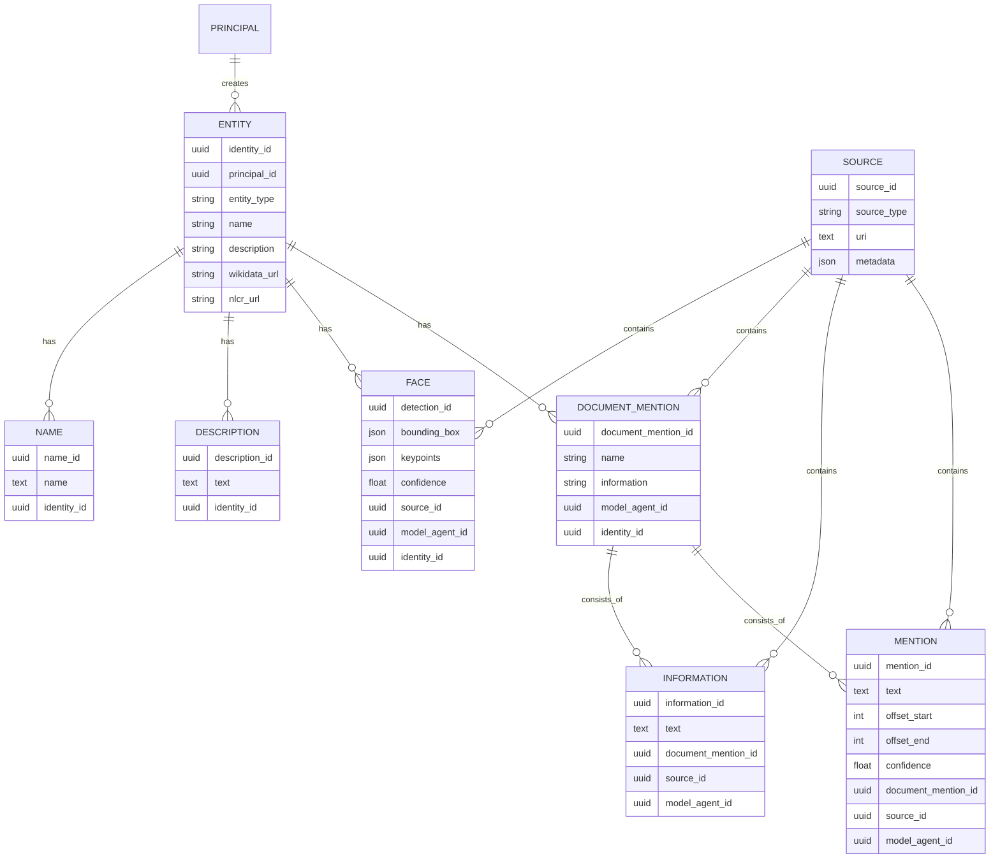

# A product for PeopleGator API: Simpler overview of basic functionalities

Core concept is to define bare minimum system specs that define just the data model shown in the ER diagram.

## 0. Core functionality

We want to facilitate search, addition of new mention and information, search for similar identities, and user modification of whether a mention was correctly assigned to some identity.

There are 2 types of user, a model or agent user, who automaticallu annotated pages in a document and triest to link them to the correct identity. And a human user, who can review the annotations and make corrections.

The agent can:
- Create a new document mention, mention and information
- Take a document mention, which is an aggregation of mentions and information, and link it to an identity
- Link a face detection to an identity

The user can:
- Retrieve and identity from a list
- Display faces for identity
- Check if face matches
- Show similar identities based on current identity
- Search directly for identities using one or more modalities
- Merge identities

Low priority functionality for future user:
- Display document mentions for identity
- Display mentions for identity
- Search for similar identities based on face, name, or description.

Ultra low priority:
- Text search for mentions and information, with ability to link to identity.

## 1. Introduction

This specification defines a simplified identity-centric annotation model.

The model includes:
- Identities as the central person record
- Mentions extracted from source text
- Information extracted at page/document level
- One document-level aggregator that groups mentions and information
- Face detections
- Descriptions
- Names
- Sources

## 2. Core Data Architecture

### 2.0 IDs

IDs are globally unique identifiers using UUIDv6 format.

### 2.1 Identity `IDENTITY`

> Central person record.

| Field Name | Type | Description |
|------------|------|-------------|
| `identity_id` | UUID | Unique identifier for the identity. |
| `principal_id` | UUID | Identifier of the principal that created the identity. |
| `entity_type` | STRING | Entity type discriminator used for filtering search results. |
| `name` | STRING | Best available aggregated name for the identity. |
| `description` | STRING | Best available aggregated description for the identity. |

### 2.2 Mention `MENTION`

> Text mention extracted from a source and strictly attached to one `DOCUMENT_MENTION`.

| Field Name | Type | Description |
|------------|------|-------------|
| `mention_id` | UUID | Unique identifier for the mention. |
| `text` | TEXT | Mention text span. |
| `offset_start` | INTEGER | Start character offset in source text. |
| `offset_end` | INTEGER | End character offset in source text. |
| `polygons` | JSON | Optional polygon coordinates for mention in source. |
| `confidence` | FLOAT | Extraction confidence. |
| `document_mention_id` | UUID | Required foreign key to the owning document mention. |
| `source_id` | UUID | Source containing the mention. |
| `model_agent_id` | UUID | Model agent that extracted the mention. |

### 2.3 Information `INFORMATION`

> Relevant information extracted at page/document level and strictly attached to one `DOCUMENT_MENTION`.

| Field Name | Type | Description |
|------------|------|-------------|
| `information_id` | UUID | Unique identifier for the information record. |
| `text` | TEXT | Extracted information text. |
| `document_mention_id` | UUID | Required foreign key to the owning document mention. |
| `source_id` | UUID | Source containing the information. |
| `model_agent_id` | UUID | Model agent that extracted the information. |

### 2.4 Document Mention `DOCUMENT_MENTION`

> Single per-document aggregator that groups `MENTION` and `INFORMATION`.

| Field Name | Type | Description |
|------------|------|-------------|
| `document_mention_id` | UUID | Unique identifier for the document mention record. |
| `name` | STRING | Aggregated name value for the document-level record. |
| `information` | STRING | Aggregated information value for the document-level record. |
| `model_agent_id` | UUID | Model agent that produced the aggregation. |
| `identity_id` | UUID | Identity associated with this document-level record. |

### 2.5 Face `FACE`

> Face detection linked to an identity.

| Field Name | Type | Description |
|------------|------|-------------|
| `detection_id` | UUID | Unique identifier for the face detection. |
| `bounding_box` | JSON | Face bounding box coordinates. |
| `keypoints` | JSON | Facial keypoints. |
| `confidence` | FLOAT | Detection confidence. |
| `source_id` | UUID | Source containing the face detection. |
| `model_agent_id` | UUID | Model agent that performed detection. |
| `identity_id` | UUID | Identity associated with this face detection. |

### 2.6 Description `DESCRIPTION`

> Description text linked to an identity.

| Field Name | Type | Description |
|------------|------|-------------|
| `description_id` | UUID | Unique identifier for the description. |
| `text` | TEXT | Description text. |
| `language` | STRING | Language code. |
| `source_id` | UUID | Source containing the description. |
| `identity_id` | UUID | Identity associated with this description. |

### 2.7 Name `NAME`

> Name linked to an identity.

| Field Name | Type | Description |
|------------|------|-------------|
| `name_id` | UUID | Unique identifier for the name. |
| `name` | TEXT | Name value. |
| `source_id` | UUID | Source containing the name. |
| `identity_id` | UUID | Identity associated with this name. |

### 2.8 Source `SOURCE`

> Source document or media metadata.

| Field Name | Type | Description |
|------------|------|-------------|
| `source_id` | UUID | Unique identifier for the source. |
| `source_type` | STRING | Type of source. |
| `uri` | TEXT | Source URI. |
| `metadata` | JSON | Source metadata. |

## 2.9 Search behaviour

Search must support both unimodal and multimodal retrieval over identities and annotations.

- A search query may be based on existing annotation vectors, a reference identity, or a combination of available modalities.
- Identity search must support per-modality aggregation over the annotations belonging to one identity.
- Supported aggregation modes for an identity are:
  - best matching annotation of the modality,
  - average score across all annotations of the modality,
  - direct search against an identity-level named vector when such a vector is maintained.
- Final multimodal ranking is a weighted combination of the enabled modality scores.
- Identities must be filterable by `entity_type`.

The MVP uses a single hardcoded search profile stored in service configuration rather than user-managed profiles in the database.

That configured profile must define:

- which modalities are enabled,
- which annotation collection each modality targets,
- which named vector is used for each annotation collection when relevant,
- which named vector is used for identity-level search when relevant,
- which aggregation mode is used for identity scoring per modality,
- the modality weights used for multimodal ranking,
- optional confidence thresholds for confidence-bearing annotations.

## 3. Relationship Summary

- `PRINCIPAL` creates `IDENTITY`.
- `SOURCE` contains `MENTION`, `INFORMATION`, `DOCUMENT_MENTION`, and `FACE`.
- Every `MENTION` and every `INFORMATION` row must reference exactly one `DOCUMENT_MENTION` via `document_mention_id`.
- `IDENTITY` has `DOCUMENT_MENTION`, `FACE`, `DESCRIPTION`, and `NAME`.

## 4. Entity Relationship Diagram

