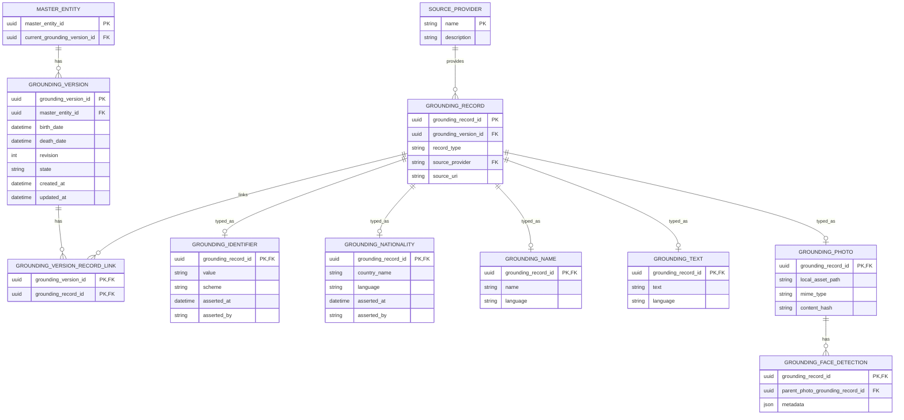
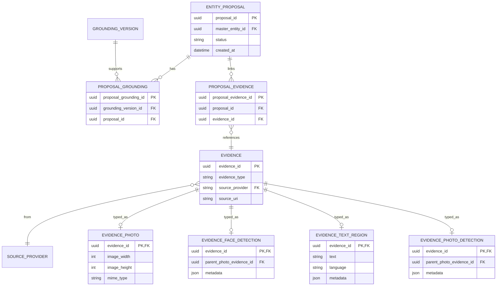
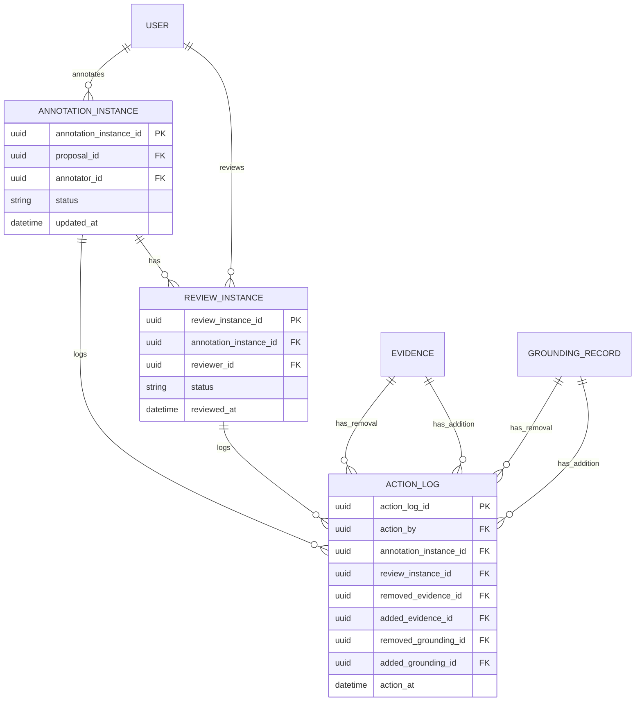
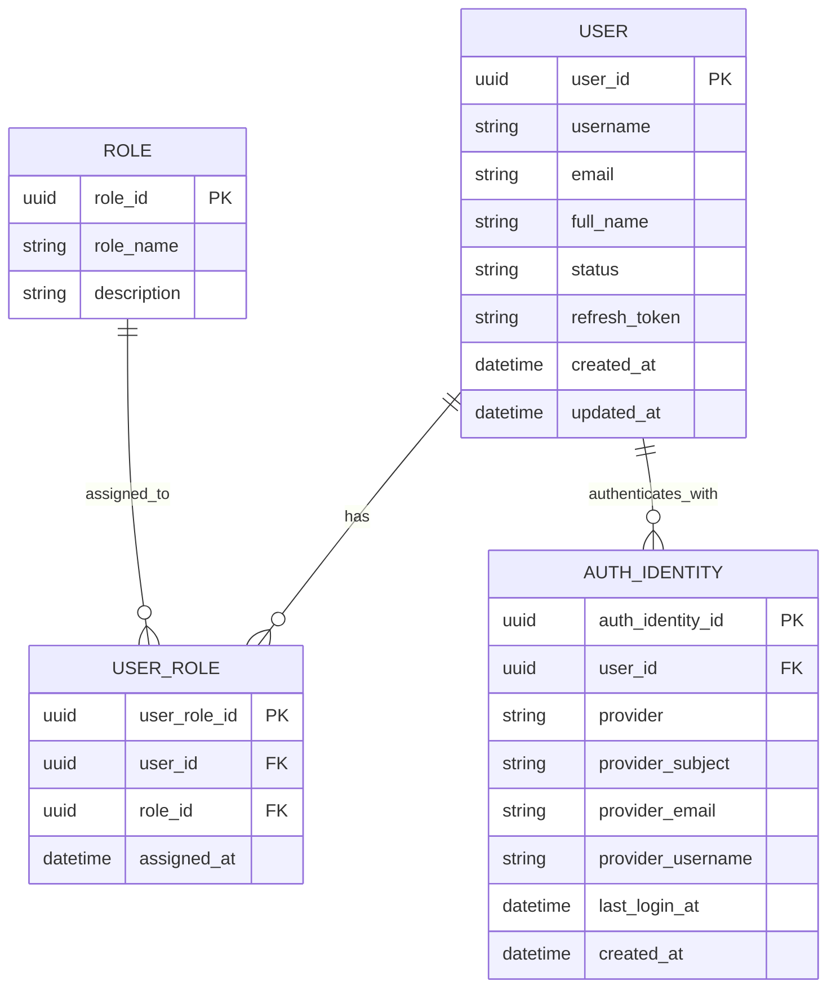

# Entity-Relationship Diagrams

This document keeps the data model intentionally simple and split into focused diagrams.

## 1. Master Entity and Grounding Versions

## 2. Entity Proposal and Evidence Acquisition

## 3. Annotation, Review, and Removal Log

## 4. User and Role Management

