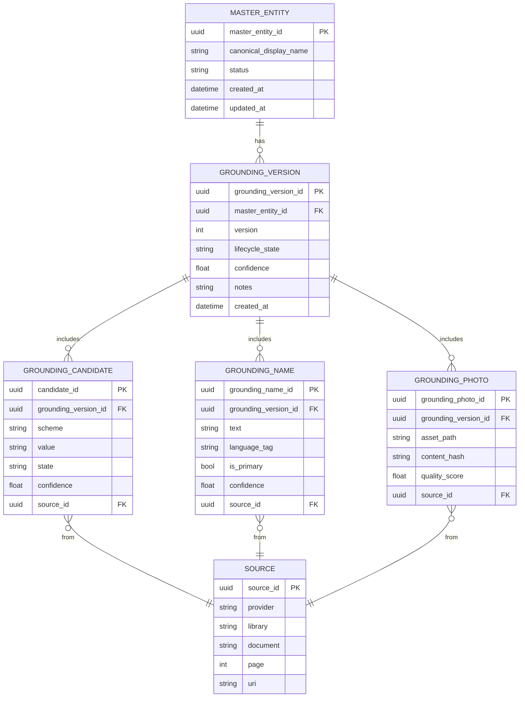
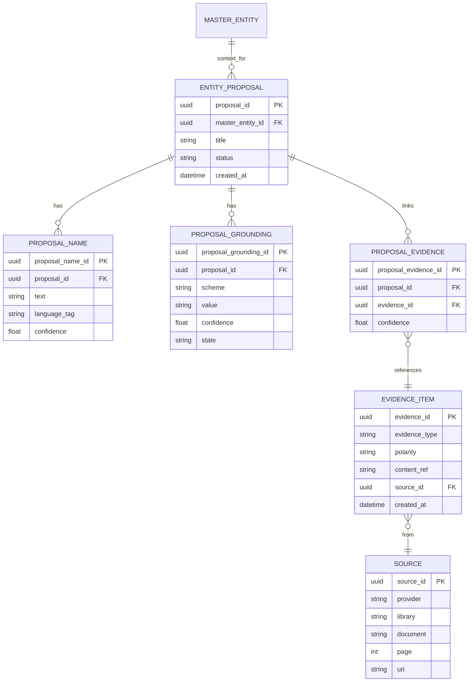
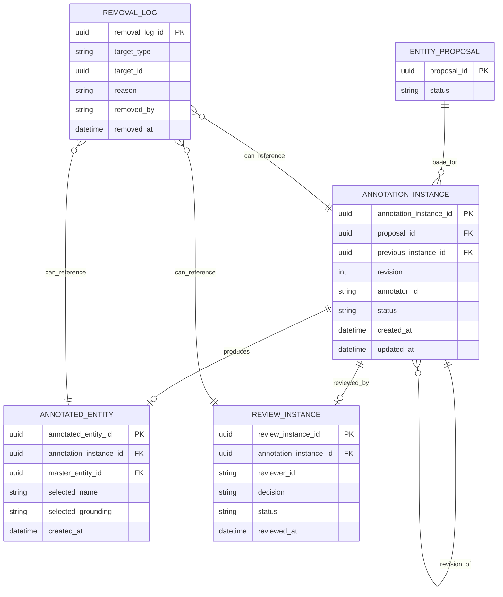

# Entity-Relationship Diagrams

This document keeps the data model intentionally simple and split into focused diagrams.

## 1. Master Entity and Grounding Versions

## 2. Entity Proposal and Evidence Acquisition

`EVIDENCE_ITEM.polarity` is constrained to `positive` or `negative`.

## 3. Annotation, Review, and Removal Log

Rules:

1. `ENTITY_PROPOSAL` is the baseline and remains preserved.
2. Updates create new `ANNOTATION_INSTANCE` revisions rather than overwriting earlier rows.
3. Each annotation instance is reviewable.
4. Removals are soft and recorded in `REMOVAL_LOG`.
